<div align="center">

<table width="100%" style="border:none;">
<tr>
<td align="left" width="50%" style="border:none;">

**B.Tech in AI &amp; DS**
Amrita School of Computing,
Amrita Vishwa Vidyapeetham
30/08/2026

</td>
<td align="right" width="50%" style="border:none;">

**AMRITA VISHWA VIDYAPEETHAM**

</td>
</tr>
</table>

<br/><br/><br/>

# PROJECT
# SYSTEM DESIGN

**Final Year Project (23AID498)**

<br/>

### Project Title

**SafeStream-Redactor: A Memory-Safe, Local-First Hybrid Streaming Architecture for PII &amp; Credential Redaction in Enterprise Data Migration**

<br/><br/>

**Presented By:**

**GROUP 2**

| Roll Number | Name |
| --- | --- |
| AM.AI.U4AID23014 | Ashrith Reddy Nemali |
| AM.AI.U4AID23056 | Sandhiya Kennedy |
| AM.AI.U4AID23058 | Mounish Senisetty |

<br/><br/>

<table width="100%" style="border:none;">
<tr>
<td align="right" style="border:none;">

**Coordinator:** Dr. Kiran

**Guide:** Parvathy R

</td>
</tr>
</table>

</div>

<div style="page-break-after: always;"></div>

---

## 1. Revision History

| Version | Author | Date | Description |
| :--- | :--- | :--- | :--- |
| 1.0 | Group 2 (Systems Architecture Team) | 30/08/2026 | Initial System Design Document derived from the SafeStream-Redactor source repository at commit `cf683d8`. Covers the streaming engine, four-tier detection pipeline, redaction policy layer, parallel scheduler, offline guard, configuration, and CI/CD. |

> **Provenance note.** Every architectural statement in this document is traced to
> the repository: source code under `src/safestream_redactor/`, tests under `tests/`,
> benchmarks under `benchmarks/`, configuration (`pyproject.toml`, `Dockerfile`,
> `.github/workflows/`), and project documentation (`README.md`, `SECURITY.md`,
> `CHANGELOG.md`, `docs/AUDIT.md`, `docs/ROADMAP.md`). Where a design property is
> deduced rather than stated verbatim in the code, it is explicitly flagged as an
> **architectural inference**. Where information is genuinely unavailable, the document
> states: *"Not explicitly available in the repository."*

<div style="page-break-after: always;"></div>

## 2. Table of Contents

1. [Revision History](#1-revision-history)
2. [Table of Contents](#2-table-of-contents)
3. [Introduction](#3-introduction)
4. [System Overview](#4-system-overview)
5. [Functional Requirements](#5-functional-requirements)
6. [Non-Functional Requirements](#6-non-functional-requirements)
7. [Assumptions](#7-assumptions)
8. [Constraints](#8-constraints)
9. [Technology Stack](#9-technology-stack)
10. [Repository Structure](#10-repository-structure)
11. [Overall Architecture](#11-overall-architecture)
12. [Architecture Diagram](#12-architecture-diagram)
13. [Component Diagram](#13-component-diagram)
14. [Package Diagram](#14-package-diagram)
15. [Module Description](#15-module-description)
16. [Class Design](#16-class-design)
17. [Sequence Diagrams](#17-sequence-diagrams)
18. [Activity Diagrams](#18-activity-diagrams)
19. [Data Flow Diagram](#19-data-flow-diagram)
20. [Processing Pipeline](#20-processing-pipeline)
21. [Streaming Architecture](#21-streaming-architecture)
22. [Chunk Overlap Logic](#22-chunk-overlap-logic)
23. [Detection Engine](#23-detection-engine)
24. [Redaction Engine](#24-redaction-engine)
25. [Memory Management](#25-memory-management)
26. [Security Design](#26-security-design)
27. [Error Handling](#27-error-handling)
28. [Configuration Design](#28-configuration-design)
29. [Logging Design](#29-logging-design)
30. [File Processing Workflow](#30-file-processing-workflow)
31. [Algorithms](#31-algorithms)
32. [Performance Analysis](#32-performance-analysis)
33. [Design Decisions](#33-design-decisions)
34. [Design Patterns](#34-design-patterns)
35. [Testing Strategy](#35-testing-strategy)
36. [Deployment](#36-deployment)
37. [Future Improvements](#37-future-improvements)
38. [Limitations](#38-limitations)
39. [Conclusion](#39-conclusion)
40. [Appendix](#40-appendix)

<div style="page-break-after: always;"></div>

## 3. Introduction

### 3.1 Purpose

This document specifies the system design of **SafeStream-Redactor**, a Python library
and command-line tool that detects and redacts Personally Identifiable Information (PII)
and credentials/secrets from arbitrarily large text streams while holding memory usage
constant. It is intended to serve as the authoritative engineering reference for the
system's architecture, module decomposition, data flow, algorithms, security posture,
and operational behaviour.

The purpose of SafeStream-Redactor, as declared in `pyproject.toml`, is:

> *"Streaming PII &amp; credential detection/redaction for very large text files with
> constant memory usage."*

The design's central technical claim — proven by the memory test in
`tests/test_memory.py` — is that a 1 GB file can be redacted under a 16 MB Python-heap
allocation cap: memory does not grow with input size.

### 3.2 Scope

The system covers the following capabilities, all present in the repository:

- **Streaming redaction** of text from files, standard input, or any Python iterable of
  string chunks, with output to files or standard output (`engine.py`, `redactor.py`,
  `cli.py`).
- **Multi-tier detection** combining deterministic regex-and-validator patterns, a
  Shannon-entropy statistical tier, an optional spaCy Named-Entity-Recognition (NER)
  tier, and a contextual heuristic tier (`detectors/`).
- **Detection of both PII and credentials/secrets** in a single pass — a capability that
  distinguishes it from PII-only engines (`detectors/deterministic.py`,
  `detectors/entropy.py`).
- **Configurable redaction policies**: replace, mask, and deterministic HMAC
  pseudonymize modes, with per-entity-type overrides (`policy.py`).
- **Parallel, RAM-aware directory redaction** across many files via a process pool
  (`scheduler.py`).
- **A best-effort offline network guard** that blocks outbound non-loopback connections
  during redaction (`netguard.py`).
- **Content-free run reports** for compliance/audit filing (`report.py`).
- **A plugin mechanism** allowing third-party detection tiers via Python entry points
  (`detectors/registry.py`).
- **TOML policy-file configuration** with fail-closed validation (`config.py`).

Out of scope (explicitly, per `docs/ROADMAP.md`): a hosted REST redaction service,
authentication, rate limiting, persistent storage, and any component that would require
sensitive text to leave the machine before redaction. The roadmap states these were
"evaluated and **rejected for the core**" because they invert the product's local-first
guarantee.

### 3.3 Objectives

Derived from the README, the roadmap, and the implementation, the system's objectives are:

1. **Constant-memory processing** — redact files of any size using memory bounded by
   `chunk_size + overlap`, independent of total input length.
2. **Boundary-safe detection** — guarantee that any entity up to `overlap` characters
   long is detected even when a chunk boundary cuts through it.
3. **High precision under distractors** — resist false positives on adversarial text
   (order numbers, timestamps, UUIDs, git hashes) using validators and contextual
   scoring.
4. **Credential coverage** — detect cloud/service credentials and undocumented
   high-entropy secrets that general PII engines miss.
5. **Local-first privacy** — process data on the machine, with a default-on egress guard
   and no cloud dependency.
6. **Auditability** — emit content-free evidence (counts, sizes, durations) of what each
   run did, without ever recording the matched sensitive text.
7. **Extensibility** — allow new detection tiers to be added without forking, via a
   `Detector` protocol and entry-point discovery.

### 3.4 Audience

| Audience | Interest |
| :--- | :--- |
| Software architects &amp; principal engineers | Layered pipeline design, extension seams, streaming algorithm |
| Platform / DevSecOps engineers | CLI usage, Docker/CI integration, offline guard, secret gating |
| Security &amp; compliance officers | Threat model, content-free reports, pseudonymization semantics |
| Application developers | Python API (`Redactor`, `RedactionPolicy`, `EntityType`) |
| Academic evaluators (23AID498) | Design rationale, algorithms, complexity, testing rigour |

### 3.5 Definitions

| Term | Definition |
| :--- | :--- |
| **PII** | Personally Identifiable Information — data identifying an individual (email, phone, SSN, credit card, IP address, names/locations). |
| **Credential / Secret** | Authentication material (API keys, tokens, private keys, connection-string passwords) or high-entropy strings with no published format. |
| **Detection** | A single located sensitive span, represented by the `Detection` dataclass (start, end, text, type, confidence, source). |
| **Redaction** | Rewriting a detected span according to a policy (replace / mask / pseudonymize). |
| **Chunk** | A fixed-size unit of text read from the input (default 64 KiB). |
| **Overlap window** | Trailing region of the rolling buffer (default 4 KiB) retained so boundary-straddling entities are seen whole. |
| **Tier** | One detection strategy in the pipeline (deterministic, entropy, NER, contextual). |
| **Detector** | Any object satisfying the `Detector` protocol: a `name` plus `detect(text) -> list[Detection]`. |
| **Anchor** | A literal substring every match of a pattern must contain, enabling a cheap prefilter. |
| **Pseudonymization** | Deterministic keyed tokenisation (HMAC-SHA256) preserving referential integrity; reversible by the key holder. |

### 3.6 Abbreviations

| Abbreviation | Expansion |
| :--- | :--- |
| PII | Personally Identifiable Information |
| DLP | Data Loss Prevention |
| NER | Named Entity Recognition |
| CLI | Command-Line Interface |
| API | Application Programming Interface |
| HMAC | Hash-based Message Authentication Code |
| PEM | Privacy-Enhanced Mail (key encoding) |
| JWT | JSON Web Token |
| SSN | Social Security Number |
| DSN | Data Source Name (connection string) |
| ReDoS | Regular-expression Denial of Service |
| SBOM | Software Bill of Materials |
| OIDC | OpenID Connect |
| GHCR | GitHub Container Registry |
| CI/CD | Continuous Integration / Continuous Delivery |
| RSS | Resident Set Size |

### 3.7 References

1. Project `README.md` — overview, install, CLI/API usage, architecture, evaluation.
2. `SECURITY.md` — threat model and guarantees/limits.
3. `docs/AUDIT.md` — category-by-category codebase audit (v0.1.0, commit `cf683d8`).
4. `docs/ROADMAP.md` — phased improvement plan and rejected-alternatives rationale.
5. `CHANGELOG.md` — released and unreleased changes.
6. `benchmarks/README.md` — regression fixture vs. accuracy harness distinction.
7. Source tree under `src/safestream_redactor/` and `tests/`.
8. Microsoft Presidio — comparison baseline referenced in the benchmarks.

<div style="page-break-after: always;"></div>

## 4. System Overview

### 4.1 The problem the software solves

Organisations routinely need to move, share, or archive large volumes of text —
application logs, database exports, migration dumps, CSV/JSON payloads — that contain
embedded sensitive data: customer PII and, increasingly, machine credentials (cloud
access keys, service tokens, private keys, passwords buried in connection strings).
Two failure modes dominate:

1. **Memory exhaustion.** Most PII engines load the entire document into memory. As the
   README states: *"Most PII tools load the whole document into memory."* This makes
   multi-gigabyte logs impractical to process on ordinary machines.
2. **Credential blindness.** General PII tools (the README names Presidio and scrubadub)
   detect names, emails, and card numbers but ship no recognisers for AWS keys, GitHub
   tokens, JWTs, or undocumented high-entropy secrets.

SafeStream-Redactor addresses both: it processes text in fixed-size chunks with an
overlapping context window so memory stays constant, and it detects credentials and
secrets in the same streaming pass as PII.

### 4.2 Business motivation

From the README and roadmap, the business drivers are:

- **Enterprise data migration and log handling** where files are too large to fit in
  RAM but must be sanitised before leaving a trust boundary.
- **Regulatory compliance** (the roadmap names GDPR/CCPA/SOC 2) requiring auditable
  evidence of redaction that does not itself leak the redacted content.
- **Secret hygiene in CI/CD** — the `detect --fail-on-detect` mode turns the tool into a
  pre-commit / build-time gate that blocks secrets before they reach a repository or log
  sink.
- **Local-first privacy** as a differentiator: the roadmap explicitly frames the
  *enforced offline guarantee* — sensitive text never leaving the machine — as the
  product's strongest property, and rejects any hosted-service design that would violate
  it.

### 4.3 Enterprise use cases

Grounded in the README's documented invocations:

- **Bulk log sanitisation.** `safestream redact ./logs -o ./logs_redacted --workers 8`
  redacts an entire directory tree in parallel with RAM/CPU-aware worker sizing.
- **Streaming pipeline filtering.** `tail -f app.log | safestream redact - -o -` inserts
  redaction into a Unix pipeline, streaming from stdin to stdout.
- **Deterministic pseudonymisation for analytics.**
  `--mode pseudonymize --hmac-key "$SECRET"` yields stable tokens so the same value maps
  to the same token across a corpus (referential integrity) while hiding the raw value.
- **Compliance filing.** `--stats --report run.json` writes a content-free JSON report
  (type names, counts, sizes) suitable for audit archives.
- **CI secret gate.** `safestream detect build.log --fail-on-detect` exits non-zero if
  any secret is found.
- **Masking for partial disclosure.** `--mode mask --keep-last 4` masks all but the last
  four characters (e.g. of card numbers).

### 4.4 Overall workflow

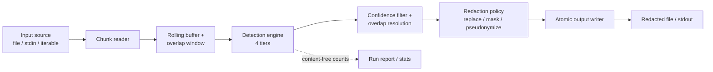

### 4.5 High-level architecture

The system is a **layered streaming pipeline** with a thin facade. Text flows through a
constant-memory engine that delegates detection to a stack of independent tiers behind a
single protocol, then applies a redaction policy. Orthogonal concerns — parallel
scheduling, network guarding, reporting, configuration, plugin discovery — sit beside the
core rather than inside it. Section 11 develops this in full; the audit
(`docs/AUDIT.md`) scores the architecture 8/10 and calls it a *"clean layered pipeline
with a real plugin seam."*

### 4.6 System context

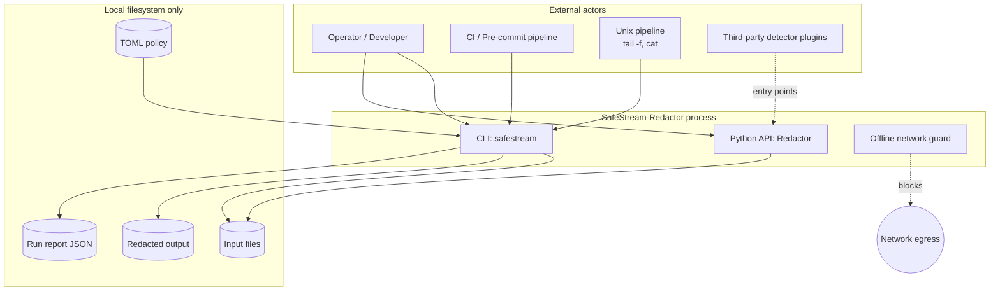

The context diagram reflects a deliberate property from `docs/AUDIT.md`: the system is
**storage-free** ("statelessness *is* the privacy feature") — there is no database,
cache, or server; every arrow that leaves the process terminates at the local filesystem,
and the only network arrow is one the offline guard blocks.

<div style="page-break-after: always;"></div>

## 5. Functional Requirements

Each requirement below is derived directly from the implementation, with the source
location noted.

| ID | Requirement | Source |
| :--- | :--- | :--- |
| **FR-1** | The system shall detect emails, phone numbers, credit cards, SSNs, IPv4, and IPv6 addresses in text. | `detectors/deterministic.py` `_PATTERNS`; `EntityType` |
| **FR-2** | The system shall detect credentials: AWS keys, GitHub tokens, Slack tokens/webhooks, Stripe keys, Google API keys, SendGrid, Twilio, npm, OpenAI, and Anthropic keys, JWTs, private-key PEM blocks, generic `key=value` API keys, and connection-string passwords. | `detectors/deterministic.py` `_PATTERNS` |
| **FR-3** | The system shall detect undocumented high-entropy secrets via Shannon-entropy scoring, enabled by default. | `detectors/entropy.py`; `Redactor(use_entropy=True)` |
| **FR-4** | The system shall validate structurally ambiguous matches — credit cards via the Luhn checksum, SSNs via area/group/serial rules, IPv6 via `ipaddress` parsing, phones via digit-count and shape rejection. | `luhn_ok`, `ssn_ok`, `ipv6_ok`, `phone_ok` |
| **FR-4a** | The system shall reject known non-PII shapes that a naive regex would swallow (ISO dates and SSN-shaped strings as phones; version strings, order numbers as distractors). | `_DATE_SHAPE`, `_SSN_SHAPE`; adversarial corpus |
| **FR-5** | The system shall adjust detection confidence based on surrounding trigger words (boost near "ssn:", "card", "phone"; suppress near "example", "test", "dummy"). | `detectors/contextual.py` |
| **FR-6** | The system shall promote a bare 9-digit number to an SSN detection only when an SSN trigger word is nearby. | `ContextualScorer.detect` / `_BARE_SSN` |
| **FR-7** | The system shall optionally detect PERSON, ORG, and LOC entities using a spaCy NER model when the `[ner]` extra is enabled. | `detectors/ner.py` |
| **FR-8** | The system shall accept user-supplied literal words/phrases and custom regexes to always redact. | `detectors/custom.py`; `--custom-word`, `--custom-regex` |
| **FR-9** | The system shall filter detections below a configurable minimum confidence (default 0.5). | `Redactor.detect`; `min_confidence` |
| **FR-10** | The system shall resolve overlapping detections keeping the higher-confidence (tie: longer) span. | `entities.resolve_overlaps` |
| **FR-11** | The system shall redact strings held fully in memory via `Redactor.redact`. | `redactor.py` |
| **FR-12** | The system shall redact any iterable of text chunks with O(1) memory via `redact_stream`. | `redactor.py`, `engine.stream_transform` |
| **FR-13** | The system shall redact a file to another file without loading either fully. | `Redactor.redact_file` |
| **FR-14** | The system shall write file output atomically (temp file + `os.replace`) so a crash never leaves a partial-but-complete-looking output. | `Redactor.redact_file`; `cli._atomic_write_stream` |
| **FR-15** | The system shall reject redacting a file onto itself. | `Redactor.redact_file` same-file check |
| **FR-16** | The system shall guarantee any entity up to `overlap` characters long is detected even when split across chunk boundaries. | `engine.stream_windows` |
| **FR-17** | The system shall support three redaction modes: replace (fixed string), mask (keep last N chars), and pseudonymize (HMAC-SHA256 keyed token). | `policy.RedactionMode`, `RedactionPolicy.render` |
| **FR-18** | The system shall support per-entity-type replacement overrides taking priority over the mode. | `RedactionPolicy.replacements` |
| **FR-19** | The system shall require an HMAC key for pseudonymize mode and reject the mode otherwise. | `RedactionPolicy.__post_init__`; CLI check |
| **FR-20** | The CLI shall provide `redact`, `detect`, and `init-config` subcommands. | `cli._build_parser` |
| **FR-21** | The CLI `detect` command shall optionally emit one JSON object per detection and shall support `--fail-on-detect` (exit 1 if anything detected). | `cli._cmd_detect` |
| **FR-22** | The CLI shall read from stdin (`-`) and write to stdout (`-`) for pipeline composition. | `cli._input_chunks`, `_cmd_redact` |
| **FR-23** | The CLI shall redact an input directory into an output directory, mirroring the tree, using parallel workers. | `cli._redact_directory`, `scheduler.redact_tree` |
| **FR-24** | The scheduler shall size worker count from CPU count capped by available RAM (from `/proc/meminfo`), honouring an explicit `--workers` value. | `scheduler.ram_aware_workers` |
| **FR-25** | The system shall load a TOML policy file and let CLI flags override its values. | `config.py`; `cli._build_redactor` |
| **FR-26** | The system shall reject unknown TOML sections/keys (fail-closed) with a "did you mean" suggestion. | `config.validate_config` |
| **FR-27** | The `init-config` command shall emit a documented, schema-valid starter policy. | `cli._cmd_init_config`, `_STARTER_CONFIG` |
| **FR-28** | The system shall produce a content-free run report (tool, version, timestamp, file count, duration, per-type counts, char sizes) — never matched text. | `report.build_report`, `write_report`; `--report` |
| **FR-29** | The system shall accumulate per-type detection counts and character sizes during redaction (`RedactionStats`) and print a `--stats` summary to stderr. | `report.RedactionStats`; `cli._finish_run` |
| **FR-30** | The system shall count and warn about undecodable input bytes (U+FFFD) since unscanned bytes are a coverage risk, and shall accept an `--encoding` flag. | `RedactionStats.decode_replacements`; `read_chunks` |
| **FR-31** | The system shall install an offline network guard by default that raises on any non-loopback connection during redaction, with `--allow-network` to disable. | `netguard.install`; `cli.main` |
| **FR-32** | The system shall discover and load third-party detectors from the `safestream_redactor.detectors` entry-point group, skipping (with a warning) any that fail to load or violate the protocol. | `detectors/registry.load_plugins` |
| **FR-33** | The system shall allow disabling plugin loading, entropy, and selecting a subset of entity types. | `Redactor(load_plugins=, use_entropy=, types=)` |
| **FR-34** | The system shall expose the version via `--version` and `__version__`. | `cli`, `__init__.py` |
| **FR-35** | The system shall skip regex patterns whose guaranteed anchor literals (or required digit) are absent from a window, with output provably identical to unfiltered detection. | `DeterministicDetector.detect` prefilter; `tests/test_prefilter.py` |

<div style="page-break-after: always;"></div>

## 6. Non-Functional Requirements

| ID | Category | Requirement | Evidence |
| :--- | :--- | :--- | :--- |
| **NFR-1** | **Memory efficiency** | Peak Python-heap allocation shall be a small multiple of chunk size, independent of input size (proven under 16 MB for a 1 GB file). | `tests/test_memory.py`; `engine.py` design |
| **NFR-2** | **Streaming capability** | The engine shall process input incrementally as an iterator; no full-file materialisation is permitted on the file/stream paths. | `engine.stream_windows`, `read_chunks` |
| **NFR-3** | **Performance** | Single-core throughput is ~3.1 MB/s on the adversarial corpus; the anchored prefilter yields ~25× speed-up on secret-sparse prose. Throughput is documented as a *known limitation*, not a strength. | README evaluation; `docs/ROADMAP.md` |
| **NFR-4** | **Scalability** | Redaction shall scale across files via a process pool bounded by CPU and RAM; a single very large file is processed single-core by design. | `scheduler.py`; `docs/AUDIT.md` |
| **NFR-5** | **Reliability / Fault tolerance** | File writes shall be atomic; failures shall clean up temp files and re-raise; self-overwrite shall be rejected. | `Redactor.redact_file`; `tests/test_atomic_writes.py` |
| **NFR-6** | **Availability** | The tool is a stateless batch/stream process with no server component; availability equals the host's. | Storage-free design (`docs/AUDIT.md`) |
| **NFR-7** | **Maintainability** | Every module is under ~330 lines with a single responsibility; strict `mypy` and `ruff` gates enforce quality. | `pyproject.toml`; `docs/AUDIT.md` |
| **NFR-8** | **Security** | Sensitive text shall never be logged; reports shall be content-free by construction; the offline guard blocks accidental egress. | `report.py`, `netguard.py`, `__init__.py` NullHandler |
| **NFR-9** | **Privacy** | No cloud dependency; all processing is local; the pseudonymize mode's re-identifiability is explicitly documented. | `SECURITY.md`; README |
| **NFR-10** | **Portability** | The tool shall run on Linux, macOS, and Windows, and Python 3.10–3.13; OS-sensitive paths are CI-tested cross-platform. | `pyproject.toml` classifiers; `ci.yml` matrix |
| **NFR-11** | **Extensibility** | New detection tiers shall be addable without forking, via the `Detector` protocol and entry-point plugins. | `detectors/base.py`, `registry.py` |
| **NFR-12** | **Compliance** | Runs shall be auditable via content-free reports suitable for GDPR/CCPA/SOC 2 filing. | `report.py`; `docs/ROADMAP.md` §1.3 |
| **NFR-13** | **Correctness assurance** | Streaming output shall be byte-identical to whole-text redaction for any chunking (property-tested). | `tests/test_properties.py`, `tests/test_streaming.py` |
| **NFR-14** | **Supply-chain integrity** | Releases shall ship multi-arch images with SBOM + provenance; dependencies shall be audited (`pip-audit`) and auto-updated (Dependabot). | `docker.yml`, `ci.yml`, `dependabot.yml` |
| **NFR-15** | **Robustness (ReDoS)** | Pattern bodies vulnerable to pathological scans shall be length-bounded. | Private-key pattern in `deterministic.py` |
| **NFR-16** | **Testability** | The suite shall enforce a 95% coverage floor and detection-quality floors in CI. | `pyproject.toml` `fail_under`; `ci.yml` quality job |

<div style="page-break-after: always;"></div>

## 7. Assumptions

The following assumptions are implied by the implementation and documentation. Items
marked *(inference)* are architectural inferences based on the code.

1. **Input is text.** The engine reads and processes decoded text (`str`), not binary
   formats; `read_chunks` opens files in text mode with an encoding.
2. **Input is UTF-8 unless specified.** The default encoding is `utf-8`; other encodings
   require `--encoding`. Undecodable bytes are replaced with U+FFFD and *counted*, on the
   assumption that surfacing coverage gaps is safer than hiding them (`report.py`).
3. **Entities are shorter than the overlap.** The boundary-safety guarantee holds only
   for entities up to `overlap` characters (default 4 KiB); this is stated in `engine.py`.
   *(inference: PEM private keys are bounded to 8 KiB in the pattern precisely to respect
   this envelope on the largest expected entity.)*
4. **The host filesystem supports atomic rename within a directory.** `os.replace` is
   used for atomicity; the temp file is created in the destination directory to avoid
   cross-device rename failures (`redactor.py`).
5. **`/proc/meminfo` may or may not exist.** The scheduler reads it when present and
   falls back to CPU-only sizing otherwise (`scheduler.py`).
6. **Detector plugins are trusted.** The entry-point loader executes plugin code with
   full process privileges; `SECURITY.md` states only trusted plugins should be installed.
7. **The offline guard is best-effort.** It assumes egress happens through Python's
   `socket` layer; native syscalls and subprocesses are assumed out of scope
   (`netguard.py`, `SECURITY.md`).
8. **Synthetic benchmark corpora measure format coverage, not real-world recall.** The
   README and `benchmarks/README.md` make this assumption explicit.

<div style="page-break-after: always;"></div>

## 8. Constraints

1. **Language/runtime.** Python ≥ 3.10 (`requires-python = ">=3.10"`). The core uses only
   the standard library at runtime (plus `tomli` on Python < 3.11 for TOML).
2. **Single-core per file.** A single large file is processed sequentially because each
   chunk depends on the rolling context of the previous one; intra-file parallelism is
   deferred (`docs/ROADMAP.md`).
3. **Throughput ceiling.** ~3 MB/s single-core means a 100 GB file takes hours; compiled
   scanners are 100–1000× faster (README).
4. **Recall on free-form prose is limited without NER.** The regex core does not detect
   names/addresses; recall there is "substantially lower" unless the `[ner]` extra is
   enabled (README, `benchmarks/README.md`).
5. **NER requires an optional heavy dependency.** spaCy plus a model must be installed
   separately (`pip install 'safestream-redactor[ner]'`).
6. **Pseudonymization is reversible.** It is keyed and deterministic; it leaks value
   equality and is invertible by the key holder — it is not anonymization (`SECURITY.md`).
7. **Detection is probabilistic at the margins.** No detector guarantees complete recall
   on arbitrary text; output is "risk-reduced, not certified-clean" (`SECURITY.md`).
8. **Offline guard is not a hard boundary.** A container-level policy (`--network none`)
   is required for a guaranteed boundary (README, `SECURITY.md`).
9. **Configuration is fail-closed.** Unknown TOML keys/sections are hard errors, not
   ignored (`config.py`).

<div style="page-break-after: always;"></div>

## 9. Technology Stack

### 9.1 Languages

- **Python** (≥ 3.10, tested on 3.10, 3.11, 3.12, 3.13) — the entire codebase.

### 9.2 Runtime dependencies

Per `pyproject.toml`:

- **Core:** none beyond the standard library, except `tomli>=2.0` on Python < 3.11
  (identical backport of stdlib `tomllib`). The "zero third-party runtime deps" claim in
  the README holds for the core install.
- **Standard-library modules used:** `re`, `ipaddress`, `hashlib`, `hmac`, `socket`,
  `math`, `collections`, `concurrent.futures`, `tempfile`, `os`, `stat`, `contextlib`,
  `logging`, `argparse`, `json`, `importlib.metadata`, `dataclasses`, `enum`, `tomllib`.

### 9.3 Optional dependencies (extras)

| Extra | Packages | Purpose |
| :--- | :--- | :--- |
| `ner` | `spacy>=3.5` | Optional PERSON/ORG/LOC NER tier |
| `dev` | `pytest>=7.0`, `pytest-cov>=4.1`, `hypothesis>=6.90`, `ruff>=0.4`, `mypy>=1.8` | Testing, coverage, property tests, lint, type check |
| `bench` | `presidio-analyzer>=2.2` | Comparison baseline in benchmarks |

### 9.4 Build tools &amp; package management

- **Build backend:** `hatchling` (PEP 517), with dynamic version read from
  `__init__.py`.
- **Packaging:** wheel + sdist; console script `safestream = safestream_redactor.cli:main`.
- **Package manager:** `pip` (install via PyPI, source, or Docker).
- **Distribution:** PyPI via OIDC Trusted Publishing (`publish.yml`); multi-arch images
  on GHCR (`docker.yml`).

### 9.5 Quality tooling

- **Ruff** — linter + formatter (rule sets `E, F, W, I, UP, B, SIM, RUF`; line length 100).
- **Mypy** — `strict = true` over `src`.
- **Pytest** — with `pytest-cov` (95% floor) and `hypothesis` for property tests.
- **pip-audit** — dependency vulnerability scanning in CI.

### 9.6 Operating-system support

`Operating System :: OS Independent` (classifier). CI exercises Ubuntu (all Python
versions), plus macOS and Windows on Python 3.12 for OS-sensitive surfaces (sockets,
`/proc`, process spawn, `os.replace`).

### 9.7 External software

- **spaCy** (optional) with an English model such as `en_core_web_sm` for NER.
- **Docker** (optional) — multi-stage build on `python:3.14-slim`, non-root user.
- **Microsoft Presidio** (benchmark-only) — comparison baseline.

<div style="page-break-after: always;"></div>

## 10. Repository Structure

```
SafeStream-Redactor/
├── src/safestream_redactor/          # the installable package
│   ├── __init__.py                   # public API surface + version + NullHandler
│   ├── __main__.py                   # `python -m safestream_redactor` shim
│   ├── engine.py                     # constant-memory streaming window algorithm
│   ├── redactor.py                   # Redactor facade (detect / redact / files)
│   ├── entities.py                   # EntityType, Detection, resolve_overlaps
│   ├── policy.py                     # RedactionPolicy, RedactionMode, rendering
│   ├── config.py                     # TOML policy loading + fail-closed validation
│   ├── report.py                     # RedactionStats + content-free run reports
│   ├── scheduler.py                  # RAM-aware parallel directory redaction
│   ├── netguard.py                   # best-effort offline network guard
│   ├── cli.py                        # argparse CLI (redact / detect / init-config)
│   ├── py.typed                      # PEP 561 typing marker
│   └── detectors/                    # the detection tiers
│       ├── __init__.py               # re-exports the built-in detectors
│       ├── base.py                   # Detector Protocol (extension contract)
│       ├── deterministic.py          # Tier 1: regex + validators + prefilter
│       ├── entropy.py                # Tier 2: Shannon-entropy secret detection
│       ├── ner.py                    # Tier 3: optional spaCy NER
│       ├── contextual.py             # Tier 4: trigger-word boost/suppress
│       ├── custom.py                 # user-supplied words/regexes
│       └── registry.py               # entry-point plugin discovery
├── tests/                            # 16 test modules (unit, property, memory, ...)
├── benchmarks/                       # dataset generators + eval harnesses
├── docs/                             # AUDIT.md, ROADMAP.md, good_first_issues.md
├── .github/                          # workflows (ci, docker, publish), templates
├── Dockerfile                        # multi-stage, non-root image
├── pyproject.toml                    # build, deps, tooling config
├── README.md, SECURITY.md, CHANGELOG.md, CONTRIBUTING.md, CODE_OF_CONDUCT.md, LICENSE
```

### 10.1 Directory purposes and relationships

| Directory | Purpose | Relationship |
| :--- | :--- | :--- |
| `src/safestream_redactor/` | The installable package: engine, facade, policy, and orthogonal services. | Depends inward on `entities.py` (shared types); `redactor.py` wires everything. |
| `src/.../detectors/` | The four detection tiers plus the plugin registry, all behind `base.Detector`. | Consumed by `redactor.py`; each tier depends only on `entities.py`. |
| `tests/` | Unit, integration, property-based, memory, encoding, and OS-surface tests. | Exercises every `src` module; the memory test is opt-in (marker `memory`). |
| `benchmarks/` | Seeded synthetic dataset generators, a regression fixture (`run_benchmark.py`), and a real-accuracy harness (`evaluate.py`). | Imports `Redactor`; gated in CI's `quality` job. |
| `docs/` | Audit, roadmap, and contributor guidance. | Reference material; drives the design rationale in this SDD. |
| `.github/` | CI (`ci.yml`), image publishing (`docker.yml`), PyPI publishing (`publish.yml`), Dependabot, issue templates. | Automates test/lint/quality/audit gates and releases. |

The dependency direction is strictly inward toward `entities.py`: every tier and the
policy layer depend on the shared `Detection`/`EntityType` value types, but `entities.py`
depends on nothing else in the package — a clean acyclic layering.

<div style="page-break-after: always;"></div>

## 11. Overall Architecture

SafeStream-Redactor is organised as a **layered pipeline behind a facade**, with
orthogonal services attached at the edges. The layers below map onto concrete modules.

### 11.1 Presentation layer

Two front ends share one core:

- **CLI** (`cli.py`) — an `argparse` interface with `redact`, `detect`, and
  `init-config` subcommands; handles stdin/stdout, directory dispatch, stats/reporting,
  and installs the offline guard.
- **Python API** (`__init__.py` exports) — `Redactor`, `RedactionPolicy`, `RedactionMode`,
  `EntityType`, `Detection`, `RedactionStats` for embedding.

### 11.2 Core engine (facade)

`Redactor` (`redactor.py`) is the facade. It assembles the detector stack in its
constructor, exposes `detect`, `redact`, `redact_stream`, `detect_stream`, and
`redact_file`, and delegates the streaming mechanics to `engine.py` and rendering to
`policy.py`. The audit calls it a *"thin facade wiring the above."*

### 11.3 Processing layer (streaming engine)

`engine.py` implements the pure streaming algorithm — `read_chunks`, `stream_windows`,
`stream_transform`. It knows nothing about detectors or policies; it accepts a
`detect` callable and an `apply` callable and guarantees constant memory and
boundary-safe emission. This isolation is the architecture's strongest idea
(`docs/AUDIT.md`).

### 11.4 Detection layer

Four tiers behind the `Detector` protocol (`detectors/base.py`), composed in order by the
`Redactor`:

1. **Tier 1 — Deterministic** (`deterministic.py`): ~20 regex patterns each paired with
   an optional validator and anchor-literal prefilter.
2. **Tier 2 — Statistical** (`entropy.py`): Shannon-entropy scoring of candidate tokens.
3. **Tier 3 — NER** (`ner.py`, optional): spaCy PERSON/ORG/LOC.
4. **Tier 4 — Contextual** (`contextual.py`): boosts/suppresses confidence by nearby
   trigger words and contributes trigger-gated detections.

Plus `custom.py` (user words/regexes) and `registry.py` (third-party plugins). The
`ContextualScorer` is dual-role: it is both a detector *and* a post-processor that
`Redactor.detect` calls via `adjust`.

### 11.5 Streaming layer

The rolling-buffer + overlap-window mechanism in `stream_windows` (Section 21). It
carries a read-only *prefix* of already-emitted text so backward-looking detectors
(the contextual tier) score identically to whole-text mode, and retreats emit boundaries
so a detection is never cut in half.

### 11.6 Utility layer

- `entities.py` — shared value types and `resolve_overlaps`.
- `report.py` — `RedactionStats` accumulation and content-free report building.
- `netguard.py` — socket-layer egress guard.

### 11.7 Configuration layer

`config.py` — strict, fail-closed TOML loading (`validate_config`), plus builders
(`policy_from_config`, `redactor_from_config`). The CLI's `_build_redactor` overlays flags
on top of a config file.

### 11.8 Data layer

There is **no persistent data layer** by design (`docs/AUDIT.md`: "deliberately
storage-free"). The only durable outputs are the redacted file and the optional JSON run
report — both outputs, not stores. Transient data is the rolling buffer and the
`Detection` list per window.

### 11.9 Logging layer

Standard-library `logging` with a `NullHandler` installed at import (`__init__.py`), so
the library is silent unless the host configures logging. Module loggers emit tier
composition (debug) and plugin-load failures (warning). **Matched text is never logged**
anywhere.

### 11.10 Error handling

Layered: `RedactionPolicy.__post_init__` and config validation fail fast on misuse;
`redact_file` cleans up temp files and re-raises on any `BaseException`; the CLI's
`main()` catches `OSError`/`ValueError` and prints a diagnostic with exit code 1;
`load_plugins` isolates plugin failures with a warning (Section 27).

### 11.11 Pipeline &amp; interactions

The end-to-end flow: **input source → chunk reader → rolling buffer/overlap → detection
(4 tiers) → contextual adjust → confidence filter → overlap resolution → policy render →
atomic writer → output**, with `RedactionStats` accumulated alongside and the offline
guard active around the whole run. Sections 12–14 diagram these interactions.

<div style="page-break-after: always;"></div>

## 12. Architecture Diagram

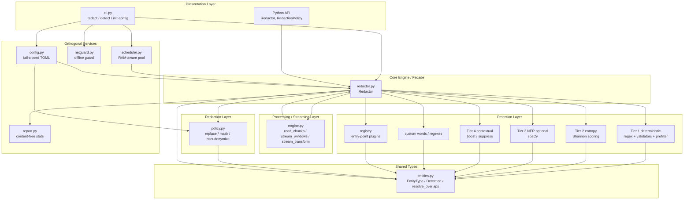

<div style="page-break-after: always;"></div>

## 13. Component Diagram

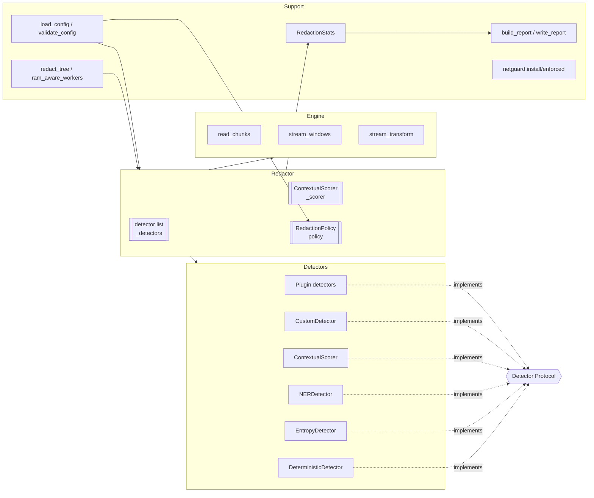

<div style="page-break-after: always;"></div>

## 14. Package Diagram

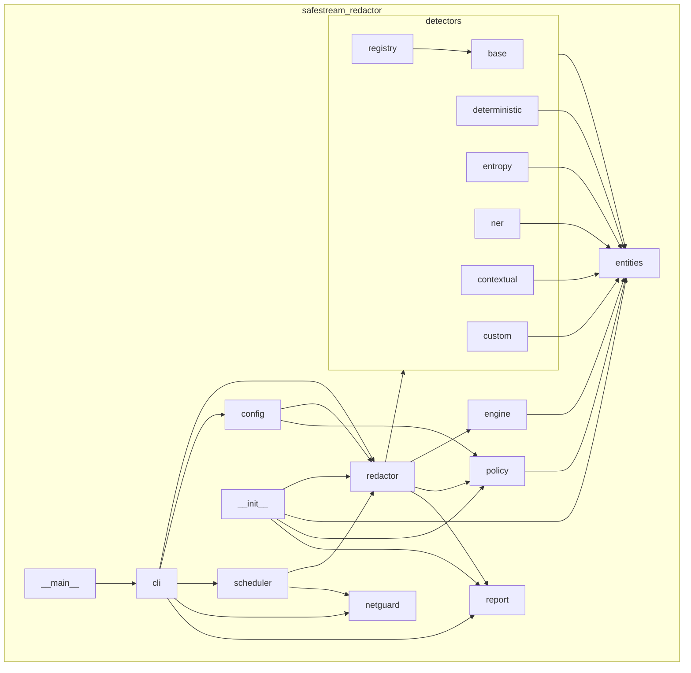

All package edges point toward `entities` (and `base` for the protocol), confirming the
acyclic, inward-facing dependency structure noted in Section 10.

<div style="page-break-after: always;"></div>

## 15. Module Description

### 15.1 `engine.py` — streaming engine

- **Responsibilities:** read files in chunks; slide a rolling buffer with an overlap
  window; emit segments and their contained detections exactly once; transform chunks to
  redacted output with O(1) memory.
- **Inputs:** an iterable of text chunks (or a file path), a `detect` callable, an
  `apply` callable, an `overlap` size.
- **Outputs:** an iterator of `(segment, detections)` pairs (`stream_windows`) or
  redacted strings (`stream_transform`).
- **Key functions:** `read_chunks`, `stream_windows`, `stream_transform`,
  `window_detect` (inner).
- **Dependencies:** `entities.Detection` only.
- **Interactions:** driven by `Redactor`; agnostic of which detectors/policies are used.

### 15.2 `redactor.py` — facade

- **Responsibilities:** compose the detector stack; run detection with scoring, filtering,
  and overlap resolution; apply redaction; provide string/stream/file entry points;
  guarantee atomic file writes.
- **Inputs:** text, chunk iterables, or file paths; construction options (types, policy,
  confidence, custom words/patterns, NER/entropy/plugin flags, chunk/overlap sizes).
- **Outputs:** redacted strings/streams; `RedactionStats` for files/streams.
- **Key methods:** `detect`, `redact`, `redact_stream`, `detect_stream`, `redact_file`.
- **Dependencies:** all detector modules, `engine`, `policy`, `entities`, `report`.
- **Interactions:** the single integration point of the whole system.

### 15.3 `entities.py` — shared types

- **Responsibilities:** define `EntityType` (the closed vocabulary of detectable kinds),
  the `Detection` dataclass, and `resolve_overlaps`.
- **Inputs/Outputs:** value objects; `resolve_overlaps` takes and returns
  `list[Detection]`.
- **Dependencies:** standard library only.
- **Interactions:** imported by every tier, the policy, and the engine.

### 15.4 `policy.py` — redaction rendering

- **Responsibilities:** decide the replacement string per detection (`render`) and rewrite
  text (`apply`); enforce mode invariants.
- **Inputs:** a `Detection`; policy configuration (mode, replacement, per-type map, mask
  params, HMAC key, pseudonym length).
- **Outputs:** rewritten text.
- **Dependencies:** `entities`, `hashlib`, `hmac`.
- **Interactions:** invoked by `Redactor.redact` and the streaming transform.

### 15.5 `detectors/deterministic.py` — Tier 1

- **Responsibilities:** run anchored, validator-backed regex patterns for PII and
  credentials; prefilter patterns whose anchors/digit requirement are absent.
- **Inputs:** text; optional type subset; `prefilter` flag.
- **Outputs:** `list[Detection]`.
- **Dependencies:** `entities`, `re`, `ipaddress`.
- **Interactions:** the primary tier; runs first in the stack.

### 15.6 `detectors/entropy.py` — Tier 2

- **Responsibilities:** flag high-entropy candidate tokens as generic secrets, tuned per
  alphabet (hex vs base64) with length/charset gates.
- **Inputs:** text; thresholds.
- **Outputs:** `list[Detection]` of type `SECRET`.
- **Dependencies:** `entities`, `math`, `collections.Counter`, `re`.

### 15.7 `detectors/ner.py` — Tier 3 (optional)

- **Responsibilities:** map spaCy entity labels to `EntityType` (PERSON/ORG/LOC); lazily
  load the model; pickle as config only for multiprocessing.
- **Inputs:** text; model name; confidence.
- **Outputs:** `list[Detection]`.
- **Dependencies:** `spacy` (lazy, optional), `entities`.
- **Interactions:** added to the stack only when `use_ner=True`.

### 15.8 `detectors/contextual.py` — Tier 4

- **Responsibilities:** adjust detection confidence by nearby trigger words; promote a
  bare 9-digit SSN when contextually indicated.
- **Inputs:** text and the current detection list.
- **Outputs:** in-place confidence adjustments (`adjust`) and new detections (`detect`).
- **Dependencies:** `entities`, `re`.

### 15.9 `detectors/custom.py`

- **Responsibilities:** compile user words (as an escaped alternation) and regexes into
  `CUSTOM` detections at confidence 1.0.
- **Inputs:** words, patterns, case sensitivity.
- **Outputs:** `list[Detection]`.

### 15.10 `detectors/registry.py`

- **Responsibilities:** discover entry-point plugins, instantiate factories/classes,
  validate against the `Detector` protocol, and skip failures with a warning.
- **Inputs:** an entry-point group name.
- **Outputs:** `list[Detector]`.
- **Dependencies:** `importlib.metadata`, `base.Detector`, `logging`.

### 15.11 `config.py`

- **Responsibilities:** load and strictly validate TOML policy files; build `RedactionPolicy`
  and `Redactor` from them.
- **Inputs:** a TOML path.
- **Outputs:** validated dict; `RedactionPolicy`; `Redactor`.
- **Dependencies:** `tomllib`/`tomli`, `entities`, `policy`, `redactor`, `engine`.

### 15.12 `report.py`

- **Responsibilities:** accumulate per-type counts and char sizes; merge across
  files/workers; build/write a content-free JSON report.
- **Inputs:** segments, redacted output, detections; run metadata.
- **Outputs:** `RedactionStats`; a JSON-serialisable report dict.
- **Dependencies:** `entities`, `json`, `datetime`, `collections.Counter`.

### 15.13 `scheduler.py`

- **Responsibilities:** enumerate an input tree; size workers by CPU and RAM; redact files
  in a process pool; aggregate results in input order; report progress.
- **Inputs:** input/output directories, a `Redactor`, worker count, encoding, guard flag,
  progress callback.
- **Outputs:** `list[RedactResult]`.
- **Dependencies:** `concurrent.futures`, `os`, `pathlib`, `redactor`, `netguard`.

### 15.14 `netguard.py`

- **Responsibilities:** monkeypatch `socket.connect`/`connect_ex` to raise on non-loopback
  targets; install/uninstall idempotently; provide an `enforced()` context manager.
- **Inputs:** socket connection addresses.
- **Outputs:** side effect (raises `NetworkAccessError`) or pass-through for loopback.
- **Dependencies:** `socket`.

### 15.15 `cli.py`

- **Responsibilities:** parse arguments; build the redactor (config + flag overlay);
  dispatch file/stdin/directory paths; emit stats/reports/warnings; install the guard.
- **Inputs:** `argv`.
- **Outputs:** process exit code; stdout/stderr; output files.
- **Dependencies:** most of the package.

<div style="page-break-after: always;"></div>

## 16. Class Design

### 16.1 Important classes and responsibilities

| Class | Module | Responsibility |
| :--- | :--- | :--- |
| `EntityType(str, Enum)` | `entities` | Closed vocabulary of detectable entity kinds; `from_name` parsing. |
| `Detection` (dataclass, slots) | `entities` | One located span: start, end, text, type, confidence, source, meta; `overlaps`. |
| `RedactionMode(str, Enum)` | `policy` | `REPLACE`, `MASK`, `PSEUDONYMIZE`. |
| `RedactionPolicy` (dataclass, slots) | `policy` | Renders replacements; validates mode invariants; `render`, `apply`. |
| `Redactor` | `redactor` | Facade composing detectors, engine, policy; detect/redact/file APIs. |
| `Pattern` (frozen dataclass) | `deterministic` | A regex + validator + confidence + anchors + group. |
| `DeterministicDetector` | `deterministic` | Runs patterns with prefiltering and validation. |
| `EntropyDetector` | `entropy` | Shannon-entropy secret detection. |
| `NERDetector` | `ner` | spaCy-backed NER; config-only pickling. |
| `ContextualScorer` | `contextual` | Confidence adjustment + trigger-gated detection. |
| `CustomDetector` | `custom` | User words/regexes. |
| `Detector` (Protocol) | `base` | Extension contract (`name` + `detect`). |
| `RedactionStats` (dataclass, slots) | `report` | Counters; `add_segment`, `merge`, `summary`. |
| `RedactResult` (dataclass, slots) | `scheduler` | Per-file outcome (paths, bytes, counts). |
| `NetworkAccessError(RuntimeError)` | `netguard` | Raised on blocked egress. |

### 16.2 Methods of the central classes

**`Redactor`**
- `__init__(...)` — resolves types, builds the detector stack in tier order, wires the
  contextual scorer.
- `detect(text) -> list[Detection]` — gathers raw detections from all tiers, applies
  contextual `adjust`, filters by `min_confidence`, resolves overlaps.
- `redact(text) -> str`; `redact_stream(chunks, stats=None)`;
  `detect_stream(chunks)`; `redact_file(in, out, encoding) -> RedactionStats`.

**`RedactionPolicy`**
- `__post_init__` — coerces mode; requires HMAC key for pseudonymize; bounds
  `pseudonym_length` to 8–64.
- `render(detection) -> str` — per-type override → mask → pseudonymize → default replace.
- `apply(text, detections) -> str` — splice replacements over sorted, non-overlapping
  detections.

**`DeterministicDetector`**
- `__init__(types, *, prefilter=True)` — selects the pattern subset.
- `detect(text)` — per-pattern anchor/digit prefilter, then `finditer` + validator.

### 16.3 Relationships: inheritance, composition, aggregation

- **Inheritance / realisation:** `DeterministicDetector`, `EntropyDetector`,
  `NERDetector`, `ContextualScorer`, `CustomDetector`, and plugins *realise* the
  `Detector` Protocol (structural typing, `@runtime_checkable`). `EntityType` and
  `RedactionMode` inherit from `(str, Enum)`. `NetworkAccessError` inherits `RuntimeError`.
- **Composition:** `Redactor` composes a list of `Detector`s, a `ContextualScorer`, and a
  `RedactionPolicy` (their lifetimes are owned by the `Redactor`).
  `DeterministicDetector` composes a tuple of `Pattern`s.
- **Aggregation:** `RedactionStats` aggregates `Counter` values across segments/files;
  the scheduler aggregates `RedactResult`s. `Redactor` *uses* the engine functions and a
  detector's output but does not own the engine's internal state.
- **Dependency:** every detector depends on `Detection`/`EntityType`; `RedactionPolicy`
  depends on `Detection`.

### 16.4 UML Class Diagram

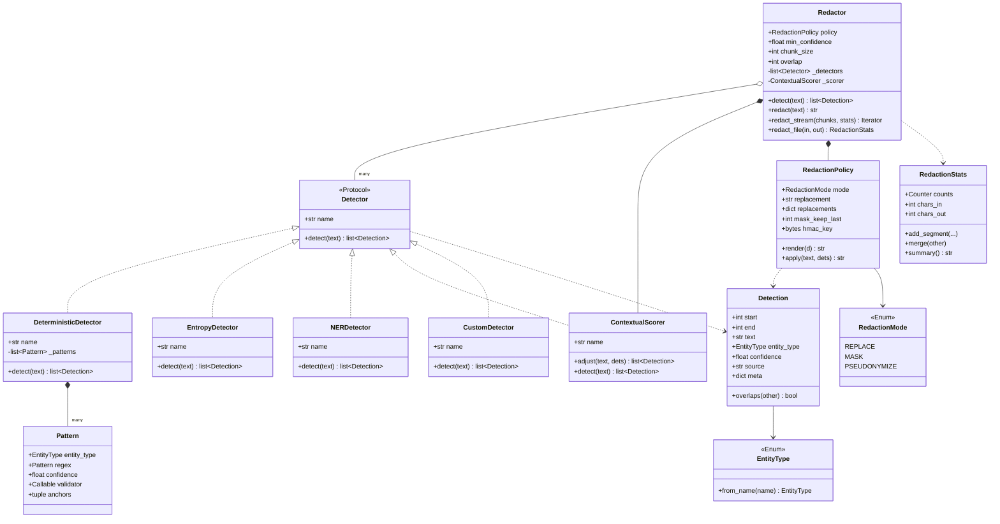

<div style="page-break-after: always;"></div>

## 17. Sequence Diagrams

### 17.1 CLI execution (redact a file)

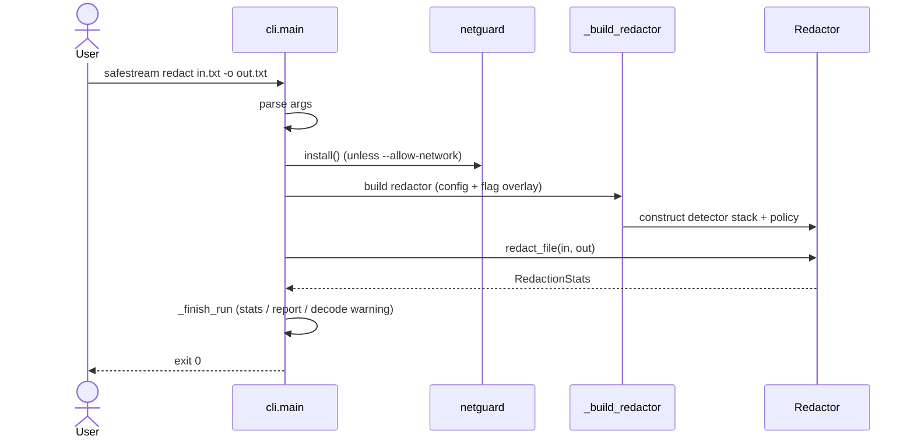

### 17.2 File processing (`redact_file`)

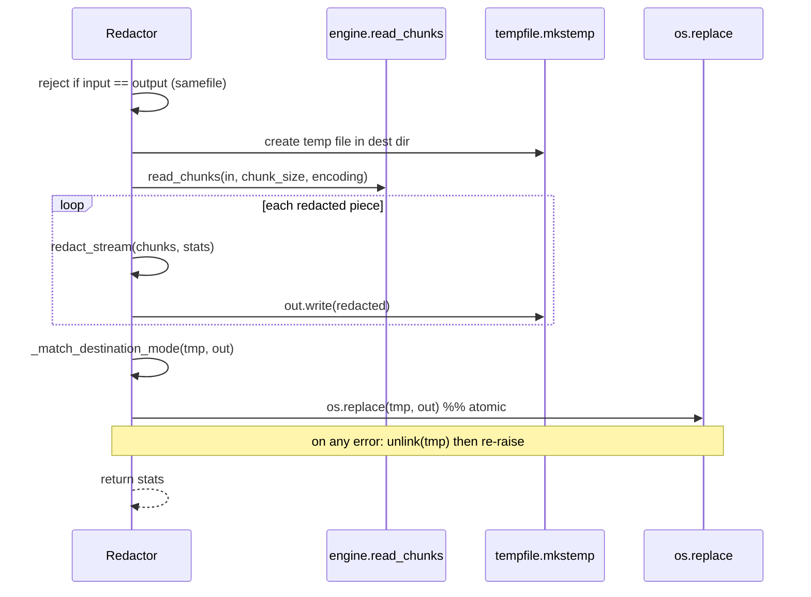

### 17.3 Streaming pipeline (`stream_windows`)

```mermaid
sequenceDiagram
    participant Caller
    participant SW as stream_windows
    participant WD as window_detect
    participant D as detect callable
    loop each chunk
        Caller->>SW: chunk
        SW->>SW: buffer += chunk
        alt len(buffer) <= overlap
            SW-->>Caller: (carry over, emit nothing)
        else
            SW->>SW: emit_upto = len(buffer) - overlap
            SW->>WD: window_detect(prefix, buffer)
            WD->>D: detect(prefix + buffer)
            D-->>WD: detections
            WD-->>SW: shifted, prefix-dropped detections
            SW->>SW: retreat emit_upto past any straddling detection
            SW-->>Caller: (segment, ready detections)
            SW->>SW: prefix = last overlap chars; buffer = remainder
        end
    end
    SW-->>Caller: final (buffer, detections)
```

### 17.4 Entity detection (`Redactor.detect`)

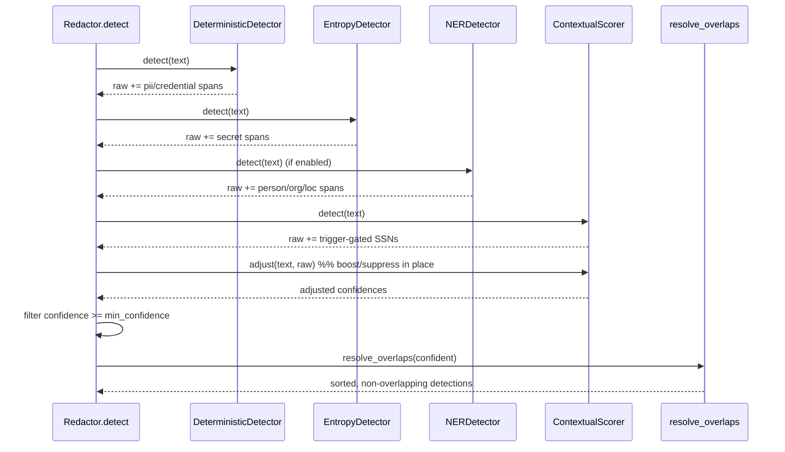

### 17.5 Chunk processing (per window transform)

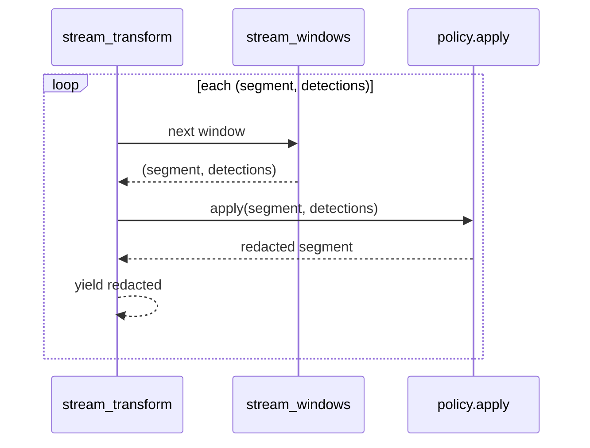

### 17.6 Redaction flow (`RedactionPolicy.render`)

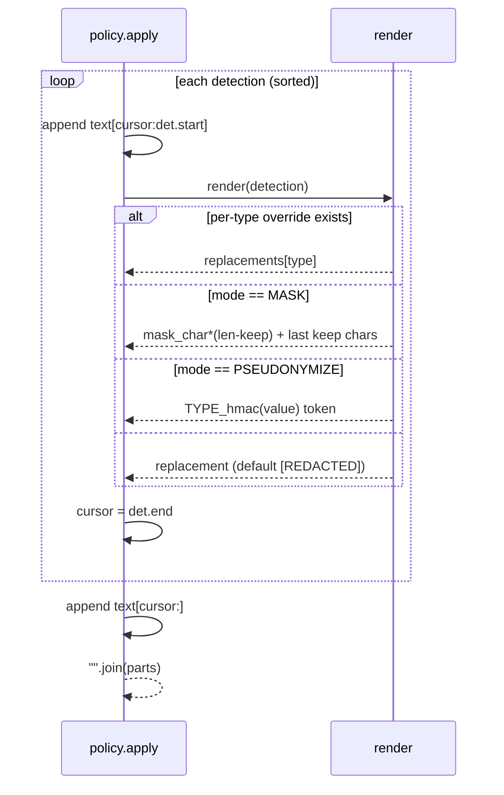

### 17.7 Output generation &amp; report

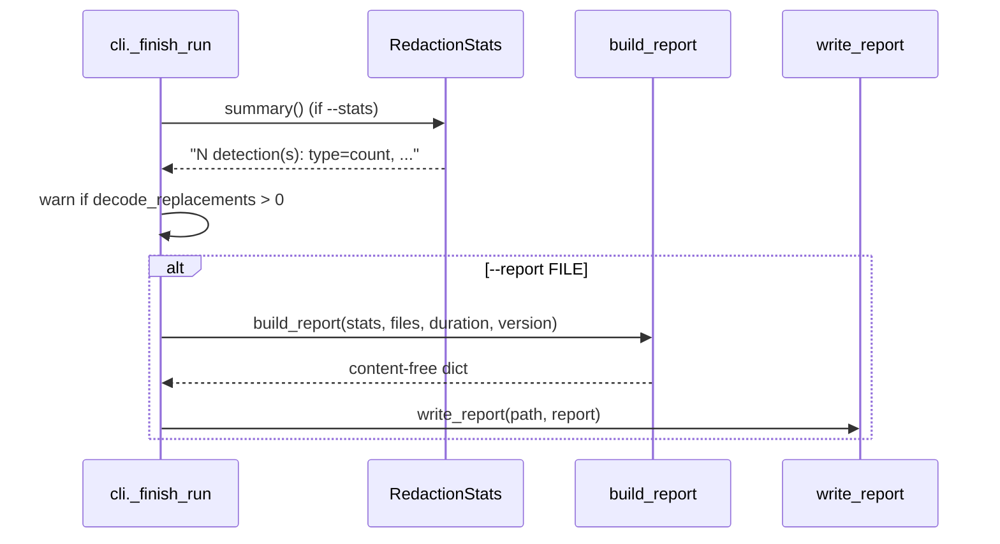

<div style="page-break-after: always;"></div>

## 18. Activity Diagrams

### 18.1 Overall redaction activity

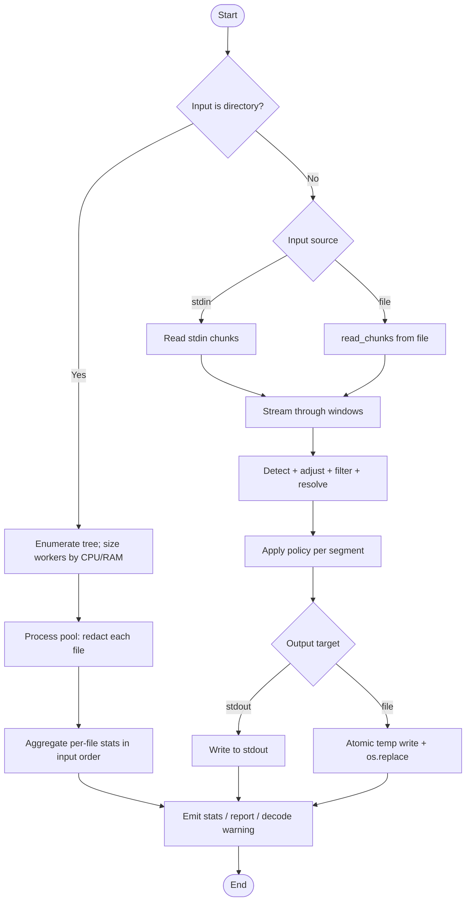

### 18.2 Detection decision activity (per pattern)

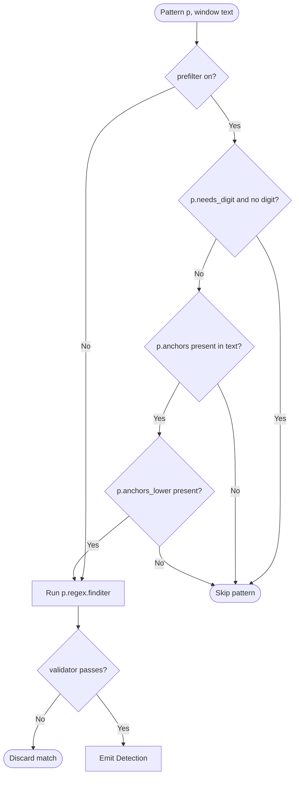

### 18.3 Config resolution activity

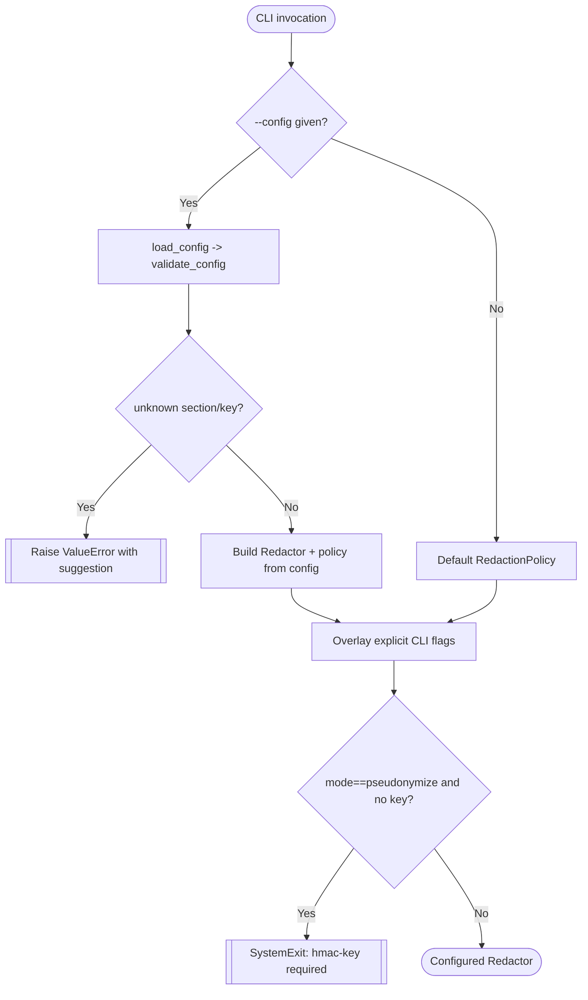

<div style="page-break-after: always;"></div>

## 19. Data Flow Diagram

### 19.1 Level 0 (context)

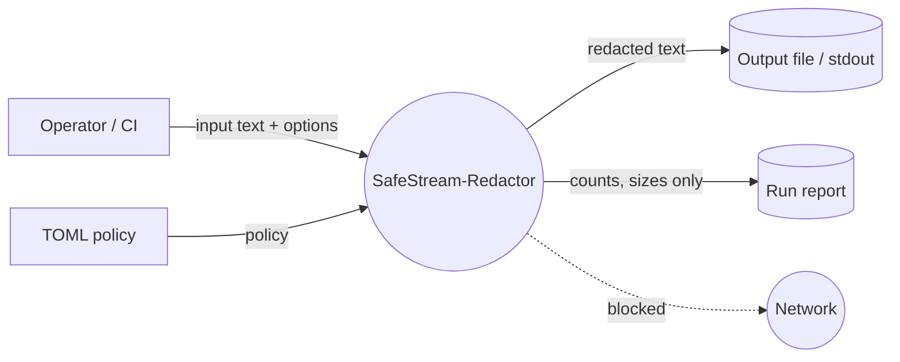

### 19.2 Level 1 (major processes)

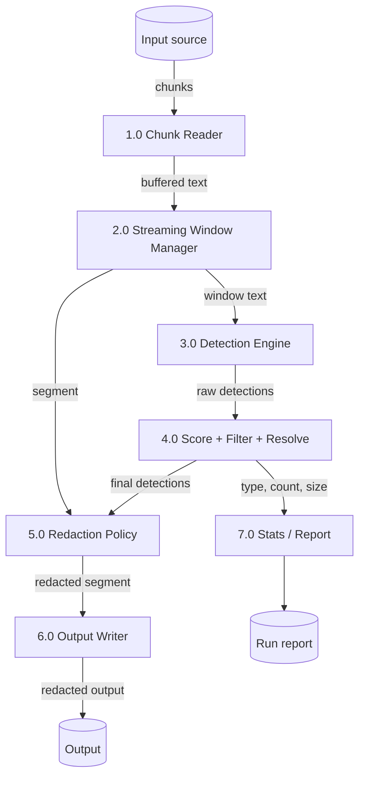

### 19.3 Level 2 (Detection Engine internals — process 3.0)

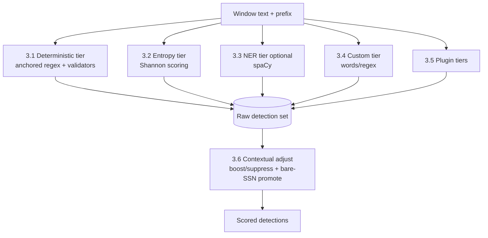

<div style="page-break-after: always;"></div>

## 20. Processing Pipeline

The complete execution flow from an input file to a final redacted file passes through
the stages below. This maps the requested pipeline onto the concrete implementation.

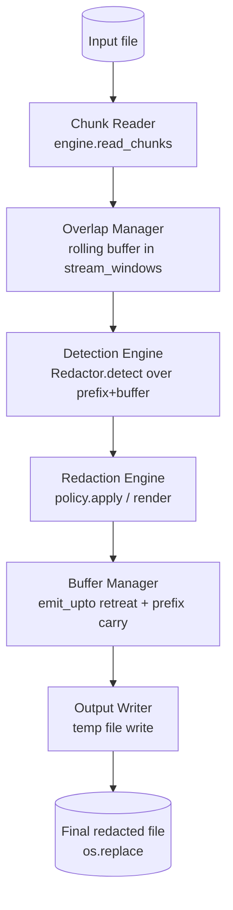

### 20.1 Stage 1 — Chunk Reader (`read_chunks`)

Opens the input in text mode with the chosen encoding and `errors="replace"`, yielding
fixed-size chunks (default 64 KiB) via the walrus loop `while chunk := f.read(chunk_size)`.
For stdin, `cli._input_chunks` performs the equivalent read loop. This stage never holds
more than one chunk plus the buffer, establishing the constant-memory property at the
source.

### 20.2 Stage 2 — Overlap Manager (rolling buffer)

`stream_windows` maintains `buffer` (accumulated unemitted text) and `prefix` (up to
`overlap` characters of already-emitted left context). Each incoming chunk is appended to
`buffer`. If the buffer is not yet longer than `overlap`, nothing is emitted — the text is
carried forward so no entity near the tail is prematurely cut.

### 20.3 Stage 3 — Detection Engine (`window_detect` → `Redactor.detect`)

Detection runs on `prefix + buffer` so backward-looking detectors see true left context.
The inner `window_detect` shifts detection offsets back by `len(prefix)` and drops
detections that begin inside the prefix (already emitted). `Redactor.detect` then runs all
four tiers, applies contextual scoring, filters by confidence, and resolves overlaps.

### 20.4 Stage 4 — Redaction Engine (`policy.apply`)

Each emitted segment is rewritten by `RedactionPolicy.apply`, which splices replacement
strings over the sorted, non-overlapping detections contained wholly within the segment.

### 20.5 Stage 5 — Buffer Manager (boundary retreat &amp; carry)

Before emitting, `emit_upto` is set to `len(buffer) - overlap`. Any detection that
*straddles* the boundary (`det.start < emit_upto < det.end`) forces `emit_upto` to retreat
to `det.start`, so a match is never split. Only detections fully before `emit_upto` are
emitted; the remaining tail becomes the next `buffer`, and the last `overlap` characters of
what was emitted become the next `prefix`.

### 20.6 Stage 6 — Output Writer (atomic)

Redacted segments are written to a temp file created in the destination directory. When
the stream completes, the temp file's mode is matched to the destination and
`os.replace` atomically moves it into place. Any failure unlinks the temp file and
re-raises, so the destination is either the old content or the fully redacted result —
never a partial file.

### 20.7 Stage 7 — Final redacted file

The atomic replacement yields the final output. Alongside, `RedactionStats` carries
per-type counts and char sizes for the optional stderr summary and JSON report.

<div style="page-break-after: always;"></div>

## 21. Streaming Architecture

### 21.1 Why streaming is used

The design goal (README, `pyproject.toml`) is to redact files far larger than RAM —
"a 100 GB log file with the same memory footprint as a 1 KB one." Loading the whole file,
as most PII engines do, makes this impossible. Streaming with a bounded rolling buffer
decouples memory from input size.

### 21.2 Chunking strategy

Input is read in fixed-size chunks: `DEFAULT_CHUNK_SIZE = 64 * 1024` characters,
configurable via `chunk_size` / `--chunk-size`. Chunk size trades syscall/iteration
overhead against buffer footprint; 64 KiB is a common efficient block size (architectural
inference from the default).

### 21.3 Overlap mechanism

`DEFAULT_OVERLAP = 4 * 1024`. The engine keeps a rolling buffer of up to
`chunk_size + overlap` characters. Only text at least `overlap` characters from the
buffer's end is emitted each round; the tail is carried forward. Consequently any entity
up to `overlap` characters long is seen whole at least once, even when a chunk boundary
cuts through it — this is the explicit **guarantee** stated in the `engine.py` docstring
and pinned by `tests/test_streaming.py` and `tests/test_properties.py`.

### 21.4 Boundary detection

Two mechanisms guarantee correctness at boundaries:

1. **Emit-boundary retreat.** If a detection straddles `emit_upto`, the boundary retreats
   to the detection's start (`if det.start < emit_upto < det.end: emit_upto = det.start`),
   so the match stays wholly in the next segment.
2. **Read-only left context (prefix).** Up to `overlap` characters of already-emitted text
   are prepended for detection only; their detections are shifted and dropped so output is
   never duplicated, but backward-looking detectors (contextual) score identically to
   whole-text mode.

### 21.5 Memory management

Peak memory is bounded by `chunk_size + overlap` plus the largest single detection.
`tests/test_memory.py` redacts a ~1 GB generated file and asserts peak
`tracemalloc` allocations stay under 16 MB — orders of magnitude below the input.

### 21.6 Incremental processing

`stream_windows` and `stream_transform` are generators; `Redactor.redact_stream` and
`redact_file` consume them lazily. Output is produced as input is read; there is no
buffering of the whole result.

### 21.7 Buffer handling

The buffer is a plain Python `str` accumulated by `buffer += chunk` and sliced
(`buffer[:emit_upto]`, `buffer[emit_upto:]`). The prefix is recomputed as
`(prefix + buffer[:emit_upto])[-overlap:]`. When `overlap == 0` the prefix is empty. A
trailing non-empty buffer at end-of-input is always flushed as a final window.

### 21.8 File writer

The writer (in `redact_file` and `cli._atomic_write_stream`) streams redacted pieces to a
temp file and atomically renames. This ties durable, crash-safe output to the streaming
model without ever materialising the full output in memory.

```mermaid
flowchart LR
    subgraph Buffer[Rolling buffer]
        PFX[prefix<br/>≤ overlap<br/>read-only left context]
        EMIT[emit region<br/>len-overlap]
        TAIL[tail<br/>overlap<br/>carried forward]
    end
    CHUNK[next chunk] --> Buffer
    EMIT --> OUT[redacted output]
    TAIL --> NEXT[becomes next buffer head]
    EMIT --> NP[last overlap chars -> next prefix]
```

<div style="page-break-after: always;"></div>

## 22. Chunk Overlap Logic

### 22.1 Why overlap exists

Without overlap, a fixed chunk split can cut an entity in two — e.g. an email split at the
`@`, or an SSN split as `123` / `-45-` / `6789`. Neither half matches the full pattern, so
the entity would leak. Overlap ensures every position is examined within a full-width
window at least once.

### 22.2 How chunk boundaries are handled

The engine never treats a raw chunk boundary as an emit boundary. It computes
`emit_upto = len(buffer) - overlap` and only emits text that is at least `overlap`
characters from the current buffer end. The unemitted tail (≥ `overlap` chars) is
re-scanned together with the next chunk. If a detection still straddles the computed
boundary, the boundary retreats to the detection's start.

### 22.3 Why entities split across chunks are detected

Because the tail carried forward is at least `overlap` characters, and the guarantee is
that any entity of length ≤ `overlap` is fully contained in some window. The property test
`test_streaming_equals_whole_text_for_any_input_and_chunking` verifies, for chunk sizes
1–97 and many generated inputs, that streaming output is byte-identical to whole-text
redaction. Concrete tests cover an email split at `@`, an SSN split across three chunks,
and a 100-char secret spanning the emit boundary.

### 22.4 Advantages

- **Correctness:** boundary-straddling entities are never missed (within the length
  bound).
- **Determinism:** contextual scoring matches whole-text mode via the retained prefix.
- **Constant memory:** the carried tail is bounded by `overlap`.

### 22.5 Trade-offs

- **Recomputation:** the overlap region is scanned in two consecutive windows (the tail of
  one, the head of the next), a bounded constant-factor cost.
- **Length bound:** entities longer than `overlap` are not guaranteed whole — mitigated by
  a generous 4 KiB default and by bounding the largest pattern (PEM key ≤ 8 KiB) and
  configuring `overlap` upward if needed.
- **Latency:** emission lags by `overlap` characters.

### 22.6 Complexity

Let `N` be total input length, `c` the chunk size, `o` the overlap. Each character is
scanned at most twice (once as emit region, once as carried tail/prefix), so detection is
**O(N)** in input length (times the per-window pattern cost — see Section 32). Memory is
**O(c + o)**, independent of `N`.

<div style="page-break-after: always;"></div>

## 23. Detection Engine

The detection engine is a stack of independent tiers, each satisfying the `Detector`
protocol, combined by `Redactor.detect`. All raw detections are pooled, contextually
adjusted, confidence-filtered, and overlap-resolved.

### 23.1 Tier 1 — Deterministic (regex + validators)

`DeterministicDetector` runs a tuple of `Pattern` objects. Each `Pattern` bundles a
compiled regex, a base confidence, an optional validator, a capture group, and prefilter
anchors. Coverage (`_PATTERNS`):

- **PII:** email (0.95), credit card (0.9, Luhn), SSN (0.85, area/group/serial rules),
  IPv4 (0.9), IPv6 (0.9, `ipaddress`-validated), structured phone (0.6) and bare phone
  (0.45), each with `phone_ok` shape/length validation.
- **Credentials:** private key PEM (0.99, length-bounded body), JWT (0.95), AWS key
  (0.98), GitHub token (0.98), Slack token (0.98) and webhook (0.98), Stripe key (0.97),
  Google API key (0.95), SendGrid (0.98), Twilio (0.9), npm (0.98), Anthropic (0.98),
  OpenAI (0.95), URL-embedded password (0.97, only the password span via capture group 1),
  and a generic `key=value` API-key pattern (0.75, group 1).

**Validators** encode domain rules so a syntactic match is not sufficient: `luhn_ok`
(card checksum, 13–19 digits), `ssn_ok` (rejects area `000`/`666`/`9xx`, group `00`,
serial `0000`), `phone_ok` (rejects ISO-date and SSN shapes; requires 7–15 digits),
`ipv6_ok` (must parse as an `IPv6Address`).

### 23.2 Tier 2 — Statistical (entropy)

`EntropyDetector` scans candidate tokens (runs of `[A-Za-z0-9+/=_-]{20,}`) and flags those
whose Shannon entropy exceeds an alphabet-specific floor: hex tokens need length ≥ 32 and
entropy ≥ 3.0; other tokens need entropy ≥ 4.0. Pure-alphabetic runs are rejected as
likely prose. This catches bespoke secrets with no published format that pattern-only
tools miss. Confidence 0.6; the detection carries the measured entropy in `meta`.

### 23.3 Tier 3 — NER (optional)

`NERDetector` maps spaCy labels (`PERSON`, `ORG`, `GPE`/`LOC`/`FAC`) to `EntityType`
PERSON/ORG/LOC at confidence 0.7. spaCy is imported lazily and loaded with unused
components excluded for speed. It pickles as configuration only so the multiprocessing
scheduler can ship it cheaply to workers.

### 23.4 Tier 4 — Contextual

`ContextualScorer` plays two roles:

- **`adjust(text, detections)`** — for each detection, examines a 48-char left window for
  type-specific *boost* triggers (e.g. "ssn", "card", "phone", "key") and a tight 16-char
  window (plus the match itself) for *suppress* triggers ("example", "test", "dummy",
  "xxx-xx"), adjusting confidence by ±0.2 / −0.4.
- **`detect(text)`** — promotes a bare 9-digit number to an SSN (confidence 0.8) only when
  an SSN trigger word is within the window — a detection Tier 1 deliberately omits as too
  ambiguous.

### 23.5 Custom detectors

`CustomDetector` compiles user words into an escaped alternation and user regexes,
emitting `CUSTOM` detections at confidence 1.0.

### 23.6 Priority, fallback, and confidence

- **Priority** is expressed through base confidences and `resolve_overlaps`: named
  credentials outscore the generic entropy tier, and the URL-password pattern (0.97)
  outscores the email pattern so `pass@host.tld` resolves to the precise label.
- **Fallback:** the bare-phone (0.45) and generic API-key (0.75) patterns score below or
  near the default 0.5 threshold, surviving only with a contextual boost — a graceful
  fallback from precise to context-dependent detection.
- **Confidence filter:** `Redactor.detect` keeps detections with
  `confidence >= min_confidence` (default 0.5).

### 23.7 Detection pipeline (summary)

```mermaid
flowchart LR
    T[text] --> D1[Tier1 deterministic]
    T --> D2[Tier2 entropy]
    T --> D3[Tier3 NER optional]
    T --> DC[custom]
    T --> DP[plugins]
    D1 & D2 & D3 & DC & DP --> RAW[(raw detections)]
    RAW --> ADJ[contextual adjust]
    ADJ --> FLT[confidence filter]
    FLT --> RES[resolve_overlaps]
    RES --> OUT[final detections]
```

<div style="page-break-after: always;"></div>

## 24. Redaction Engine

The redaction engine is `RedactionPolicy` (`policy.py`). It decides, per detection, the
replacement text, then splices those replacements over the source.

### 24.1 Replacement strategy (`apply`)

Given sorted, non-overlapping detections, `apply` walks a cursor through the text,
appending the untouched gap `text[cursor:det.start]`, then `render(det)`, then advancing
the cursor to `det.end`; the trailing tail is appended last. This is a single linear pass
building a list of parts joined once — no quadratic string surgery.

### 24.2 Modes and precedence (`render`)

Precedence, highest first:

1. **Per-type override** — `replacements[entity_type]` if present (e.g. email → `<EMAIL>`).
2. **Mask** — keep the last `mask_keep_last` characters, replace the rest with `mask_char`
   (`*` × (len − keep) + tail). Used for partial disclosure (e.g. card last-4).
3. **Pseudonymize** — `<TYPE_token>` where `token` is the first `pseudonym_length` hex
   digits of `HMAC-SHA256(hmac_key, value)`. Deterministic: equal values map to equal
   tokens (referential integrity).
4. **Replace** — the default fixed string (`[REDACTED]`).

### 24.3 Masking

`mask_keep_last` (default 4) controls how many trailing characters remain visible;
`mask_char` (default `*`) is the fill. Negative keep values are clamped to 0.

### 24.4 Token preservation &amp; placeholder generation

- **URL-credential preservation:** the URL-password pattern captures only the password
  (group 1), so the surrounding DSN stays readable — `postgres://svc:hunter2@db/app`
  becomes `postgres://svc:[REDACTED]@db/app`.
- **Placeholder generation:** pseudonymize produces a typed, keyed placeholder
  `<SSN_ab12cd34...>`; replace/mask produce fixed or shaped placeholders. Placeholders are
  chosen so downstream tooling can still parse structure.

### 24.5 False-positive handling

- **Validators** (Luhn, SSN, IPv6, phone-shape) reject syntactic matches that are not
  real entities.
- **Suppression triggers** lower confidence near "example"/"test"/"dummy" so documentation
  placeholders are not redacted.
- **Overlap resolution** keeps the most specific/highest-confidence label, avoiding double
  redaction.

### 24.6 False-negative considerations

- **Length bound:** entities longer than `overlap` may be missed at boundaries.
- **Recall on prose:** names/addresses need the NER tier.
- **Encoding gaps:** undecodable bytes become U+FFFD and are *not* scanned; the system
  counts and warns about them rather than hiding the gap.
- `SECURITY.md` is explicit that "detection is probabilistic at the margins" and output is
  "risk-reduced, not certified-clean."

<div style="page-break-after: always;"></div>

## 25. Memory Management

### 25.1 Heap usage

The working set per stream is: the current chunk, the rolling buffer (`buffer`), the
read-only `prefix` (≤ `overlap`), and the per-window `Detection` list. All are bounded by
`chunk_size + overlap` and the number of detections in a single window. The `Detection`
and stats dataclasses use `slots=True`, reducing per-object overhead.

### 25.2 Streaming avoids full-file loading

Neither `redact_file` nor the stdin path ever reads the whole input into memory:
`read_chunks` yields chunks, `stream_transform` yields redacted pieces, and the writer
consumes them incrementally. The full redacted result is likewise never held in memory.

### 25.3 Memory complexity

**O(chunk_size + overlap)** for a single file — constant in total input size. Across a
directory, aggregate memory is bounded by `workers × per-worker budget`, where the
scheduler caps `workers` by `available_ram // per_worker` (`_PER_WORKER_BASE = 96 MiB`
plus buffers).

### 25.4 Large-file handling

The 1 GB memory proof (`tests/test_memory.py`) runs with 64 KiB chunks and 4 KiB overlap
and asserts peak Python allocations < 16 MB. CI runs a 64 MB variant on Linux each build;
the full 1 GB check is opt-in via `SAFESTREAM_MEMTEST_MB` and the `memory` marker.

### 25.5 Garbage-collection considerations

Buffers are reassigned each round (`buffer = buffer[emit_upto:]`), letting the previous
buffer and emitted segment become collectable immediately; nothing accumulates across
iterations. *(Architectural inference: the generator-based design keeps only one window's
objects live at a time, so CPython's reference counting reclaims them promptly without
relying on cyclic GC.)*

<div style="page-break-after: always;"></div>

## 26. Security Design

### 26.1 Threat model

`SECURITY.md` states the model explicitly. The system defends against **accidental data
exfiltration and incomplete redaction**, not a determined local adversary. Guarantees are
scoped: the offline guard covers Python socket egress; detection is probabilistic at the
margins; reports are content-free; plugins are trusted code.

### 26.2 Sensitive-data handling

- Matched text lives only transiently in `Detection.text` during processing and is
  **never logged** (`__init__.py` installs a `NullHandler`; the roadmap and audit stress
  "content must not reach logs").
- Run reports contain only type names, counts, and sizes — content-free by construction
  (`report.py`), so audit artefacts can be shipped safely.

### 26.3 Local-first processing &amp; no cloud dependency

All processing is on-host; the core has no network client and no third-party runtime
dependency. There is no server, no telemetry, no remote model call. The optional NER model
runs locally.

### 26.4 Privacy

The storage-free design means nothing is persisted beyond the redacted output the user
requests. Pseudonymize mode is documented as **re-identifiable by the key holder** (not
anonymization): it is deterministic and keyed, leaks value equality, and is invertible on
low-cardinality domains — hence the guidance to use a strong secret key and treat output
as pseudonymized.

### 26.5 Credential handling

The HMAC key for pseudonymize mode is supplied via `--hmac-key` or config; the tool never
stores it. The pseudonym token width defaults to 64 bits (configurable 8–64 hex digits)
to avoid birthday collisions on large corpora.

### 26.6 Temporary files

Atomic writes use `tempfile.mkstemp` (mode 0o600) in the destination directory; on success
the temp file's mode is matched to the destination and atomically renamed; on any failure
it is unlinked. This prevents both partial-output leaks and stale temp files.

### 26.7 Logging

Standard-library logging with a null handler by default; only operational signals (tier
composition at debug, plugin-load failures at warning) are emitted, never matched content.

### 26.8 Attack surface

- **Input parsing:** regex-based; the private-key pattern body is length-bounded to
  prevent ReDoS from a `BEGIN`-without-`END` marker followed by a large base64 run.
- **Plugins:** entry-point code runs with full process privileges; disable with
  `load_plugins=False`.
- **Config:** fail-closed validation rejects unknown keys/sections to prevent a typo from
  silently shipping unredacted output.

### 26.9 Offline network guard

`netguard.install()` monkeypatches `socket.socket.connect`/`connect_ex` to raise
`NetworkAccessError` for any non-loopback target. Loopback (`localhost`, `127.0.0.0/8`,
`::1`, IPv4-mapped loopback) and AF_UNIX sockets are allowed. It is installed by default by
the CLI (opt out with `--allow-network`) and by each scheduler worker. It is explicitly
**best-effort**: native syscalls, subprocesses, and other host processes bypass it — for a
hard boundary, combine with `docker run --network none` or a seccomp/network-namespace
policy.

### 26.10 Security best practices in the build

- Non-root Docker user (`uid 10001`).
- OIDC Trusted Publishing to PyPI (no long-lived tokens).
- SBOM + provenance attestations on released images.
- `pip-audit` and Dependabot for supply-chain hygiene.
- Least-privilege workflow permissions (`contents: read`).

```mermaid
flowchart TB
    subgraph Process[SafeStream process]
        R[Redactor] --> DET[detection]
        DET --> RED[redaction]
        NG{{netguard<br/>socket monkeypatch}}
    end
    RED --> LOCAL[(local output only)]
    R -. attempted egress .-> NG
    NG -. non-loopback .-> BLOCK[[NetworkAccessError]]
    NG -. loopback / unix .-> ALLOW[pass through]
```

<div style="page-break-after: always;"></div>

## 27. Error Handling

### 27.1 Exceptions raised

| Condition | Exception | Location |
| :--- | :--- | :--- |
| Pseudonymize without key | `ValueError` | `RedactionPolicy.__post_init__` |
| `pseudonym_length` out of 8–64 | `ValueError` | `RedactionPolicy.__post_init__` |
| Unknown entity-type name | `ValueError` | `EntityType.from_name` |
| Unknown TOML section/key | `ValueError` (with suggestion) | `config.validate_config` |
| Negative overlap | `ValueError` | `engine.stream_windows` |
| Input == output file | `ValueError` | `Redactor.redact_file` |
| Blocked network connection | `NetworkAccessError` | `netguard` |
| Missing spaCy for NER | `ImportError` (with install hint) | `ner._load_model` |
| CLI `--replace-type` malformed | `SystemExit` | `cli._build_redactor` |
| `init-config` over existing file without `--force` | `SystemExit` | `cli._cmd_init_config` |

### 27.2 Recovery

- **Atomic-write failure:** any `BaseException` during the write unlinks the temp file
  (suppressing secondary `OSError`) and re-raises, leaving the destination untouched.
- **Plugin failure:** a plugin that fails to load or violates the protocol is skipped with
  a warning — the pipeline continues rather than crashing, but never silently (a vanished
  tier is a coverage risk, so it is logged).

### 27.3 Logging of errors

Errors surfaced to the operator go to stderr (`cli.main` prints `safestream: error: ...`);
internal warnings (plugin load) go through the module logger. Matched content is never
included in any error message.

### 27.4 Retries

The core performs no automatic retries — appropriate for a deterministic batch/stream
process. *(Not explicitly available in the repository: any network/backoff retry logic —
by design there is no network path.)*

### 27.5 Invalid input &amp; unsupported files

- **Undecodable bytes** are replaced with U+FFFD, *counted* in `decode_replacements`, and
  warned about, because unscanned bytes are a redaction-coverage risk. `--encoding` lets
  the operator decode non-UTF-8 sources correctly.
- **Binary/unsupported content:** the tool treats input as text; there is no format
  sniffing. *(inference: binary files would be read as (mostly undecodable) text and
  flagged via the U+FFFD warning rather than rejected.)*

### 27.6 Graceful failure

`cli.main` wraps command execution in a `try/except (OSError, ValueError)` that prints a
concise diagnostic and returns exit code 1, so operational errors do not produce
stack-trace noise while still failing the process.

<div style="page-break-after: always;"></div>

## 28. Configuration Design

### 28.1 Configuration files (TOML)

Policies are expressed in TOML across four sections — `[detection]`, `[redaction]`
(with a nested `[redaction.replacements]`), `[custom]`, `[streaming]`. `config.py` loads
and validates them and builds a `Redactor` and `RedactionPolicy`.

### 28.2 Fail-closed validation

`validate_config` checks every section and key against an explicit `_SCHEMA` allowlist. An
unknown section or key is a **hard error** with a `difflib`-based "did you mean"
suggestion — never a silent default. The rationale (in the module docstring): "a typo like
`replacment` … silently falling back to defaults means unredacted output shipping to
production." The nested `replacements` table is exempt from key-checking because its keys
are entity-type names, validated separately.

### 28.3 CLI-over-config overlay

`cli._build_redactor` loads the config, then overlays any explicitly passed flags (mode,
replacement, mask params, HMAC key, per-type replacements, types, confidence, entropy,
custom words/regex, chunk/overlap). CLI flags always win. The audit notes this overlay
path duplicates logic with the from-scratch path and reaches into `Redactor._detectors`
(a known layering leak, flagged for refactor).

### 28.4 Parameters &amp; thresholds

| Parameter | Default | Meaning |
| :--- | :--- | :--- |
| `chunk_size` | 65536 | Read block size (bytes/chars). |
| `overlap` | 4096 | Overlap window; boundary-safety length bound. |
| `min_confidence` | 0.5 | Detection acceptance threshold. |
| `mode` | `replace` | Redaction mode. |
| `replacement` | `[REDACTED]` | Default replacement string. |
| `mask_keep_last` | 4 | Trailing visible chars in mask mode. |
| `mask_char` | `*` | Mask fill character. |
| `pseudonym_length` | 16 | Hex digits of the HMAC token (8–64). |
| `use_entropy` | true | Enable the entropy tier. |
| `use_ner` | false | Enable the NER tier. |
| Entropy floors | 4.0 (base64), 3.0 (hex) | Per-alphabet entropy thresholds. |
| Contextual windows | 48 (boost), 16 (suppress) | Trigger scan windows. |
| Boost / suppress | +0.2 / −0.4 | Confidence deltas. |

### 28.5 Environment variables

- `SAFESTREAM_MEMTEST_MB` — used only by the memory test to size the generated file.

*Not explicitly available in the repository:* runtime behaviour controlled by environment
variables (there are none for the core; configuration is via flags/TOML). The `--hmac-key`
is passed as a flag; in the README's `tail -f` example it is sourced from a shell variable
`$SECRET`, but that is shell-level, not read by the tool from the environment directly.

### 28.6 `init-config`

`safestream init-config -o policy.toml` emits `_STARTER_CONFIG`, a fully documented
template that is itself validated against the schema at emit time — executable
documentation that is guaranteed to load.

<div style="page-break-after: always;"></div>

## 29. Logging Design

### 29.1 Log flow

Each module obtains a logger via `logging.getLogger(__name__)`. The package root installs a
`NullHandler` at import (`__init__.py`), so no output is produced unless the embedding
application configures logging. This is standard library-package practice and keeps the
library silent by default.

### 29.2 Log levels

| Level | Used for | Example |
| :--- | :--- | :--- |
| DEBUG | Tier composition; successful plugin load | `"detector tiers active: [...]"`, `"loaded detector plugin ..."` |
| WARNING | Plugin load failure or protocol violation | `"detector plugin %r failed to load; skipping it"` |
| (stderr) | Operator-facing run info, not via logger | `-- N detection(s)`, decode warning, error diagnostics |

### 29.3 Log storage

The library does not manage log files; routing/formatting/storage is the embedder's
responsibility (the null-handler contract). The CLI writes human-facing messages directly
to stderr, keeping stdout clean for redacted output in pipelines.

### 29.4 Error logs

Plugin-load failures are logged at WARNING with `exc_info=True` so the operator can
diagnose a vanished tier. Fatal CLI errors are printed to stderr with a `safestream:
error:` prefix (not through the logger).

### 29.5 Audit logs

Auditability is provided not by traditional logs but by **content-free run reports**
(`report.py`): a JSON document with tool/version/timestamp, file count, duration, total and
per-type detection counts, and char sizes — deliberately excluding matched text so the
audit artefact never becomes a secondary leak. This is the design's answer to the
"audit logging" requirement, chosen specifically so it cannot weaken the privacy guarantee.

<div style="page-break-after: always;"></div>

## 30. File Processing Workflow

The complete lifecycle of processing one file (`Redactor.redact_file`):

```mermaid
flowchart TD
    A([redact_file in, out, encoding]) --> B{out exists and samefile in?}
    B -- Yes --> ERR[[ValueError: same file]]
    B -- No --> C[Create RedactionStats]
    C --> D[read_chunks in, chunk_size, encoding]
    D --> E[mkstemp in dest dir, mode 0600]
    E --> F[open temp for write]
    F --> G{next redacted piece?}
    G -- Yes --> H[redact_stream: window -> detect -> policy.apply]
    H --> I[stats.add_segment]
    I --> J[out.write redacted]
    J --> G
    G -- No --> K[_match_destination_mode]
    K --> L[os.replace tmp -> out  atomic]
    L --> M([return stats])
    F -. any error .-> X[unlink temp, re-raise]
```

Step-by-step:

1. **Self-overwrite guard.** If the output exists and resolves to the same file as the
   input, raise `ValueError` — redacting onto the source would destroy it on failure.
2. **Stats init.** A fresh `RedactionStats` accumulates counts and sizes.
3. **Chunked read.** `read_chunks` yields 64 KiB text chunks with the chosen encoding and
   `errors="replace"`.
4. **Temp file.** `mkstemp` creates a 0o600 temp file in the destination directory (same
   filesystem → rename is atomic).
5. **Stream + write.** For each redacted piece from `redact_stream` (which runs the window
   engine, detection, and policy), `add_segment` updates stats and the piece is written.
6. **Mode match.** `_match_destination_mode` sets the temp file's permissions to what the
   destination would have had (existing mode, else `0o666 & ~umask`).
7. **Atomic replace.** `os.replace(tmp, out)` swaps the finished file into place.
8. **Failure path.** Any `BaseException` unlinks the temp file (suppressing secondary
   `OSError`) and re-raises, leaving the destination untouched.
9. **Return stats.** Callers (CLI, scheduler) use the returned `RedactionStats` for
   summaries and reports.

For **stdin → file**, `cli._atomic_write_stream` provides the same durability; for
**stdin/file → stdout**, pieces are written directly to `sys.stdout` and flushed.

<div style="page-break-after: always;"></div>

## 31. Algorithms

### 31.1 Streaming overlap-window algorithm (`stream_windows`)

**Purpose:** emit each part of the input exactly once, boundary-safe, with O(1) memory.

**Pseudo-code:**
```
prefix, buffer = "", ""
for chunk in chunks:
    buffer += chunk
    if len(buffer) <= overlap: continue          # carry forward
    emit_upto = len(buffer) - overlap
    dets = detect(prefix + buffer) shifted by -len(prefix), dropping start < 0
    for d in dets:                                # never cut a match
        if d.start < emit_upto < d.end: emit_upto = d.start
    if emit_upto <= 0: continue
    ready = [d for d in dets if d.end <= emit_upto]
    yield buffer[:emit_upto], ready
    prefix = last `overlap` chars of (prefix + emitted)
    buffer = buffer[emit_upto:]
if buffer: yield buffer, detect(prefix+buffer)    # flush tail
```
**Complexity:** O(N) passes over input (each char scanned ≤ twice); memory O(chunk+overlap).
**Advantages:** boundary-safe, deterministic (prefix context), constant memory.
**Limitations:** entities longer than `overlap` not guaranteed whole; overlap re-scan is a
constant-factor overhead.

### 31.2 Overlap resolution (`resolve_overlaps`)

**Purpose:** keep at most one detection per region; higher confidence wins, ties to the
longer span.

**Pseudo-code:**
```
ordered = sort by (-confidence, start-end, start)      # best first; longer breaks ties
starts, kept = [], []                                  # kept stays sorted, non-overlapping
for cand in ordered:
    i = bisect_left(starts, cand.end)
    if i > 0 and kept[i-1].end > cand.start: continue  # overlaps a kept interval -> drop
    insert cand at i (keeping starts sorted)
return kept
```
**Complexity:** O(M log M) for M detections (sort + bisect/insert). Insertion is O(M) worst
case, but M per window is small.
**Invariants (property-tested):** output is sorted, pairwise non-overlapping, drawn from
input, maximal (nothing droppable dropped needlessly), and idempotent.

### 31.3 Luhn checksum (`luhn_ok`)

Standard mod-10 checksum over 13–19 digits, doubling every second digit from the right and
subtracting 9 when > 9; valid iff the total is divisible by 10. **O(d)** in digit count.

### 31.4 SSN validity (`ssn_ok`)

Rejects impossible area (`000`, `666`, `9xx`), group (`00`), and serial (`0000`) segments —
domain rules that eliminate many distractors (e.g. invalid-area SSNs in the adversarial
corpus). **O(1)**.

### 31.5 Shannon entropy (`shannon_entropy`)

`H = -Σ (cᵢ/n) log₂(cᵢ/n)` over character counts. **O(k)** in token length. Used with
per-alphabet floors to separate high-entropy secrets from prose/identifiers.

### 31.6 Anchored prefilter (`DeterministicDetector.detect`)

**Purpose:** skip regexes that provably cannot match a window. Each pattern declares literal
anchors (and/or a digit requirement) guaranteed to appear in any match; a cheap
C-level substring scan per window skips patterns whose anchors are absent. The README
reports ~25× speed-up on secret-sparse prose; a differential test
(`tests/test_prefilter.py`) proves output is byte-identical with prefiltering disabled.
**Complexity:** turns worst-case O(patterns × N) into, on sparse text, O(anchors × N) plus
the few surviving regex passes.

### 31.7 RAM-aware worker sizing (`ram_aware_workers`)

```
if requested is not None: return max(1, requested)
per_worker = 96 MiB + chunk_size + overlap
mem_cap = cpu if /proc/meminfo unavailable else max(1, available // per_worker)
return max(1, min(cpu, mem_cap))
```
Bounds peak aggregate memory across the pool. **O(1)**.

### 31.8 HMAC pseudonymisation (`RedactionPolicy.render`)

`token = HMAC-SHA256(key, value).hexdigest()[:pseudonym_length]`, wrapped as
`<TYPE_token>`. Deterministic and keyed. **O(k)** in value length.

<div style="page-break-after: always;"></div>

## 32. Performance Analysis

### 32.1 Time complexity

- **Per window:** O(P × w) worst case for P patterns over window width w, reduced by the
  anchored prefilter to roughly O(A × w + P' × w) where A is the (cheap) anchor scan and P'
  the few patterns that survive the prefilter. Validators add O(1)–O(d) per match.
- **Whole file:** O(N) in input length N (each character scanned at most twice by the
  overlap), times the per-window pattern cost. Overlap resolution adds O(M log M) per window
  for M detections (M small).

### 32.2 Memory complexity

O(chunk_size + overlap) per file — constant in N; O(workers × per-worker budget) across a
directory, with workers RAM-capped.

### 32.3 Scalability

- **Across files:** near-linear in core count up to the RAM cap (process pool).
- **Single large file:** single-core by design (sequential rolling context); this is the
  headline scalability limitation.

### 32.4 Measured large-file performance

README benchmarks: ~3.1 MB/s single-core on the 1 MB adversarial corpus with precision
0.999 and (self-generated) recall 1.000, versus Presidio's pattern recognizers at
~0.06 MB/s and precision 0.649. On credentials, SafeStream detects 9/9 where Presidio
(no credential recognizers) detects 0/9. **Recall figures on synthetic corpora measure
format coverage, not real-world recall** — the README is explicit about this.

### 32.5 Bottlenecks

1. **Sequential regex passes** per window (the deterministic tier runs multiple compiled
   regexes) — the dominant cost, partly mitigated by prefiltering.
2. **Pure-Python scanning** — ~3 MB/s means a 100 GB file takes hours; compiled scanners
   are 100–1000× faster (README, `docs/AUDIT.md`).
3. **Single-core per file** — no intra-file parallelism.

### 32.6 Optimisations present

- **Anchored prefilter** (~25× on sparse text; ~1.7× on digit-heavy logs), with a
  differential-equivalence test.
- **Length-bounded regex bodies** to avoid pathological scans.
- **Lazy imports** (spaCy, tomli) keep the common path light.
- **`slots=True` dataclasses** reduce per-object memory.
- **Config-only NER pickling** avoids shipping a spaCy model over IPC.
- **CI detection-quality gate** guards against silent precision/recall regressions.

### 32.7 Optimisations on the roadmap (not yet implemented)

A Vectorscan/re2 backend behind the `Detector` seam and intra-file parallelism are the
roadmap's named next steps to close the ~100× throughput gap; deferred because a correct
intra-file split must preserve the constant-memory guarantee and left-context determinism
at seams.

<div style="page-break-after: always;"></div>

## 33. Design Decisions

Each decision below is drawn from the code, `docs/ROADMAP.md`, or `docs/AUDIT.md`, with the
rationale ("why").

### 33.1 Streaming with an overlap window

**Why:** to decouple memory from file size and still catch boundary-straddling entities.
The alternative (load-then-scan) cannot process files larger than RAM. The retreat-boundary
+ read-only-prefix design makes streaming output provably identical to whole-text mode
(property-tested), so correctness is not sacrificed for memory.

### 33.2 Hybrid, tiered detection

**Why:** no single technique covers the space. Deterministic patterns give high-precision
structured PII and credentials; entropy catches undocumented secrets; NER (optional) covers
free-form names; contextual scoring recovers ambiguous cases and suppresses placeholders.
Confidence + overlap resolution merges them coherently. The tiers are independent and
testable behind one protocol.

### 33.3 Local-first, storage-free

**Why:** the differentiator is an *enforced* guarantee that sensitive text never leaves the
machine. A hosted service would require shipping the text out before redacting — the exact
opposite. The roadmap records that the "production-grade" REST/DB/K8s template was
evaluated and rejected for the core because it inverts this property. Statelessness *is* the
privacy feature.

### 33.4 Memory safety as a tested invariant

**Why:** the constant-memory claim is only credible if enforced. Hence the 1 GB / 16 MB
`tracemalloc` proof and CI's per-build 64 MB variant — the claim is proven, not asserted.

### 33.5 Modularity behind a facade and a protocol

**Why:** the engine, detectors, policy, and services are independently testable and
replaceable. `Detector` as a `runtime_checkable` Protocol is the extension contract;
entry-point discovery lets third parties add tiers without forking. The facade (`Redactor`)
keeps the public API small.

### 33.6 Fail-closed configuration

**Why:** for a DLP tool, a silently ignored typo can ship unredacted output. Unknown TOML
keys/sections are therefore hard errors with suggestions — fail-closed, not fail-open.

### 33.7 Atomic writes &amp; self-overwrite guard

**Why:** a crash mid-run must never leave a truncated file that *looks* fully redacted (a
downstream leak), and writing over the source must never destroy it on failure. Temp file +
`os.replace` in the destination directory gives cross-platform atomicity.

### 33.8 Content-free reports

**Why:** compliance needs evidence, but an audit log containing the secrets is itself a
leak. The report schema carries only counts and sizes by construction — auditability without
a secondary exposure.

### 33.9 Default-on offline guard, honestly scoped

**Why:** defense-in-depth against accidental egress by the tool and its dependencies, shipped
enabled because most users want it. It is documented as best-effort, not a hard boundary, to
avoid a false sense of security.

<div style="page-break-after: always;"></div>

## 34. Design Patterns

Only patterns genuinely present in the code are listed.

| Pattern | Where | How it manifests |
| :--- | :--- | :--- |
| **Facade** | `Redactor` | A single small class hides the detector stack, engine, and policy behind `detect`/`redact`/`redact_file`. |
| **Strategy** | `Detector` protocol; `RedactionMode` | Interchangeable detection tiers and redaction modes selected at runtime; `render` dispatches on mode. |
| **Pipeline** | `engine.stream_transform` → `Redactor.detect` → `policy.apply` | Text flows through composable stages (read → window → detect → score → resolve → render → write). |
| **Plugin / Registry** | `detectors/registry.py` | Entry-point discovery instantiates third-party detectors and validates them against the protocol. |
| **Factory** | `registry.load_plugins`; `redactor_from_config`, `policy_from_config` | Zero-arg class/factory instantiation for plugins; builders construct configured objects from TOML. |
| **Iterator / Generator** | `read_chunks`, `stream_windows`, `stream_transform`, `redact_stream` | Lazy generators drive constant-memory streaming. |
| **Adapter** | `NERDetector` | Adapts spaCy's `Doc.ents` API to the `Detector` protocol and `EntityType` vocabulary via `_LABEL_MAP`. |
| **Template-ish composition** | `Pattern` + `DeterministicDetector` | A uniform (regex, validator, anchors) record drives a generic detection loop. |
| **Context Manager (RAII)** | `netguard.enforced()` | `@contextmanager` installs/uninstalls the guard around a block. |
| **Value Object** | `Detection`, `RedactResult`, `RedactionStats` | Immutable-ish slotted dataclasses carrying data between stages. |

**Patterns deliberately *not* used** (with justification from the repo):

- **Singleton** — detectors and the redactor are ordinary instances; parallel workers each
  hold their own, avoiding shared mutable state. *(Architectural inference; no singleton is
  present.)*
- **Dependency Injection framework** — dependencies are passed as plain constructor
  arguments (`extra_detectors`, `policy`, `types`), not via a DI container.
- **Builder (formal)** — configuration uses factory functions and dataclass defaults rather
  than a fluent builder.

<div style="page-break-after: always;"></div>

## 35. Testing Strategy

The suite comprises 16 test modules under `tests/`, run in the CI `test` job across Python
3.10–3.13 on Ubuntu plus macOS/Windows on 3.12. A 95% coverage floor is enforced
(`pyproject.toml` `fail_under = 95`).

### 35.1 Unit tests

- `test_detectors.py` — one positive and one negative per entity type; validator units
  (`luhn_ok`, `ssn_ok`).
- `test_redaction.py` — all redaction modes and per-type mapping.
- `test_report.py` — counts correct; reports never contain matched text.
- `test_config.py` — TOML loading, fail-closed rejection of unknown keys.
- `test_registry.py` — entry-point plugin discovery, failure isolation.
- `test_ner.py` — NER via an injected fake spaCy; config-only pickling for multiprocessing.
- `test_netguard.py` — loopback allowed, non-loopback blocked.

### 35.2 Integration tests

- `test_cli.py` — calls `main()` in-process across subcommands and flags.
- `test_scheduler.py` — parallel multi-file redaction, input-order aggregation.
- `test_streaming.py` — streaming-equals-whole-text; entity split across two/three chunks;
  detection spanning the emit boundary; `redact_file`.

### 35.3 Property-based tests (`test_properties.py`, Hypothesis)

Two core invariants get generative coverage, derandomized for reproducibility:

1. **Streaming equivalence** — for any token-built input and any chunk size 1–97, streamed
   output equals whole-text output; segments reassemble and offsets hold.
2. **Overlap-resolution contract** — kept detections are sorted, non-overlapping, drawn from
   input, maximal, and idempotent (200 examples).

### 35.4 Validation / differential tests

- `test_prefilter.py` — the anchored prefilter must produce byte-identical detections to the
  unfiltered detector across entity-dense and adversarial corpora (proves the optimisation
  is behaviour-preserving).
- `test_encoding.py` — undecodable bytes are surfaced (counted/warned), not dropped.
- `test_atomic_writes.py` — atomic replacement, failure cleanup, self-overwrite rejection.
- `test_evaluate.py` — smoke tests for the accuracy-harness scoring plumbing.

### 35.5 Performance / memory / stress tests

- `test_memory.py` (marker `memory`, opt-in) — redacts a ~1 GB generated file and asserts
  peak allocations < 16 MB; CI runs a 64 MB variant each build.
- **Detection-quality gate** (CI `quality` job) — regenerates seeded synthetic and
  adversarial corpora and fails if precision/recall fall below fixed floors
  (`--assert-precision`, `--assert-recall`).

### 35.6 Edge cases covered

Empty and single-character inputs; entities exactly at boundaries; multi-chunk splits;
non-UTF-8 sources; placeholder/test suppression; overlapping card-vs-phone spans;
URL-password-vs-email overlap; version strings and order numbers as hard negatives.

### 35.7 Static analysis (quality gate)

The CI `lint` job runs `ruff check`, `ruff format --check`, and `mypy --strict`; the
`audit` job runs `pip-audit`. These are gates, not advisory.

<div style="page-break-after: always;"></div>

## 36. Deployment

### 36.1 Installation

Three documented paths (README):

1. **pip:** `pip install safestream-redactor` (constant-memory core, zero third-party
   runtime deps). Optional NER: `pip install 'safestream-redactor[ner]'` then
   `python -m spacy download en_core_web_sm`.
2. **From source:** clone, then `pip install -e '.[dev]'`.
3. **Docker:** `docker build -t safestream-redactor .`, or pull the released multi-arch
   image `ghcr.io/mounishsenisetty/safestream-redactor`.

### 36.2 Requirements

Python ≥ 3.10; no runtime third-party dependency for the core (plus `tomli` on 3.10). For
Docker, only Docker is required on the host.

### 36.3 Build

- **Wheel/sdist:** `python -m build` (hatchling backend). Version is read dynamically from
  `__init__.py`.
- **Container:** multi-stage Dockerfile — a `build` stage produces the wheel, a `runtime`
  stage on `python:3.14-slim` installs it, drops to a non-root user (`uid 10001`), and sets
  `ENTRYPOINT ["safestream"]`.

### 36.4 Execution

- **CLI:** `safestream redact IN -o OUT [...]`, `safestream detect IN [...]`,
  `safestream init-config -o policy.toml`.
- **Module:** `python -m safestream_redactor` (via `__main__.py`).
- **Docker:** `docker run --rm -v "$PWD":/data safestream-redactor redact /data/in.txt -o /data/out.txt`;
  add `--network none` for a hard egress boundary.
- **API:** `from safestream_redactor import Redactor`.

### 36.5 Environment

Runs offline by default (the guard blocks non-loopback egress). No services, ports, or
persistent state. The container runs as non-root in `/data`.

### 36.6 Dependencies at deploy time

Core: none beyond stdlib (+`tomli` < 3.11). NER: spaCy + a model. Bench: presidio-analyzer.
Dev/CI: pytest, pytest-cov, hypothesis, ruff, mypy, pip-audit.

### 36.7 CI/CD pipeline

```mermaid
flowchart LR
    PR[Push / PR] --> LINT[lint: ruff + mypy]
    PR --> TEST[test: pytest matrix + memory 64MB]
    PR --> QUAL[quality: precision/recall floors]
    PR --> AUD[audit: pip-audit]
    REL[GitHub Release] --> PUB[publish: PyPI via OIDC]
    REL --> IMG[docker: GHCR multi-arch + SBOM + provenance]
```

- **`ci.yml`** — `lint`, `test` (4 Python versions on Linux + macOS/Windows on 3.12,
  including the memory proof on Linux), `quality` (detection-quality gate), `audit`
  (`pip-audit`); least-privilege `contents: read`; concurrency-cancel on new pushes.
- **`publish.yml`** — builds and publishes to PyPI on release via OIDC Trusted Publishing;
  TestPyPI dry-run on manual dispatch.
- **`docker.yml`** — on release, builds `linux/amd64,linux/arm64` images to GHCR with SBOM
  and `provenance: mode=max`.
- **`dependabot.yml`** — automated updates for GitHub Actions and pip.

### 36.8 Deployment diagram

```mermaid
flowchart TB
    subgraph Dev[Developer / CI host]
        SRC[Source repo]
        WHEEL[Wheel build - hatchling]
    end
    subgraph Registries
        PYPI[(PyPI)]
        GHCR[(GHCR multi-arch<br/>+ SBOM + provenance)]
    end
    subgraph Runtime[Target host]
        VENV[pip install into venv]
        CTR[Docker container<br/>non-root, /data]
    end
    SRC --> WHEEL
    WHEEL --> PYPI
    WHEEL --> GHCR
    PYPI --> VENV
    GHCR --> CTR
    VENV --> RUN[safestream CLI / API]
    CTR --> RUN
    RUN --> FS[(local filesystem<br/>input / output / report)]
```

<div style="page-break-after: always;"></div>

## 37. Future Improvements

Drawn from `docs/ROADMAP.md` (Phase 3–4 and the "still open" items):

1. **Throughput (highest value).** A Vectorscan/re2 backend behind the `Detector` seam plus
   correct intra-file parallelism to close the ~100× gap from compiled scanners, with an
   equivalence proof preserving constant memory and left-context determinism at seams.
2. **Format-aware context.** Recognise JSON/CSV/logfmt structure so field *names*
   (`"ssn":`, `password=`) feed the contextual tier with near-perfect precision — the
   audit's noted missing seam.
3. **Calibrated confidence.** Replace hand-set per-pattern confidences with scores
   calibrated on a labelled corpus, with a published methodology.
4. **ONNX / transformer NER option.** Higher-recall NER without the spaCy dependency chain,
   with cross-chunk-boundary accuracy tests, keeping local inference.
5. **Public evaluation harness.** Reproducible comparisons on public PII corpora so accuracy
   claims graduate from synthetic to independent evidence (`benchmarks/evaluate.py` is the
   groundwork).
6. **Optional ecosystem (opt-in).** A separately packaged `safestream-server` (REST + auth +
   rate limiting) for teams accepting in-network redaction, plus a pre-commit hook and
   GitHub Action wrapping the CI gate — the core never depending on these.

### 37.1 Improvements suggested by the current implementation (inference)

- Refactor the duplicated CLI/config override paths and remove the CLI's reach into
  `Redactor._detectors` (flagged in the audit as a layering leak).
- A data-driven pattern-test harness so each new credential pattern does not need
  hand-written tests.

<div style="page-break-after: always;"></div>

## 38. Limitations

Stated honestly, mostly from the README, `SECURITY.md`, and `docs/AUDIT.md`:

1. **Throughput.** ~3 MB/s single-core; a 100 GB file takes hours. This is the headline
   limitation and is documented as such.
2. **Single-core per file.** No intra-file parallelism; only across-file parallelism exists.
3. **Recall on free-form prose.** The regex core does not detect names/addresses; recall
   there is far below the synthetic numbers unless the `[ner]` extra is enabled.
4. **Synthetic benchmark caveat.** The bundled benchmark corpora are self-generated; their
   recall is near-circular and measures format coverage, not real-world accuracy. Only
   `benchmarks/evaluate.py` against an independent corpus yields defensible numbers.
5. **Detection is probabilistic at the margins.** No detector guarantees complete recall;
   output is risk-reduced, not certified-clean.
6. **Overlap length bound.** Entities longer than `overlap` (default 4 KiB) are not
   guaranteed to be caught whole at boundaries.
7. **Offline guard is best-effort.** Native syscalls, subprocesses, and co-resident
   processes bypass it; a hard boundary needs OS/container-level controls.
8. **Pseudonymization is reversible.** Keyed and deterministic; re-identifiable by the key
   holder; leaks value equality — not anonymization.
9. **Plugins are trusted code.** The entry-point loader runs plugin code with full process
   privileges.
10. **Encoding coverage risk.** Undecodable bytes are not scanned (surfaced via a warning
    and count, not silently ignored).
11. **NER accuracy across chunk boundaries is untested**, and NER confidence is a fixed
    0.7 rather than calibrated (audit AI-components score 6/10).
12. **Some CLI/config override logic is duplicated and reaches into private state**
    (maintainability risk noted in the audit).

<div style="page-break-after: always;"></div>

## 39. Conclusion

SafeStream-Redactor is a compact, well-layered DLP primitive whose architecture is
organised around a single strong idea: **constant-memory streaming redaction with a
boundary-safe overlap window**, proven — not merely claimed — by a 1 GB / 16 MB memory
test and by property-based equivalence between streaming and whole-text redaction.

Around that engine sits a **hybrid, tiered detection pipeline** (deterministic
regex-plus-validators, statistical entropy, optional NER, and contextual scoring) behind a
uniform `Detector` protocol, a **policy layer** offering replace/mask/pseudonymize with
per-type overrides, and a set of **orthogonal services** — a RAM-aware parallel scheduler,
a best-effort offline guard, content-free audit reports, fail-closed configuration, and an
entry-point plugin seam. The design is deliberately **local-first and storage-free**: the
roadmap records that a hosted-service alternative was evaluated and rejected because it
would invert the product's central privacy guarantee.

The engineering is disciplined: strict typing and linting gates, a 95% coverage floor,
property-based tests for the load-bearing invariants, a detection-quality gate, and
supply-chain hardening (SBOM, provenance, dependency auditing, non-root images). The
project is equally disciplined about its **limits** — throughput, single-core-per-file
processing, prose recall without NER, the reversibility of pseudonymization, and the
best-effort nature of the offline guard are all documented plainly rather than glossed.

The result is a system that trades raw speed for two properties its competitors do not
combine: an *enforced* constant-memory guarantee and first-class credential/secret
coverage alongside PII, delivered as an embeddable, offline, auditable tool — a sound and
honest architecture appropriate both for enterprise data-migration pipelines and as a
final-year engineering study.

<div style="page-break-after: always;"></div>

## 40. Appendix

### 40.1 Repository tree

```
SafeStream-Redactor/
├── src/safestream_redactor/
│   ├── __init__.py
│   ├── __main__.py
│   ├── engine.py
│   ├── redactor.py
│   ├── entities.py
│   ├── policy.py
│   ├── config.py
│   ├── report.py
│   ├── scheduler.py
│   ├── netguard.py
│   ├── cli.py
│   ├── py.typed
│   └── detectors/
│       ├── __init__.py
│       ├── base.py
│       ├── deterministic.py
│       ├── entropy.py
│       ├── ner.py
│       ├── contextual.py
│       ├── custom.py
│       └── registry.py
├── tests/
│   ├── test_cli.py
│   ├── test_config.py
│   ├── test_detectors.py
│   ├── test_encoding.py
│   ├── test_evaluate.py
│   ├── test_memory.py
│   ├── test_ner.py
│   ├── test_netguard.py
│   ├── test_prefilter.py
│   ├── test_properties.py
│   ├── test_redaction.py
│   ├── test_registry.py
│   ├── test_report.py
│   ├── test_scheduler.py
│   ├── test_streaming.py
│   └── test_atomic_writes.py
├── benchmarks/
│   ├── README.md
│   ├── generate_dataset.py
│   ├── generate_hard_dataset.py
│   ├── run_benchmark.py
│   └── evaluate.py
├── docs/
│   ├── AUDIT.md
│   ├── ROADMAP.md
│   └── good_first_issues.md
├── .github/
│   ├── workflows/{ci.yml, docker.yml, publish.yml}
│   ├── ISSUE_TEMPLATE/{bug_report.yml, feature_request.yml, config.yml}
│   └── dependabot.yml
├── Dockerfile
├── pyproject.toml
├── README.md
├── SECURITY.md
├── CHANGELOG.md
├── CONTRIBUTING.md
├── CODE_OF_CONDUCT.md
├── LICENSE
├── .dockerignore
└── .gitignore
```

### 40.2 Glossary

| Term | Meaning |
| :--- | :--- |
| Anchor | Literal substring every match of a pattern must contain; drives the prefilter. |
| Boundary retreat | Moving an emit boundary back to a detection's start so a match is not split. |
| Content-free report | Audit output containing only type names, counts, sizes — never matched text. |
| Detection | A located sensitive span (`Detection` dataclass). |
| Fail-closed | Rejecting misconfiguration rather than falling back to a permissive default. |
| Overlap window | Trailing region of the buffer retained so boundary-straddling entities are seen whole. |
| Prefilter | Cheap anchor/digit test that skips regexes that cannot match a window. |
| Prefix (left context) | Already-emitted text retained read-only so backward-looking detectors match whole-text behaviour. |
| Pseudonymize | Deterministic keyed tokenisation (HMAC-SHA256); reversible by the key holder. |
| Tier | One detection strategy in the pipeline. |

### 40.3 Abbreviations

See Section 3.6.

### 40.4 Key configuration defaults (quick reference)

| Constant | Value | Module |
| :--- | :--- | :--- |
| `DEFAULT_CHUNK_SIZE` | 65536 | `engine.py` |
| `DEFAULT_OVERLAP` | 4096 | `engine.py` |
| `min_confidence` | 0.5 | `redactor.py` |
| Default replacement | `[REDACTED]` | `policy.py` |
| `pseudonym_length` | 16 hex (64-bit) | `policy.py` |
| `mask_keep_last` | 4 | `policy.py` |
| Entropy floors | 4.0 base64 / 3.0 hex | `entropy.py` |
| Contextual boost / suppress | +0.2 / −0.4 | `contextual.py` |
| `_PER_WORKER_BASE` | 96 MiB | `scheduler.py` |
| Coverage floor | 95% | `pyproject.toml` |

### 40.5 References

See Section 3.7. Primary sources are the repository files under
`src/safestream_redactor/`, `tests/`, `benchmarks/`, `.github/`, and the project
documents `README.md`, `SECURITY.md`, `CHANGELOG.md`, `docs/AUDIT.md`, and
`docs/ROADMAP.md`, analysed at commit `cf683d8`.

---

<div align="center">

*End of System Design Document — SafeStream-Redactor*

*Prepared by GROUP 2 · B.Tech AI &amp; DS · Amrita School of Computing, Amrita Vishwa Vidyapeetham*

</div>
