# SafeStream-Redactor: Bounded-Memory Streaming Redaction of Personal Data and Credentials

**Project report (Phase I)**

| | |
|---|---|
| Team | Mounish Senisetty, Sandhiya Kennedy, Ashrith Reddy N |
| Guide | Parvathy R |
| Institution | Amrita School of Computing, Amrita Vishwa Vidyapeetham, Amritapuri, India |
| Repository | https://github.com/MounishSenisetty/SafeStream-Redactor |
| Release | `safestream-redactor` 1.0.0 on PyPI (2026-11-14) |
| Live demo | https://mounishsenisetty.github.io/SafeStream-Redactor/ |

Every number in this report is taken from the project's manuscripts
(`paper/journal/`, `paper/conference/`) and the raw results they cite
(`research/results/raw/`). Where a figure comes from the companion agent study rather
than the main study, the text says so.

---

## Contents

1. [Introduction](#1-introduction)
2. [Problem Definition](#2-problem-definition)
3. [Objectives](#3-objectives)
4. [Research Contribution and Innovation](#4-research-contribution-and-innovation)
5. [Literature Review Summary](#5-literature-review-summary)
6. [Research Gap](#6-research-gap)
7. [Dataset Description](#7-dataset-description)
8. [Methodology / Proposed Method](#8-methodology--proposed-method)
9. [Design / Architecture](#9-design--architecture)
10. [Algorithms](#10-algorithms)
11. [Evaluation Metrics](#11-evaluation-metrics)
12. [Result Analysis](#12-result-analysis)
13. [Limitations](#13-limitations)
14. [Phase II Plan](#14-phase-ii-plan)
15. [Publication Plan](#15-publication-plan)
16. [References](#16-references)

---

## 1. Introduction

Text that leaves an organisation routinely carries sensitive values. An application log
attached to a support ticket, a database export handed to an analyst or a packet capture
shared with a vendor can contain two kinds of secret:

- **personal data**: e-mail addresses, telephone and card numbers, national identifiers,
  names, addresses;
- **credentials**: API keys, access tokens, private keys, passwords, connection strings.

Data-loss-prevention (DLP) systems inspect such content before it crosses a boundary
(Alneyadi et al., 2016), and measurement studies show that credentials leak into shared
artefacts at scale (Meli et al., 2019; Krause et al., 2023).

Two families of tools address the problem today. Personal-data engines such as
Microsoft Presidio (Microsoft, 2026a) combine pattern recognisers with a statistical
named-entity model but ship no credential recognisers. Secret scanners such as gitleaks
(Gitleaks contributors, 2026) and TruffleHog (Truffle Security, 2026) target credentials
in source repositories, and their accuracy varies widely across secret types
(Basak, Cox, et al., 2023).

The artefacts that most need redaction are often too large to analyse in one call: a
production log can be many gigabytes. They are therefore processed in pieces, and this
introduces a silent failure. A value that straddles a chunk boundary reaches the detector
in two halves, neither of which matches, and both halves are written out in the clear.
Network intrusion detection met the same problem with signatures split across packets
(Ptacek & Newsham, 1998) and solved it with stream reassembly and streaming regex
engines (Wang et al., 2019). Redaction is harder, because its detectors read context
around a match (`Patient ID:` before a number, a key name before a token), adjust
confidences from neighbouring text, and merge overlapping detections before rewriting.

**SafeStream-Redactor** (SafeStream) is an offline, open-source redaction engine built to
make chunked redaction *provably* as safe as redacting the whole document at once, in
constant memory, at high throughput. It ships as a Python package with an optional Rust
core, a command-line tool, a REST API, a Model Context Protocol (MCP) server for AI
agents, a local web playground, a Linux file-system DLP daemon, a CI secret gate and a
browser demo that runs the real package in WebAssembly.

---

## 2. Problem Definition

**Definition 1 (Detections and redaction).** A text $T$ is a finite character string.
A *detection* is a tuple $(i, j, \tau, c)$ with $0 \le i < j \le |T|$: a half-open span,
an entity type $\tau$ and a confidence $c \in [0,1]$, produced by one detector $d$ from a
finite set $\mathcal{D}$. A *pipeline* $\Pi$ maps $T$ to a set of pairwise-disjoint
detections. *Redaction* rewrites each span in $\Pi(T)$ according to a policy (replace,
mask, hash, keyed pseudonym, fictionalise or encrypt). The replacement of a span depends
only on its type and text, so redaction acts on each span separately.

**Definition 2 (Leak).** Given gold sensitive spans $G$ for $T$, a *leak* is any
character of a gold span not covered by a span in $\Pi(T)$. A gold span with even one
uncovered character is *leaked*, because a partly visible card number or key can often
be reconstructed.

**The problem.** Given an input that may be larger than memory and may arrive as an
arbitrary sequence of chunks, produce redacted output that is:

1. **equivalent**: identical, byte for byte, to what a whole-document pass would produce,
   for every possible chunking and for any number of parallel workers;
2. **bounded**: computed in working memory independent of input size;
3. **accurate**: detecting as much personal data and as many credentials as possible,
   measured on held-out and real, human-labelled data;
4. **local**: computed with no network access, so unredacted text never leaves the host.

**Threat model.** The adversary is a later reader of the redacted output (for example,
the recipient of a shared log).

- *In scope:* (i) chunked and parallel processing must add no leak beyond the
  whole-document pipeline; (ii) bounded working memory; (iii) the measured detection
  quality of the whole-document pipeline.
- *Out of scope:* detection completeness (values no detector recognises are missed
  either way); deliberate adversarial obfuscation; re-identification from residual
  quasi-identifiers (Lison et al., 2021; Sweeney, 2002); side channels such as output
  length.

---

## 3. Objectives

1. **Correctness under chunking.** Derive and enforce an overlap condition under which
   streamed and parallel redaction equal whole-document redaction, and show that the
   obvious condition (overlap = longest match) is insufficient.
2. **Constant memory.** Keep the working buffer independent of input size, and measure
   it from megabytes to gigabytes.
3. **Throughput.** Process large logs fast enough for routine use: a Rust core
   byte-identical to the Python reference, and multi-process parallelism with no loss or
   duplication of text.
4. **Detection coverage.** Detect credentials and personal data in one pass with a tiered
   cascade (validated patterns, label-anchored identifiers, entropy, context, optional
   named-entity models).
5. **Rigorous evaluation.** Compare against Presidio, gitleaks and TruffleHog on held-out
   splits and on four real, human-labelled corpora, with protocols frozen before scoring
   and cluster-robust bootstrap intervals.
6. **Offline, agent-safe deployment.** Provide CLI, Python, REST, MCP and browser
   surfaces that never send text off the machine, and audit what an AI agent can learn
   through them.
7. **Open, reproducible release.** Publish the package (PyPI 1.0.0), container image,
   live demo, raw results and every evaluation script.

---

## 4. Research Contribution and Innovation

1. **A tight, per-detector overlap condition for context-dependent redaction.** Every
   detector $d$ declares the longest span it can emit, $L_d$, and the context it reads on
   each side, $C_{\text{left},d}$ and $C_{\text{right},d}$. We prove that an overlap

   $$w \;\ge\; w^\star = \max_{d \in \mathcal{D}} \max\bigl(L_d + C_{\text{right},d},\; C_{\text{left},d}\bigr)$$

   makes the streamed output equal to the whole-document output for every chunking, and
   show the bound is tight up to one character: an overlap of $\max_d L_d$, the natural
   choice, can leak.
2. **A guarantee enforced by the code, not chosen by hand.** The engine computes $w^\star$
   from the active detectors' declarations and refuses to run with a smaller overlap.
   Regression and differential tests check the declarations. For the default pipeline
   $w^\star = 8192$ characters, exactly the default overlap.
3. **Parallel redaction that cannot lose or duplicate text.** A seam protocol between
   worker processes makes parallel output equal to sequential output, and falls back to
   a sequential pass on any disagreement, whatever the detectors do.
4. **Measured bounded memory.** Peak added memory stayed at 8.4–8.54 MiB from 8 MiB to
   2 GiB of input (a 256-fold range), where whole-document redaction needed about 28× the
   input size.
5. **The condition transfers to other tools.** Wrapped around Presidio's recognisers, the
   engine made Presidio's chunked output identical to its whole-document output, and the
   same check exposed a Presidio pattern whose output depends on arbitrarily distant
   text.
6. **A pre-registered evaluation on real data.** Four real, human-labelled corpora
   (system logs, 14,626 real credentials, court judgments, Wikipedia biographies), each
   with a protocol committed before any system ran, and paired bootstrap intervals at
   document, cluster and two-stage levels. Margins that do not survive are reported.
7. **Engineering innovations.**
   - A Rust core (PyO3, abi3) that is byte-identical to the Python reference. Each `\b`
     rule is compiled twice: a relaxed copy runs on the fast DFA to find candidates, and
     the exact regex verifies them, which lifted labelled-identifier scanning on mixed
     text from 4.9 to 85.5 MB/s with matches unchanged.
   - Entropy detection with benign-shape suppression (UUIDs, digests, `data:` URIs) and a
     secret-key veto.
   - A union rule in overlap resolution, so a name tag can never shrink an e-mail
     redaction and leave the domain visible.
   - A regex micro-window gate that sends only about 6.3% of characters to an INT8
     DistilBERT model.
   - A content-free reporting contract (reports, SARIF, MCP replies carry types and
     counts, never values), enforced by an allow-list after the companion audit found a
     leak through detector metadata (Senisetty et al., 2026).
8. **An egress audit of agent-facing redaction tools** (companion study). A differential
   audit of what an LLM agent learns through MCP redaction tools, applied to SafeStream
   and four third-party tools (Senisetty et al., 2026).

---

## 5. Literature Review Summary

| # | Work | Area | Approach | Key finding | Relevance / gap for this project |
|---|---|---|---|---|---|
| 1 | Neamatullah et al. (2008) | Clinical de-identification | Lookup tables and regular expressions on nursing notes | Rule-based de-identification is feasible for free-text medical records | Whole-document only; no credentials; no streaming |
| 2 | Stubbs & Uzuner (2015) | Clinical de-identification corpus | Annotated 2014 i2b2/UTHealth corpus | Established annotation and evaluation practice for PHI | Benchmark for clinical text; not logs or secrets |
| 3 | Dernoncourt et al. (2017) | Neural de-identification | Recurrent neural networks on patient notes | Strong results on i2b2 corpora | Model cost per character is far too high for multi-GB logs |
| 4 | Norgeot et al. (2020) — Philter | Clinical de-identification | Refined patterns plus statistical filtering | Accurate, secure de-identification of clinical notes | Domain-specific; no chunking guarantee |
| 5 | Microsoft (2026a) — Presidio | PII detection SDK | Pattern recognisers plus spaCy/transformer NER | De facto open-source PII baseline | No credential recognisers; chunked output can differ from whole-document output (shown in §12.1) |
| 6 | Lison et al. (2021) | Text anonymisation theory | Survey and position | Sequence labelling alone is not anonymisation; need disclosure-risk measures | Frames our scope: redaction, not anonymisation |
| 7 | Pilán et al. (2022) — TAB | Anonymisation benchmark | ECHR judgments with direct/quasi identifier annotations; entity-level metrics | Dedicated corpus and evaluation framework | Used as our real free-text evaluation |
| 8 | Sweeney (2002) | Privacy model | k-anonymity | Residual attributes allow re-identification | Out of scope here, stated as a limitation |
| 9 | Meli et al. (2019) | Secret leakage measurement | Large-scale scan of public GitHub | Secrets leak at scale in public repositories | Motivates credential detection in shared text |
| 10 | Sinha et al. (2015) | Secret-key leaks | Vendor-specific regular expressions | Detects and mitigates key leaks in repositories | Fixed formats only; misses bespoke tokens |
| 11 | Saha et al. (2020) | Secret detection | Machine-learned false-positive filter | ML reduces false positives of regex scanners | Repository-oriented, not streaming redaction |
| 12 | Feng et al. (2022) — PassFinder | Password leakage | Neural detection of free-form passwords | Finds passwords that patterns miss | Model per line; no bounded-memory guarantee |
| 13 | Basak, Neil, et al. (2023) — SecretBench | Secret dataset | Labelled corpus of candidate secrets | Shared benchmark for secret detectors | Candidate set comes from existing tools |
| 14 | Basak, Cox, et al. (2023) | Tool comparison | Nine secret-detection tools compared | False positives from generic/entropy rules, false negatives from missing rules | Motivates our entropy suppression and real-data evaluation |
| 15 | Krause et al. (2023) | Developer study | Mixed-methods study of handling leaked secrets | Secrets are pushed by accident and handled inconsistently | Motivates fail-closed redaction before sharing |
| 16 | Gitleaks contributors (2026); Truffle Security (2026) | Secret scanners | Rule sets with false-positive filtering | Industry-standard repository scanners | Detection only, no redaction; used as baselines |
| 17 | Ptacek & Newsham (1998) | Network IDS evasion | Analysis of stream reconstruction | Signatures split across packets evade detectors | Same boundary problem, in a different domain |
| 18 | Wang et al. (2019) — Hyperscan | Streaming regex | Automaton state carried across blocks | Matches independent of block splitting | Exact for pure matching, but says nothing about validators, context-dependent confidence or overlap resolution |
| 19 | Muthukrishnan (2005) | Streaming algorithms | Data stream model | Formalises bounded-memory computation | Theoretical basis for the memory bound |
| 20 | Devlin et al. (2019); Sanh et al. (2019) | Transformer NER | BERT; distilled DistilBERT | High-accuracy NER; DistilBERT is smaller and faster | Basis of our gated INT8 NER tier |
| 21 | Zaratiana et al. (2024) — GLiNER | Generalist NER | Span model for arbitrary entity types | Flexible zero-shot entity detection | Not implemented; candidate for Phase II |
| 22 | Greshake et al. (2023); Debenedetti et al. (2024) | LLM agent security | Indirect prompt injection; AgentDojo benchmark | Tool outputs can steer an agent | Motivates our audit of agent-facing redaction tools |
| 23 | Lukas et al. (2023) | PII in language models | Leakage analysis | Language models can leak PII | Motivates redacting before text reaches a model |

---

## 6. Research Gap

1. **No stated equivalence condition.** None of the redaction, de-identification or
   secret-scanning systems examined states when its chunked output equals its
   whole-document output, or how large the overlap must be. Streaming regex engines make
   *matching* exact, but redaction pipelines also validate, adjust confidences from
   context on both sides and resolve overlaps jointly.
2. **The obvious remedy is wrong.** An overlap equal to the longest match can still leak:
   a match whose right context is cut off at the window edge is rejected there, the
   boundary does not retreat, and its first characters are emitted in the clear.
3. **Personal data and credentials are handled by separate tools.** PII engines lack
   credential recognisers; secret scanners detect but do not redact, and they target
   repositories rather than logs, exports and prose.
4. **Memory grows with input.** Whole-document redaction holds the input, detections and
   output at once; we measured about 28× the input size.
5. **Evaluations rely on synthetic data.** Template-generated corpora and rule-author
   examples dominate. Our results show a synthetic advantage reversing on real court
   judgments, so real, human-labelled, held-out data is needed.
6. **Agent-facing tools are unaudited.** Redaction tools are now exposed to LLM agents
   over MCP, but whether their "content-free" replies or restore tools leak values to the
   agent had not been measured.

---

## 7. Dataset Description

### 7.1 Main study: test splits

Each corpus was split once into development and test halves with a fixed seed. Manifests
record document identifiers and the SHA-256 of the source data; the loader refuses a
changed source. Development, error analysis and tuning used development halves only;
test halves were scored after the code was frozen.

| Corpus | Type | Documents | Gold spans | Gold-free docs | Bytes | Resampling clusters |
|---|---|--:|--:|--:|--:|---|
| presidio-research (Microsoft, 2026b) | Synthetic PII, template-generated | 750 | 1,394 | 63 | 63,678 | 200 templates |
| secrets (Nosey Parker rule examples + 200 generated non-secrets; Praetorian, 2026) | Semi-synthetic credentials, split by rule | 313 | 293 | 97 | 46,595 | 96 rules + 5 templates |
| RedactionBench (Brynjólfsson et al., 2026) | 11 domains, mostly seeded from real sources; mandatory and contextual spans | 100 | 25,592 | 0 | 1,378,267 | 11 domains |
| OpenSSH logs, Loghub (Zhu et al., 2023) | Real system logs; IPs and account names | 2,000 | 2,491 | 148 | 221,218 | 27 templates |
| Linux logs, Loghub (Zhu et al., 2023) | Real system logs, held out from the user-name tier | 2,000 | 1,876 | 407 | 212,487 | 118 templates |
| TAB judgments (Pilán et al., 2022) | Real ECHR court judgments, 1–10 annotators each | 127 | 6,201* | 0 | 652,935 | documents |
| TAB held-out (training split) | Real, never inspected before scoring | 1,014 | 59,143* | 0 | 8,328,627 | documents |
| Wikipedia biographies (Papadopoulou et al., 2022) | Real, TAB annotation scheme, held out | 553 | 7,527* | 0 | 270,206 | documents |
| CredData (Yun et al., 2021) | Real credentials from 337 repositories, human labels, obfuscated values | 63,706 | 14,626 | 49,517 | 17,345,610 | 337 repositories |

\* Union over annotators with overlapping mentions merged; TAB is scored against each
annotator separately.

### 7.2 Additional data

| Data | Used for |
|---|---|
| Loghub logs of 16 real systems (4.4 MB, no redaction labels) | Leaks caused by chunking (missed reference detections) |
| Dense generated log (4.2 MB, 56,153 gold values) | Leaks caused by chunking |
| Generated logs from 8 MiB to 2 GiB | Memory scaling |
| 256 MB generated log | Parallel throughput |
| WNUT-17 (Derczynski et al., 2017), 129 real documents | Agent study: neural name tier, egress audit |
| 2,000 generated agent tool outputs | Agent study: egress audit |
| ai4privacy pii-masking-300k (AI4Privacy, 2024), 3,973 documents | Agent study: egress audit |

### 7.3 Ethics and handling

No example credential was sent to a live service (TruffleHog ran with
`--no-verification`). CredData values are obfuscated by its builder. Raw results publish
annotations, hashes and aggregates, not discovered secrets.

---

## 8. Methodology / Proposed Method

### 8.1 Overall method

1. **Tiered detection.** Cheap deterministic tiers read every byte. Optional
   named-entity tiers read only the parts of the text that could hold a name.
2. **Declared streaming bounds.** Every detector declares
   `StreamingRequirements(L, C_left, C_right)`. The engine derives the overlap
   $w^\star$ (Eq. in §4) and refuses a smaller one.
3. **Streaming engine with boundary retreat** (Algorithm 1). Each pass reads the
   last $w$ emitted characters as read-only left context plus the unemitted buffer. It
   emits only text at least $w$ characters before the buffer end, and retreats the emit
   boundary out of any detection that crosses it.
4. **Parallel engine with seam cross-check** (Algorithm 2). Each worker owns a range;
   neighbours compute each seam independently, and any disagreement triggers a
   sequential fallback.
5. **Overlap resolution with a union rule** (Algorithm 3), then a one-pass rewrite by
   the redaction policy and an atomic write.
6. **Evaluation protocol.** Seven research questions, frozen manifests and protocols,
   baselines run under fixed settings, paired bootstrap at three resampling levels.

### 8.2 Detection tiers

| Tier | Module | What it detects | How |
|---|---|---|---|
| Deterministic patterns | `detectors/deterministic.py` | Cloud and provider keys, tokens, JWTs, PEM private keys, e-mail, phone, card, SSN, IPv4/IPv6, generic `api_key=` assignments | Regex + validators: Luhn, SSN area/group/serial rules, IPv4 octet ranges, IPv6 parsing, MAC groups, E.164 shape |
| Label-anchored identifiers | `detectors/labeled_id.py` | Medical record, account, licence, case numbers | Value accepted only with a naming cue (e.g. `Patient ID:`) within 96 characters to its left |
| Entropy + compound secrets | `detectors/entropy.py` | Bespoke high-entropy tokens with no published format | Runs of 20–8192 characters scored by length, class mix and Shannon entropy; benign-shape suppression with a secret-key veto |
| Contextual scorer | `detectors/contextual.py` | Confidence adjustment and trigger-gated detections | 48-character left window of trigger words |
| Structured fields | `detectors/structured.py` | Values typed by their field name in JSON, XML, `Label: value`, `key=value` | The key types the value |
| Opt-in: regional | `detectors/regional.py` | IBAN, UK NINO/NHS, Aadhaar, PAN, crypto addresses | ISO 7064 mod-97, Verhoeff, mod-11 |
| Opt-in: dates, prose values, log user names | `deterministic.py`, `prose_values.py`, `log_username.py` | Dates/years; money and case/application numbers; user names in sshd, PAM, su, sudo, login messages | Patterns anchored on documented formats |
| Opt-in: named entities | `ner.py` (spaCy), `onnx_ner.py` (ONNX), `gazetteer_ner.py`, `semantic_ensemble.py` | Person, organisation, location | spaCy model; regex-gated INT8 DistilBERT; model-free heuristics |
| Plugins | `detectors/registry.py` | Third-party tiers | Python entry points |

### 8.3 Redaction policies

`replace` (fixed text such as `[REDACTED]`), `mask` (keep the last N characters),
`pseudonymize` (keyed HMAC, consistent per value; Krawczyk et al., 1997), `hash`,
`fictionalize` (realistic fake values), and `encrypt` (AES-256-GCM, reversible with
`safestream deanonymize`). Every operator is a pure function of key material, entity type
and matched text; this is what lets the equivalence theorem carry over from detections to
redacted bytes.

### 8.4 Experimental setup

- **Systems.** SafeStream with the Rust core and default tiers (*pattern*), +dates,
  +spaCy (`en_core_web_sm`), and the free-text configuration
  (`profile="prose"`, `use_ner=True`). Presidio 2.2.355 as regex only, +spaCy sm and +lg.
  gitleaks 8.28.0 and TruffleHog 3.90.8 with default rules; a sensitivity run disabled
  their false-positive filters.
- **Fairness.** All SafeStream thresholds were defaults; no threshold was tuned on test
  data. Presidio received documents over 20,000 characters in line-aligned pieces; no
  gold span crossed a piece boundary.
- **Environment.** 4-vCPU Intel Xeon VM at 2.80 GHz, 15 GB RAM, Linux, CPython 3.13.
  Throughput: five runs per configuration on an otherwise idle machine. Memory: peak RSS
  of a fresh process minus RSS after imports.

### 8.5 Research questions

| RQ | Question |
|---|---|
| RQ1 | Do streamed, parallel and native outputs match the reference, and how often does chunking without the guarantee leak? |
| RQ2 | How do memory and throughput scale? |
| RQ3 | How well do the pattern tiers detect credentials compared with purpose-built scanners? |
| RQ4 | How well does SafeStream detect personal data compared with Presidio, with and without NER? |
| RQ5 | How much document-level protection does it give, and how much depends on rules written after seeing the benchmark? |
| RQ6 | How well do systems detect personal data in real system logs? |
| RQ7 | How well do they detect personal data in real free text annotated by others? |

---

## 9. Design / Architecture

An interactive version of this diagram is published at
https://claude.ai/artifact/HFUpzodTymVSkfLYgMuvYB, and the canonical Mermaid and PlantUML
sources are in [`docs/architecture/`](architecture/).

### 9.1 Layered architecture

```mermaid
flowchart TB
  subgraph L1["1 · Entry points"]
    CLI["CLI safestream<br/>redact · detect · deanonymize · init-config<br/>serve · mcp-serve · fanotify · ui"]
    PY["Python API<br/>Redactor"]
    REST["REST API (loopback)<br/>/health /version /detectors /redact /scan"]
    MCP["MCP server (stdio)<br/>scan · redact · explain_detection · detectors"]
    UI["Web playground (Streamlit)"]
    DLP["DLP daemon<br/>fanotify / inotify"]
    CI["CI gate<br/>GitHub Action · pre-commit · SARIF"]
    WEB["Browser demo<br/>Pyodide / WebAssembly"]
  end
  subgraph L2["2 · Orchestration"]
    RED["Redactor<br/>builds the tier list"]
    CFG["Policy config<br/>policy.toml"]
    SCH["Directory scheduler<br/>CPU- and RAM-aware"]
    PAR["Intra-file parallel<br/>seam cross-check"]
    MEM["Memory budget"]
  end
  subgraph L3["3 · Streaming engine"]
    ENG["Rolling buffer: chunk + overlap w<br/>boundary retreat · w ≥ w* enforced"]
  end
  subgraph L4["4 · Detection cascade"]
    T0["Tier 0 (every byte)<br/>patterns+validators · labelled IDs · entropy · context · structured"]
    BK["Python reference ≡ Rust native core"]
    OPT["Opt-in: regional · dates · log user names · prose values · plugins"]
    T1["Tier 1 gate: name-shaped micro-windows (~6.3%)"]
    T2["Tier 2: ONNX INT8 DistilBERT · or spaCy · or gazetteer/ensemble"]
  end
  subgraph L5["5 · Resolve and rewrite"]
    CF["Confidence filter + calibration"]
    RES["resolve_overlaps<br/>(Tier 0 wins; name clusters → union span)"]
    POL["Policy: replace · mask · pseudonymize · hash · fictionalize · encrypt"]
  end
  subgraph L6["6 · Outputs"]
    OUT["Atomic file / stream"]
    FIND["Findings: JSON · SARIF · line/col"]
    REP["Content-free run report"]
  end
  GUARD["Offline guarantee<br/>socket guard · seccomp / netns · CSP"]

  L1 --> L2 --> L3 --> L4 --> L5 --> L6
  T0 --- BK
  T1 --> T2
  GUARD -.-> L1
```



### 9.2 Component responsibilities

| Layer | Components | Responsibility |
|---|---|---|
| Entry points | `cli.py`, `api.py`, `mcp_server.py`, `ui/`, `watch.py`, `action.yml`, `site/` | Accept text and policy; every surface builds the same `Redactor`, so output is identical across surfaces |
| Orchestration | `redactor.py`, `config.py`, `scheduler.py`, `parallel.py`, `memory_budget.py` | Assemble tiers; split work across files and within a file; admission control |
| Streaming engine | `engine.py`, `detectors/base.py` | Rolling buffer, overlap sizing from declarations, boundary retreat |
| Detection | `detectors/*`, `native/src/*` | Tiered cascade; Rust core verified equal to Python at start-up |
| Resolution and rewrite | `entities.py`, `calibration.py`, `severity.py`, `policy.py`, `operators.py` | Disjoint span list; one left-to-right rewrite |
| Outputs | `_atomic.py`, `locate.py`, `sarif.py`, `report.py` | Atomic writes; positions; SARIF 2.1.0; content-free reports |
| Cross-cutting | `netguard.py`, `netguard_hard.py` | Block non-loopback egress; Linux kernel-enforced offline mode |

### 9.3 Streaming window

```
            last w emitted chars          unemitted buffer B
          ┌──────────────────────┬────────────────────────────────┬──────────────┐
          │ P (read-only context) │   emitted in this pass         │ last w of B  │
          └──────────────────────┴───────────────────────┬────────┴──────────────┘
                                                [span s] ←┘ planned boundary |B| − w
                                     boundary retreats to the start of s, so s is
                                     carried to the next pass and detected whole
```

Memory bound: the unemitted buffer never exceeds $w + m + c$ characters and each detection
window never exceeds $2w + m + c$, where $c$ is the longest input chunk and $m$ the
minimum emit size. For `redact_file`, $w = 8192$ and $c = m = 65{,}536$, so the buffer
stays below 139,264 characters and each window below 147,456.

### 9.4 Deployment

| Channel | Artefact |
|---|---|
| PyPI | `safestream-redactor` 1.0.0: pure-Python wheel and sdist, no runtime dependencies; extras `ui`, `crypto`, `ner`, `onnx` |
| Container | Multi-arch image on GHCR; read-only filesystem, no capabilities, 64 MiB memory cap in compose |
| GitHub Pages | Live demo: the released wheel in Pyodide, CSP-locked |
| Source | Rust core built with `pip install 'git+https://github.com/MounishSenisetty/SafeStream-Redactor#subdirectory=native'` |
| CI | `ci.yml`, `package.yml`, `native-wheels.yml`, `pages.yml` on every change; `publish.yml` and `docker.yml` on a GitHub release |

---

## 10. Algorithms

### Algorithm 1 — Streaming detection with overlap $w$ (`engine.stream_windows`)

```
Require: chunks c1, c2, …; pipeline Π; overlap w ≥ w*; minimum emit size m ≥ w
P ← ε                        # emitted text kept as read-only left context
B ← ε                        # unemitted buffer
for each chunk c:
    B ← B · c
    if |B| < w + m: continue
    S ← { (i−|P|, j−|P|, τ, κ) : (i, j, τ, κ) ∈ Π(P · B), i ≥ |P| }
    e ← |B| − w              # planned emit boundary
    while some (i, j, τ, κ) ∈ S has i < e < j:
        e ← i                # retreat out of the straddler
    if e ≤ 0: continue       # a span pins the buffer; read more
    emit B[0:e] with { s ∈ S : s.j ≤ e }
    P ← last w characters of (P · B[0:e])
    B ← B[e:]
emit B with Π(P · B) restricted to spans starting at or after |P|
```

**Theorem 1 (streaming equivalence).** If every detector respects its declared span and
context bounds, $w \ge w^\star$ and $m \ge w$, then the streamed detections equal
$\Pi(T)$ for every text $T$ and every chunking.

**Tightness.** If $w < L_d + C_{\text{right},d} - 1$, a chunking exists in which a span of
length $L_d$ starts one character before the planned boundary, its right context falls
past the buffer end, the window rejects it, the boundary does not retreat, and its first
character is emitted unredacted.

### Algorithm 2 — Parallel redaction with seam cross-check (`parallel.py`)

```
split the file into character-aligned ranges of ≥ 4w characters, one per worker
for each worker k (in parallel):
    read w characters of scanned padding and w characters of context-only prefix
    around its interior boundaries (seams)
    run Algorithm 1 on its range
    a span crossing a seam belongs to the left worker;
    the right worker starts emitting at that span's end
    report its computed seam positions
coordinator:
    if every pair of neighbouring seam reports agrees:
        concatenate the parts      # each character emitted exactly once
    else:
        discard and redact the file sequentially
```

**Theorem 2.** (i) Under Theorem 1's conditions the parallel output equals the sequential
output byte for byte. (ii) With no assumption on the detectors, the output is either
assembled from agreeing parts (no character lost or duplicated) or is the sequential
output.

**Theorem 3 (bounded buffer).** The unemitted buffer never exceeds $w + m + c$
characters, each detection window never exceeds $2w + m + c$, and the parallel engine
needs $O(k(w + m + c))$ characters for $k$ workers, independent of $|T|$.

### Algorithm 3 — Overlap resolution with the union rule (`entities.resolve_overlaps`)

```
group detections into clusters of mutually overlapping spans
for each cluster:
    if no member comes from a name tier (ner, onnx, gazetteer, ensemble):
        keep spans greedily: highest confidence, then most specific / longest
    else:
        replace the cluster with ONE span [min start, max end)
        label it with its best Tier 0 member if any, else its best member
return the sorted, disjoint list
```

This stops two leaks: a `PERSON` tag on `john.doe` cannot shrink the redaction of
`john.doe@example.com`, and `Priya` (PERSON) inside `Priya Iyer` (ORG) cannot leave
`Iyer` visible.

### Algorithm 4 — Entropy tier with benign-shape suppression (`detectors/entropy.py`)

```
for each run R of 20..8192 characters over the key alphabet:
    H ← Shannon entropy of R
    score R by length, character-class mix and H (lower threshold for hex)
    if score ≥ threshold:
        if R is a canonical UUID, or a 40/64-char hex value after a digest cue
           (commit, sha256, hash, …), or a data: URI payload:
            if a secret-like key (key, token, secret, password, …) names R
               within 32 characters to its left:
                emit R            # veto: SAUCE_ACCESS_KEY=<uuid> stays a secret
            else: skip R
        else: emit R
```

### Algorithm 5 — Tier 1 micro-window gate (`onnx_ner._candidate_windows`)

```
open a window around each name-shaped candidate:
    a run of 2–4 Titlecase words; a Titlecase word mid-sentence;
    the words after a person cue (Dr., Mr, Dear, "signed by", "Regards,",
    form labels ending in ":" such as patient:, name:, contact:)
widen each window by ~32 characters on each side; merge overlapping windows
title-case lower-case and ALLCAPS words after a cue in the model's copy
    (lengths preserved, so offsets still index the original text)
send windows, sorted by length, in padded batches of up to 32 to the INT8 model
decode BIO tags; snap to whole words; accept spans with mean probability ≥ 0.35
```

The gate cuts the share of characters reaching the model from 35.5% (line gating) to
6.29% on the mixed benchmark corpus.

### Validators

- **Luhn** (Luhn, 1960) for card numbers.
- **SSN** area, group and serial rules.
- **IPv4** octet ranges and **IPv6** address parsing.
- **E.164** phone shape.
- **IBAN** ISO 7064 mod-97 with the country's fixed length.
- **Verhoeff** for Aadhaar and **mod-11** for NHS numbers.

---

## 11. Evaluation Metrics

Let $G$ and $R$ be the sets of gold and redacted character positions in a document.

| Metric | Definition | Why |
|---|---|---|
| Character precision | $\lvert G \cap R\rvert / \lvert R\rvert$, summed over documents | Over-redaction cost |
| Character recall | $\lvert G \cap R\rvert / \lvert G\rvert$ | Share of sensitive characters hidden |
| Character F1 | Harmonic mean of the two | Overall balance |
| Fully redacted rate (FR) | Share of gold spans with *every* character redacted | A partly visible value counts as leaked |
| False-alarm document rate (FA) | Share of gold-free documents with at least one detection | Noise on clean text |
| Mandatory recall (RedactionBench) | Character recall over mandatory spans | Must-redact coverage |
| No-leak document rate (RedactionBench) | Share of documents with every mandatory character redacted | Strict document-level protection |
| Entity recall, direct / quasi (TAB) | Share of entities all of whose mentions are fully redacted | Prescribed by the TAB authors |
| Direct-identifier protection (TAB) | Share of document–annotator pairs where every direct identifier is redacted | Whole-document safety |
| Chunking leak | Reference detections missed / gold spans leaked by a chunked variant but not by the whole-document pass | Measures the failure the guarantee prevents |
| Equivalence | Runs whose detection set equals the whole-document reference | Empirical check of Theorems 1–2 |
| Peak added memory | Peak RSS minus RSS after imports, MiB | Theorem 3 in practice |
| Throughput | MB/s, five runs per configuration | Practical cost |

All metrics are type-agnostic: a value counts as protected whatever label it receives.

**Statistics.** 95% percentile bootstrap intervals, 2,000 resamples, seed 0 (Efron &
Tibshirani, 1993). All systems on a corpus share one resample matrix, so every difference
is paired. Three schemes on the same counts (Field & Welsh, 2007):

- *document*: documents drawn independently;
- *cluster*: whole templates, rules, domains or repositories drawn with replacement;
- *two-stage*: clusters drawn, then documents within each cluster.

A difference is called **robust** only if it is significant under all three.

---

## 12. Result Analysis

### 12.1 RQ1 — Equivalence and leaks caused by chunking

- The Rust core and the Python reference produced identical predictions on every test
  split (178, 298 and 3,167 spans).
- The equivalence suite (exhaustive small chunkings, property-based inputs,
  seam-straddling entities, forced fallbacks, native parity, declared context) passed
  133 of 133 tests.

**Leaks caused by chunking alone.** Each cell: missed reference detections / gold spans
leaked; the SafeStream column counts runs identical to the whole-document reference.

| Corpus (pipeline), chunk size | Naive | Overlap 256 | Overlap 8192 | SafeStream |
|---|---|---|---|---|
| secrets (pattern), 1 KiB | 11 / 5 | 4 / 3 | 2 / 2 | 5 of 5 |
| presidio-research (pattern), 1 KiB | 5 / 7 | 1 / 1 | 1 / 1 | 5 of 5 |
| RedactionBench (pattern), 1 KiB | 74 / **237** | 3 / 2 | 3 / 2 | 5 of 5 |
| RedactionBench (pattern), 64 KiB | 1 / 1 | 0 / 0 | 0 / 0 | 5 of 5 |
| Generated log (pattern), 1 KiB | 957 / 872 | 0 / 0 | 0 / 0 | 5 of 5 |
| RedactionBench, 66 docs (+spaCy), 4 KiB | 20 / 10 | 2 / 0 | 2 / 0 | 2 of 2 |
| Loghub, 16 real systems (pattern), 1 KiB | 388 | 3 | 3 | 5 of 5 |
| Loghub, 3 systems (+spaCy), 4 KiB | 18 | 4 | 4 | 2 of 2 |
| TAB, 127 judgments (+spaCy), 4 KiB | 15 / 2 | 3 / 0 | 3 / 0 | 2 of 2 |

**Analysis.** Even with an 8 KiB window overlap, overlapping windows still missed values.
All seven residual misses came from detectors that read a cue to their *left*, which lay
in the previous window; a longer overlap only extends a window to the right. SafeStream
keeps exactly that context as its read-only prefix $P$ and matched the whole-document
reference in all 100 pattern-tier runs.

**Transfer to Presidio.** Wrapped in SafeStream's engine, Presidio's recognisers still
differed from whole-document Presidio on RedactionBench and TAB. The cause was a single
Indian-PAN pattern with `DOTALL` lookaheads whose right context is unbounded. With that
pattern removed, the wrapped engine matched whole-document Presidio in all 12 runs, while
naive chunking still leaked 145 RedactionBench gold values.

### 12.2 RQ2 — Memory and throughput

| Mode | Input size | Peak added memory |
|---|---|---|
| Streaming `redact_file`, Rust core | 8 MiB → 2 GiB | 8.4–8.54 MiB (flat) |
| Streaming `redact_file`, pure Python | 8 → 512 MiB | 4.3–4.4 MiB (flat) |
| Whole-document `redact()` | 8 MiB | 235.5 MiB |
| Whole-document `redact()` | 32 MiB | 904.6 MiB (≈28× input; ≈106× streaming) |

| Configuration | Throughput |
|---|---|
| Rust core, 1 thread, RedactionBench | 10.4 ± 1.3 MB/s |
| Pure-Python reference, 1 thread | 1.23 ± 0.15 MB/s |
| Presidio pattern recognisers | 0.069 MB/s |
| Any system with a statistical model in the loop | < 0.05 MB/s |
| `redact_file`, Rust core, 1 / 2 / 4 workers (256 MB log) | 10.5 / 20.6 / 41.1 MB/s (3.9× on 4 vCPUs) |

**Analysis.** Memory is flat across a 256-fold range of input sizes, consistent with
Theorem 3. Throughput scales almost linearly with workers. The Rust core is about 8.5×
the Python reference and about 150× Presidio's pattern recognisers.

### 12.3 RQ3 — Credentials

**Held-out secrets (313 documents).**

| System | Char P | Char R | Char F1 | FR | FA |
|---|--:|--:|--:|--:|--:|
| SafeStream pattern | .857 | .829 | **.842** | **.437** | .010 |
| SafeStream +spaCy | .757 | .845 | .799 | .488 | .340 |
| gitleaks | .837 | .473 | .604 | .311 | .000 |
| TruffleHog | .803 | .189 | .306 | .270 | .000 |
| Presidio lg | .308 | .131 | .184 | .164 | .433 |

SafeStream fully redacted more secrets than gitleaks (+0.128 [+0.073, +0.183]) and
TruffleHog (+0.167 [+0.079, +0.250]). The advantage over gitleaks in fully redacted rate
is robust to rule clustering; with the scanners' false-positive filters disabled it
remains (+0.111), while the character-F1 margin does not survive clustering.

**Real credentials, CredData (63,706 line ranges, 14,626 credentials).**

| System | Char P | Char R | Char F1 | FR | FA |
|---|--:|--:|--:|--:|--:|
| SafeStream pattern (evaluated) | .354 | .817 | .494 | **.548** | .178 |
| SafeStream default (current code) | .343 | .842 | .487 | **.717** | .328 |
| gitleaks | .879 | .630 | **.734** | .398 | .023 |
| TruffleHog | .207 | .004 | .008 | .007 | .006 |

**Analysis.** A trade-off rather than a winner. SafeStream fully redacted more real
credentials than gitleaks (0.548 vs 0.398, +0.150; robust under repository clustering)
but raised false alarms on more harmless lines (0.178 vs 0.023). The entropy tier supplies
most of the recall and most of the false alarms: without it, FR drops to 0.089 at
FA 0.075. The current default reaches 0.717 FR, chiefly because the structured-field tier
finds passwords in configuration syntax (password FR 0.88 vs 0.05 for gitleaks). For a
redactor, failing closed (over-redacting) is the safer error.

**Entropy suppression fix.** On the secrets test split, the false-alarm rate fell from
0.794 to 0.010 and precision rose from 0.589 to 0.857, with recall unchanged.

### 12.4 RQ4 — Personal data on synthetic text (presidio-research)

| System | Char P | Char R | Char F1 | FR | FA |
|---|--:|--:|--:|--:|--:|
| SafeStream pattern | .995 | .154 | .267 | .115 | .000 |
| SafeStream +spaCy (sm) | .898 | .576 | **.702** | .538 | .079 |
| Presidio regex | .948 | .175 | .296 | .123 | .000 |
| Presidio sm | .871 | .518 | .650 | .506 | .048 |
| Presidio lg | .878 | .535 | .665 | .562 | .000 |

With the same spaCy model, SafeStream exceeded Presidio sm in character F1 by +0.051,
robust to template clustering. The pattern tiers alone are very precise (0.995) but miss
names, which make up most of the gold.

### 12.5 RQ5 — Document-level protection and contamination (RedactionBench test, 100 docs)

| System | Char F1 | Mandatory recall | No-leak docs |
|---|--:|--:|--:|
| Pre-exposure, pattern | .518 | .589 | .074 |
| Pre-exposure, +spaCy | .472 | .674 | .137 |
| Exposed, pattern | .579 | .682 | .084 |
| Exposed, +spaCy | .512 | **.761** | **.179** |
| gitleaks | .214 | .247 | .021 |
| TruffleHog | .030 | .024 | .000 |
| Presidio lg | .344 | .420 | .105 |

**Analysis.** Rules written after inspecting the benchmark raised mandatory recall by
+0.091; this is an upper bound on their value for unseen data. The uncontaminated
(pre-exposure) code with spaCy still beat Presidio lg in mandatory recall by +0.262,
robust to domain clustering. Document-level protection is low for *every* system: at
least 82% of documents leaked at least one must-redact character. The leaks are whole
missed values (mostly names without NER), not boundary errors. Even the union of all
five systems would leave 69 of 95 documents leaking.

### 12.6 RQ6 — Real system logs

- **OpenSSH.** Every IP-capable system redacted all 1,349 IP addresses, but no
  evaluated system redacted user names (SafeStream pattern 0 of 1,142). Presidio's
  statistical configurations tagged nearly every timestamp as a date and flagged 99–100%
  of gold-free lines; SafeStream's pattern tiers flagged none. SafeStream's character F1
  exceeded Presidio sm and lg by +0.291 and +0.208, robust to template clustering.
- **User-name tier.** An opt-in tier of 14 patterns anchored on documented `sshd`,
  Linux-PAM, `su`, `sudo` and `login` formats closed the gap.

**Held-out Linux logs (2,000 lines).**

| System | Char P | Char R | Char F1 | IPs | User names | FA |
|---|--:|--:|--:|--:|--:|--:|
| SafeStream pattern | .956 | .866 | .909 | 1,258/1,258 | 0/618 | .005 |
| Presidio lg | .285 | .866 | .429 | 1,258/1,258 | 0/618 | .686 |
| gitleaks / TruffleHog | .000 | .000 | .000 | 0/1,258 | 0/618 | .000 |
| Current code, default | .959 | .944 | .952 | 1,258/1,258 | 372/618 | .005 |
| Current code + user-name tier | .961 | **1.000** | **.980** | 1,258/1,258 | **618/618** | .005 |

### 12.7 RQ7 — Real free text (court judgments and biographies)

On TAB's test split the originally evaluated configuration *reversed* the synthetic
result: SafeStream +spaCy was below Presidio sm by −0.213 in character F1. Dates (44.7%
of gold characters) were missed, titles were split from names, and application numbers
were unprotected. A **free-text configuration** (`profile="prose"`, with dates and years,
money and case/application numbers, and a spaCy prose mode that keeps titles with names)
was designed on the development split, frozen, then scored once on held-out data.

| System | Char P | Char R | Char F1 | ER direct | ER quasi | Direct prot. |
|---|--:|--:|--:|--:|--:|--:|
| *TAB held-out judgments (1,014)* | | | | | | |
| SafeStream free-text | **.568** | **.817** | **.670** | **.892** | **.805** | **.787** |
| SafeStream +spaCy (evaluated) | .368 | .360 | .364 | .120 | .156 | .004 |
| Presidio sm | .458 | .625 | .528 | .112 | .672 | .009 |
| Presidio lg | .465 | .641 | .539 | .129 | .693 | .006 |
| *Wikipedia biographies (553)* | | | | | | |
| SafeStream free-text | **.827** | **.710** | **.764** | .660 | **.617** | .585 |
| Presidio lg | .753 | .548 | .634 | **.689** | .505 | **.618** |

**Analysis.** On held-out judgments the free-text configuration led Presidio lg on every
planned comparison (character F1 +0.131, direct-identifier entity recall +0.764), and
fully protected direct identifiers in 78.7% of document–annotator pairs against at most
0.9% for every other system. On a second genre it again led in character F1 (+0.129),
but its direct-identifier advantage did not hold against Presidio lg (−0.029, not
significant). Its streamed output matched the whole-document output on the held-out
judgments in every chunking tried; naive 4 KiB chunking leaked 22 gold mentions.

### 12.8 Ablation

- Without the entropy tier, character F1 on secrets fell from 0.842 to 0.383.
- The label-anchored tier raised F1 on presidio-research by +0.030, a corpus it was never
  tuned on, which is evidence that it generalises.
- The named-entity union rule raised recall by up to +0.013 at no significant F1 cost.

### 12.9 Companion study: agent-facing tools (Senisetty et al., 2026)

- **Egress through "content-free" replies.** A differential audit found that the
  explanation tool returned case-folded person names through detector metadata, with
  the name-list tier active: in 701 of 2,000 generated agent tool outputs, 24 of 129
  WNUT-17 documents and 119 of 3,973 ai4privacy documents. An allow-list of value-free
  metadata keys removed every hit; this fix ships in the released package.
- **Gated neural tier.** The INT8 DistilBERT tier raised person-name character recall on
  WNUT-17 by +0.482 over the pattern tiers. The gate cost 0.225 of that recall against
  running the model on every line, because it misses lower-case names. Batched inference
  broke streaming equivalence (up to 12 names left in clear), and merged windows exceeded
  the declared 256-character context.
- **Third-party MCP tools.** Three of four expose a restore tool the agent itself can
  call, which returned every hidden value. A local LLM agent with an injected prompt
  called it in 14 and 15 of 20 runs.
- **Per-call cost.** A Nagle's-algorithm stall on kept-alive REST requests was found and
  fixed: a 256-byte call went from 44.00 ms to 0.75 ms.

### 12.10 Summary

| Claim | Status |
|---|---|
| Chunking adds no leaks (declared bounds respected) | Proven (Theorems 1–3); 100/100 pattern runs and all spaCy runs identical |
| Constant memory | Measured flat, 8 MiB → 2 GiB |
| More credentials fully redacted than gitleaks | Robust on synthetic and on 14,626 real credentials, at a higher false-alarm rate |
| Better than Presidio on real free text | Free-text configuration: F1 0.67 vs 0.54 on 1,014 held-out judgments; 0.76 vs 0.63 on biographies |
| Safe for publishing documents unreviewed | **Not supported**: ≤ 17.9% of RedactionBench documents fully protected |

---

## 13. Limitations

1. **Equivalence, not accuracy.** Streaming makes the result *equal* to the
   whole-document result; it does not improve detection. Every detection error of the
   whole-document pipeline is also an error of the streamed one.
2. **Assumptions are corroborated, not derived.** Confidence adjustment and overlap
   resolution are assumed not to reach beyond declared contexts; tests found no
   counterexample, but this is not proven from the code. The proofs were not
   machine-checked.
3. **Statistical models are outside the guarantee.** A model's output can depend on its
   whole input window. spaCy matched in every chunking tried, but batched ONNX inference
   did break equivalence in the companion study.
4. **Low document-level protection.** No configuration fully protected more than 17.9% of
   RedactionBench documents, and on held-out TAB about one document–annotator pair in
   five still leaked a direct identifier.
5. **False alarms on credentials.** On CredData SafeStream raised false alarms on 0.178
   (evaluated) to 0.328 (current default) of harmless lines, against 0.023 for gitleaks;
   its confidences offer no gitleaks-like operating point.
6. **Data limitations.**
   - Two corpora are synthetic, and RedactionBench was inspected during rule writing
     (contaminated).
   - All corpora are English.
   - Real-log labels come from templates checked by one author.
   - CredData's candidates come from existing tools, and its values are obfuscated.
   - The free-text configuration was validated on two genres of formal English prose only.
7. **Known detector gaps.**
   - Lone sentence-initial and lower-case names are not gated to the model.
   - Non-US addresses, letters-only secrets, `name=value` pairs read as one token, and
     bcrypt hashes (the `.` stays visible).
   - Keys containing `_test_` are skipped as placeholders.
8. **Not modelled.** Adversarial obfuscation, re-identification from residual text, and
   side channels.
9. **Offline guard.** The in-process socket guard is best-effort (TCP `connect` only).
   The hard guarantee needs the Linux seccomp/netns mode or OS-level isolation.
   `--memory-limit` is pre-flight admission control, not a runtime cap.
10. **Environment.** All measurements come from one virtual machine. Throughput figures
    are relative, not absolute.
11. **Distribution.** The Rust core is not on PyPI from 1.0.0; users must build it from
    source with a Rust toolchain.

---

## 14. Phase II Plan

Phase I delivered the engine, the equivalence theorems, the evaluation (RQ1–RQ7), the
agent-tool audit and the 1.0.0 release. Phase II addresses the limitations above. The
schedule is a proposal.

| # | Work package | Goal | Success criterion |
|---|---|---|---|
| P1 | **Real-world credential corpus** (`benchmarks/realworld/`) | Credentials found by a process independent of existing scanners (e.g. licensed public CI logs, or logs from an organisation that authorises the study) | Two annotators, reported agreement; no live-service testing; only annotations, hashes and aggregates published |
| P2 | **Free text beyond formal prose** | Extend the free-text configuration to e-mails, tickets, chat and medical notes; multilingual (non-English) evaluation | Held-out, frozen-protocol results per genre |
| P3 | **Name recall** | Close the gate's blind spots (sentence-initial, lower-case, signature lines); evaluate generalist span models such as GLiNER | Recall gain on WNUT-17/TAB without losing streaming equivalence |
| P4 | **Streaming-safe neural tier** | Make batched ONNX inference equivalent to whole-document inference, and enforce honest context declarations for merged windows | Streamed = whole-document in every chunking tried |
| P5 | **Credential precision** | Calibrated confidences that offer a low-false-alarm operating point; new vendor families; whole-span password hashes (bcrypt, argon2, scrypt, PBKDF2) | Pareto improvement over gitleaks on CredData |
| P6 | **Detector coverage** | Non-US addresses; checksum-validated national IDs; driver's licence and passport numbers; URL and IBAN in the default tier | Per-type recall on held-out data |
| P7 | **Resource and network enforcement** | Runtime memory caps (`RLIMIT_AS`/cgroups) instead of pre-flight admission only; broader hard offline mode | A stated budget enforced and tested under load |
| P8 | **Kernel-level DLP** | Evaluate the fanotify/inotify daemon (audit, redact, block) and explore LSM/eBPF or FUSE interception of writes | Latency and coverage measurements on real workloads |
| P9 | **Mechanised proofs** | Machine-check Theorems 1–3 (e.g. in Lean or Coq) | Proofs checked against an abstract model of the engine |
| P10 | **Distribution** | Bring prebuilt Rust wheels back within one PyPI project (platform wheels plus a pure-Python fallback) | `pip install safestream-redactor` gets the native core on major platforms |

**Indicative timeline (proposed).**

| Months | Work |
|---|---|
| 1–2 | P1 protocol and ethics approval; P4; P10 |
| 3–4 | P2 and P3 data collection and frozen protocols; P5 |
| 5–6 | P6 and P7; scoring of P1–P3 on held-out data |
| 7–8 | P8 evaluation; P9; write-up of the Phase II paper |

---

## 15. Publication Plan

Two manuscripts are written and kept separate from any publisher template. They ask
different questions on disjoint data and share no result; `paper/check_disjoint.py`
enforces this.

| Paper | Question | Status | Target |
|---|---|---|---|
| **J — Journal:** *Bounded-memory streaming redaction of personal data and credentials with a whole-document equivalence guarantee* | Is chunked redaction provably correct and bounded, and how well do the pattern tiers detect on held-out and real data? (RQ1–RQ7) | Complete; builds for Springer, Elsevier, IEEE and ACM classes, plus Online Resource 1 | International Journal of Information Security (Springer), the venue the manuscript is prepared for; alternatives via the provided wrappers |
| **C — Conference:** *Content-Free by Contract? Auditing What an LLM Agent Learns Through an On-Device Redaction Tool* | What does an agent learn through the tool: egress through content-free replies, the gated neural tier, per-call cost? | Complete, pre-registered (`PROTOCOL.md`); fits 8 IEEE two-column pages | Security / privacy venue; not chosen yet. Wrappers: IEEE, Springer LNCS, ACM |
| **Phase II paper** | Kernel-level DLP enforcement and real-world credential evidence (P1, P8) | Planned | Systems-security venue |

**Steps before submission.**

1. **Clear dual-submission risks.** Confirm in writing the status of earlier manuscripts
   in `paper/archive/` (FTNCT'09, the IEEE "Character Recall Is Not Protection" draft and
   the earlier journal version). Withdraw or shelve any that overlap with J's results, and
   cite an accepted one as prior work.
2. **Complete the author-supplied items.** Funding, author contributions,
   acknowledgements, ORCID iDs, and the generative-AI statement in each `declarations.tex`.
3. **Build and check.**
   - Build: `paper/make_submission.sh journal` and `paper/make_submission.sh conference`
     produce normal and anonymised builds with `source.zip`.
   - Verify: `audit_numbers.py` traces every number to raw results, and
     `check_disjoint.py` confirms the two papers share none.
4. **For double-blind venues,** submit the `-anon` build and create the anonymised
   repository mirror that `meta.tex` links to.
5. **Order of submission.** Submit J first, then C, citing J as "under review". C cites J
   for the engine's guarantees and reports only deltas over the pattern tiers.
6. **Artefact availability.** Code, frozen manifests, protocols and raw results are public
   in the repository; the 1.0.0 release on PyPI and GHCR is the citable artefact version.

---

## 16. References

AI4Privacy. (2024). *pii-masking-300k* [Data set]. Hugging Face.
https://huggingface.co/datasets/ai4privacy/pii-masking-300k

Alneyadi, S., Sithirasenan, E., & Muthukkumarasamy, V. (2016). A survey on data leakage
prevention systems. *Journal of Network and Computer Applications, 62*, 137–152.
https://doi.org/10.1016/j.jnca.2016.01.008

Anthropic. (2024). *Model Context Protocol specification* (Version 2024-11-05).
https://modelcontextprotocol.io/specification/2024-11-05

Basak, S. K., Cox, J., Reaves, B., & Williams, L. (2023). A comparative study of software
secrets reporting by secret detection tools. In *2023 ACM/IEEE International Symposium on
Empirical Software Engineering and Measurement (ESEM)*. IEEE.
https://doi.org/10.1109/ESEM56168.2023.10304853

Basak, S. K., Neil, L., Reaves, B., & Williams, L. (2023). SecretBench: A dataset of
software secrets. In *2023 IEEE/ACM 20th International Conference on Mining Software
Repositories (MSR)*. IEEE. https://doi.org/10.1109/MSR59073.2023.00053

Brynjólfsson, S., Jayakrishnan, S., Sali, E., Purwar, D., & Aggarwal, M. (2026).
*RedactionBench* (arXiv:2606.18782). arXiv. https://doi.org/10.48550/arXiv.2606.18782

Debenedetti, E., Zhang, J., Balunović, M., Beurer-Kellner, L., Fischer, M., & Tramèr, F.
(2024). AgentDojo: A dynamic environment to evaluate prompt injection attacks and
defenses for LLM agents. In *Advances in Neural Information Processing Systems (Datasets
and Benchmarks Track)*.

Derczynski, L., Nichols, E., van Erp, M., & Limsopatham, N. (2017). Results of the WNUT2017
shared task on novel and emerging entity recognition. In *Proceedings of the 3rd Workshop
on Noisy User-generated Text* (pp. 140–147). Association for Computational Linguistics.

Dernoncourt, F., Lee, J. Y., Uzuner, Ö., & Szolovits, P. (2017). De-identification of
patient notes with recurrent neural networks. *Journal of the American Medical
Informatics Association, 24*(3), 596–606. https://doi.org/10.1093/jamia/ocw156

Devlin, J., Chang, M.-W., Lee, K., & Toutanova, K. (2019). BERT: Pre-training of deep
bidirectional transformers for language understanding. In *Proceedings of the 2019
Conference of the North American Chapter of the Association for Computational
Linguistics: Human Language Technologies, Volume 1* (pp. 4171–4186). Association for
Computational Linguistics. https://doi.org/10.18653/v1/N19-1423

Efron, B., & Tibshirani, R. J. (1993). *An introduction to the bootstrap*. Chapman &
Hall/CRC. https://doi.org/10.1201/9780429246593

Feng, R., Yan, Z., Peng, S., & Zhang, Y. (2022). Automated detection of password leakage
from public GitHub repositories. In *Proceedings of the 44th International Conference on
Software Engineering (ICSE)*. ACM. https://doi.org/10.1145/3510003.3510150

Field, C. A., & Welsh, A. H. (2007). Bootstrapping clustered data. *Journal of the Royal
Statistical Society: Series B (Statistical Methodology), 69*(3), 369–390.
https://doi.org/10.1111/j.1467-9868.2007.00593.x

Gitleaks contributors. (2026). *Gitleaks* (Version 8.28.0) [Computer software]. GitHub.
https://github.com/gitleaks/gitleaks

Greshake, K., Abdelnabi, S., Mishra, S., Endres, C., Holz, T., & Fritz, M. (2023). Not
what you've signed up for: Compromising real-world LLM-integrated applications with
indirect prompt injection. In *Proceedings of the 16th ACM Workshop on Artificial
Intelligence and Security (AISec)* (pp. 79–90). ACM.

Honnibal, M., Montani, I., Van Landeghem, S., & Boyd, A. (2020). *spaCy:
Industrial-strength natural language processing in Python* [Computer software]. Zenodo.
https://doi.org/10.5281/zenodo.1212303

Intel Corporation. (2019). *Introduction to Hyperscan*.
https://www.intel.com/content/www/us/en/developer/articles/technical/introduction-to-hyperscan.html

Jacob, B., Kligys, S., Chen, B., Zhu, M., Tang, M., Howard, A., Adam, H., & Kalenichenko,
D. (2018). Quantization and training of neural networks for efficient
integer-arithmetic-only inference. In *Proceedings of the IEEE Conference on Computer
Vision and Pattern Recognition (CVPR)* (pp. 2704–2713). IEEE.

Krause, A., Klemmer, J. H., Huaman, N., Wermke, D., Acar, Y., & Fahl, S. (2023). Pushed by
accident: A mixed-methods study on strategies of handling secret information in source
code repositories. In *32nd USENIX Security Symposium* (pp. 2527–2544). USENIX
Association.
https://www.usenix.org/conference/usenixsecurity23/presentation/krause

Krawczyk, H., Bellare, M., & Canetti, R. (1997). *HMAC: Keyed-hashing for message
authentication* (RFC 2104). Internet Engineering Task Force.
https://doi.org/10.17487/RFC2104

Lison, P., Pilán, I., Sánchez, D., Batet, M., & Øvrelid, L. (2021). Anonymisation models
for text data: State of the art, challenges and future directions. In *Proceedings of
the 59th Annual Meeting of the Association for Computational Linguistics and the 11th
International Joint Conference on Natural Language Processing (Volume 1: Long Papers)*
(pp. 4188–4203). Association for Computational Linguistics.
https://doi.org/10.18653/v1/2021.acl-long.323

Luhn, H. P. (1960). *Computer for verifying numbers* (U.S. Patent No. 2,950,048). U.S.
Patent and Trademark Office.

Lukas, N., Salem, A., Sim, R., Tople, S., Wutschitz, L., & Zanella-Béguelin, S. (2023).
Analyzing leakage of personally identifiable information in language models. In *2023
IEEE Symposium on Security and Privacy (SP)* (pp. 346–363). IEEE.

Meli, M., McNiece, M. R., & Reaves, B. (2019). How bad can it Git? Characterizing secret
leakage in public GitHub repositories. In *Network and Distributed System Security
Symposium (NDSS)*. Internet Society. https://doi.org/10.14722/ndss.2019.23418

Microsoft. (2026a). *Presidio: Data protection and de-identification SDK* (Version
2.2.355) [Computer software]. GitHub. https://github.com/microsoft/presidio

Microsoft. (2026b). *presidio-research: Toolbox for developing and evaluating PII
detectors* [Computer software and data set]. GitHub.
https://github.com/microsoft/presidio-research

Muthukrishnan, S. (2005). Data streams: Algorithms and applications. *Foundations and
Trends in Theoretical Computer Science, 1*(2), 117–236.
https://doi.org/10.1561/0400000002

Neamatullah, I., Douglass, M. M., Lehman, L. H., Reisner, A., Villarroel, M., Long, W. J.,
Szolovits, P., Moody, G. B., Mark, R. G., & Clifford, G. D. (2008). Automated
de-identification of free-text medical records. *BMC Medical Informatics and Decision
Making, 8*, 32. https://doi.org/10.1186/1472-6947-8-32

Norgeot, B., Muenzen, K., Peterson, T. A., Fan, X., Glicksberg, B. S., Schenk, G.,
Rutenberg, E., Oskotsky, B., Sirota, M., Yazdany, J., Schmajuk, G., Ludwig, D.,
Goldstein, T., & Butte, A. J. (2020). Protected Health Information filter (Philter):
Accurately and securely de-identifying free-text clinical notes. *npj Digital Medicine,
3*, 57. https://doi.org/10.1038/s41746-020-0258-y

Papadopoulou, A., Lison, P., Øvrelid, L., & Pilán, I. (2022). Bootstrapping text
anonymization models with distant supervision. In *Proceedings of the Thirteenth Language
Resources and Evaluation Conference* (pp. 4477–4487). European Language Resources
Association.

Pilán, I., Lison, P., Øvrelid, L., Papadopoulou, A., Sánchez, D., & Batet, M. (2022). The
Text Anonymization Benchmark (TAB): A dedicated corpus and evaluation framework for text
anonymization. *Computational Linguistics, 48*(4), 1053–1101.
https://doi.org/10.1162/coli_a_00458

Praetorian. (2026). *Nosey Parker* [Computer software]. GitHub.
https://github.com/praetorian-inc/noseyparker

Ptacek, T. H., & Newsham, T. N. (1998). *Insertion, evasion, and denial of service:
Eluding network intrusion detection* [Technical report]. Secure Networks, Inc.

Saha, A., Denning, T., Srikumar, V., & Kasera, S. K. (2020). Secrets in source code:
Reducing false positives using machine learning. In *2020 International Conference on
COMmunication Systems & NETworkS (COMSNETS)*. IEEE.
https://doi.org/10.1109/COMSNETS48256.2020.9027350

Sanh, V., Debut, L., Chaumond, J., & Wolf, T. (2019). *DistilBERT, a distilled version of
BERT: Smaller, faster, cheaper and lighter* (arXiv:1910.01108). arXiv.
https://doi.org/10.48550/arXiv.1910.01108

Senisetty, M., Kennedy, S., N, A. R., & R, P. (2026). *Content-free by contract? Auditing
what an LLM agent learns through an on-device redaction tool* [Manuscript under review].

Shannon, C. E. (1948). A mathematical theory of communication. *Bell System Technical
Journal, 27*(3), 379–423. https://doi.org/10.1002/j.1538-7305.1948.tb01338.x

Sinha, V. S., Saha, D., Dhoolia, P., Padhye, R., & Mani, S. (2015). Detecting and
mitigating secret-key leaks in source code repositories. In *2015 IEEE/ACM 12th Working
Conference on Mining Software Repositories (MSR)* (pp. 396–400). IEEE.
https://doi.org/10.1109/MSR.2015.48

Stubbs, A., & Uzuner, Ö. (2015). Annotating longitudinal clinical narratives for
de-identification: The 2014 i2b2/UTHealth corpus. *Journal of Biomedical Informatics,
58*(Suppl), S20–S29. https://doi.org/10.1016/j.jbi.2015.07.020

Sweeney, L. (2002). k-anonymity: A model for protecting privacy. *International Journal
of Uncertainty, Fuzziness and Knowledge-Based Systems, 10*(5), 557–570.
https://doi.org/10.1142/S0218488502001648

Thompson, K. (1968). Regular expression search algorithm. *Communications of the ACM,
11*(6), 419–422. https://doi.org/10.1145/363347.363387

Tjong Kim Sang, E. F., & De Meulder, F. (2003). Introduction to the CoNLL-2003 shared
task: Language-independent named entity recognition. In *Proceedings of the Seventh
Conference on Natural Language Learning at HLT-NAACL 2003* (pp. 142–147). Association
for Computational Linguistics. https://aclanthology.org/W03-0419

Truffle Security. (2026). *TruffleHog* (Version 3.90.8) [Computer software]. GitHub.
https://github.com/trufflesecurity/trufflehog

Wang, X., Hong, Y., Chang, H., Park, K., Langdale, G., Hu, J., & Zhu, H. (2019).
Hyperscan: A fast multi-pattern regex matcher for modern CPUs. In *16th USENIX Symposium
on Networked Systems Design and Implementation (NSDI)* (pp. 631–648). USENIX
Association. https://www.usenix.org/conference/nsdi19/presentation/wang-xiang

Yun, J., Choi, S., Lee, Y., Sokol, O., Shim, W., Melkonyan, A., & Kuzmenko, D. (2021).
*Project CredData: A dataset of credentials for research* [Data set]. Samsung. GitHub.
https://github.com/Samsung/CredData

Zaratiana, U., Tomeh, N., Holat, P., & Charnois, T. (2024). GLiNER: Generalist model for
named entity recognition using bidirectional transformer. In *Proceedings of the 2024
Conference of the North American Chapter of the Association for Computational
Linguistics: Human Language Technologies (Volume 1: Long Papers)* (pp. 5364–5376).
Association for Computational Linguistics. https://doi.org/10.18653/v1/2024.naacl-long.300

Zhu, J., He, S., He, P., Liu, J., & Lyu, M. R. (2023). Loghub: A large collection of
system log datasets for AI-driven log analytics. In *2023 IEEE 34th International
Symposium on Software Reliability Engineering (ISSRE)* (pp. 355–366). IEEE.
https://doi.org/10.1109/ISSRE59848.2023.00071
