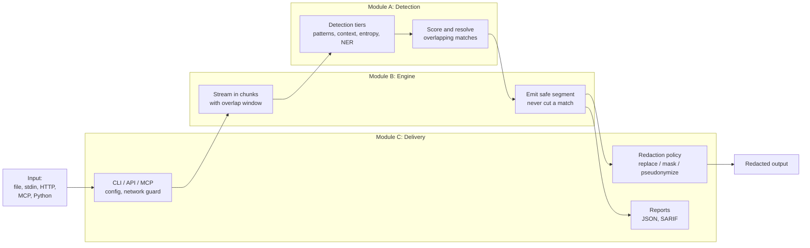

# SafeStream-Redactor: The Three Modules

SafeStream-Redactor finds and removes personal data and credentials from text of any
size. The project divides into three modules. Each one answers a different question,
and the product only works when all three do their job:

| | Module | The question it answers | If it were missing |
|---|---|---|---|
| **A** | [Detection Intelligence](#module-a--detection-intelligence) | *What in this text is sensitive?* | Nothing is found; the tool copies secrets straight through. |
| **B** | [Streaming Engine & Scale](#module-b--streaming-engine--scale) | *How do we process any amount of text, fast, with fixed memory and without missing anything?* | Large files exhaust memory, and secrets split across chunk boundaries leak. |
| **C** | [Delivery, Interfaces & Security](#module-c--delivery-interfaces--security) | *How do people and systems use it safely, and how does it reach them?* | No one can run it, output has no safe format, and data could leave the machine. |

Every source file and every test file belongs to exactly one module; nothing is shared
or left unassigned. Project-wide documents (`README.md`, `CHANGELOG.md`,
`SYSTEM_DESIGN.md`, `docs/architecture/`, the research paper in `paper/`) describe the
system as a whole and are shared by all three.

---

## How the three modules work together

A single redaction run passes through all three modules:

The modules meet at three small, stable contracts:

| Contract | From → To | What crosses it |
|---|---|---|
| `Detector.detect(text) -> list[Detection]` plus `StreamingRequirements` | A → B | Found spans, and how long a span each detector can emit. B sizes its overlap window from these declarations. |
| `Redactor` (`redact`, `redact_stream`, `redact_file`, `detect_stream`) and `RedactionStats` | B → C | The streaming API every interface calls, plus content-free counts. |
| `RedactionPolicy.apply(text, detections)` and the config loader | C → B/A | How matches are rewritten, and which detectors and settings a run uses. |

---

## Why the three modules are equally important

The three modules differ in shape, but each one is a hard dependency of the product and
each one carries the project's core claims:

| | A: Detection | B: Engine | C: Delivery |
|---|---|---|---|
| Source code | 3,529 lines | 2,510 lines (incl. Rust core) | 2,222 lines + ~870 lines of CI, Docker and release config |
| Test files / test cases | 14 / 199 | 19 / 225 | 10 / 113 |
| Headline guarantee | 29 entity types; 1.000 / 1.000 precision/recall on the CI corpus | Output is identical at every chunk size and worker count; memory is constant | Nothing but the redacted text and content-free counts leaves the tool |
| Formal or measured evidence | Validators, labelled benchmarks, RedactionBench | Three theorems in `docs/FORMAL_MODEL.md`; 1 GB redacted under a 16 MB memory cap | Released to PyPI with provenance; reproducible container image |

A tool that detects perfectly but cannot stream a 100 GB log is unusable (A without B).
A fast engine with weak detection redacts nothing (B without A). And both are worthless
if nobody can install them, the output format leaks the secret, or the process can send
data over the network (A and B without C).

---

## Module A — Detection Intelligence

### Purpose

Decide which parts of a piece of text are sensitive, label each one with a type, and
score how confident that decision is. This is the privacy judgement of the whole
product.

### Why it matters

Every other module assumes this one is right. A missed credential is a leak no matter
how fast or well packaged the tool is; a false match destroys useful text. Module A is
where the balance between **recall** (miss nothing) and **precision** (redact nothing
harmless) is set and measured.

### What it contains

| File | Role |
|---|---|
| `detectors/deterministic.py` | Tier 1: regex patterns for 22 structured types (emails, cards, SSNs, IPs, phones, AWS/GitHub/Slack/Stripe/Google/OpenAI/Anthropic keys, JWTs, private keys, …), each paired with a validator |
| `detectors/labeled_id.py` | Label-anchored identifiers: promotes a bare number to a redaction only when a cue names it (`Student ID: 202184673`, `DOB: 03/08/1996`) |
| `detectors/contextual.py` | Tier 3: raises or lowers confidence from nearby words (`ssn:` boosts, `example`/`test` suppresses) |
| `detectors/entropy.py` | Statistical tier: Shannon-entropy detection of undocumented secrets, plus the compound-secret tier for passwords with embedded symbols |
| `detectors/custom.py` | The user's own words and regexes |
| `detectors/gazetteer_ner.py`, `semantic_ensemble.py`, `name_data.py` | Model-free name and organisation detection from honorifics, suffixes and form cues, with STRICT and HIGH_RECALL policies |
| `detectors/ner.py`, `onnx_ner.py` | Optional neural tiers: spaCy, or an on-device ONNX model (no data egress) |
| `detectors/base.py`, `registry.py` | The `Detector` protocol, `StreamingRequirements`, and third-party plugin discovery through entry points |
| `entities.py` | The 29 `EntityType`s, the `Detection` record, and overlap resolution (highest confidence wins, then the longest span) |
| `calibration.py` | Learned calibration: a dependency-free logistic model that turns hand-set confidences into real probabilities |

Evaluation assets: `benchmarks/generate_dataset.py`, `generate_hard_dataset.py`,
`run_benchmark.py`, `evaluate.py`, `calibrate.py`, `baseline.py` (comparison with
Presidio) and `benchmarks/redactionbench/` (the external RedactionBench harness).

### How it works

- **Layered tiers, cheapest first.** Deterministic patterns catch structured data with
  near-perfect precision; context, entropy and name tiers add recall where patterns
  cannot reach.
- **A match alone is never enough.** Validators reject impossible values: the Luhn
  checksum for cards, SSN area/group rules, IPv4 octet ranges, a real IPv6 parse, and
  phone digit counts.
- **Cheap prefilters.** A pattern's regex runs only if the text contains one of its
  guaranteed literal anchors (`@`, `AKIA`, `eyJ`, …). This is an optimisation only; a
  differential test proves output is identical with it switched off.
- **Adversarial-input safety.** Patterns are written or scanned to run in linear time.
  The e-mail tier uses an `@`-anchored scanner, and the labeled-ID separator avoids
  quadratic backtracking, so hostile input cannot stall the tool.
- **Every tier declares its reach.** Each detector states the longest span it can emit
  and the context it reads (`StreamingRequirements`). This is what allows Module B to
  guarantee that nothing is lost at a chunk boundary.

### Evidence

- **CI quality gate on every pull request:** precision 1.000 / recall 1.000 on the
  synthetic corpus, and 0.999 / 1.000 on the adversarial corpus (the gate requires
  ≥ 0.999 and ≥ 0.995 respectively).
- **RedactionBench** (external dataset, 200 documents, streaming): mandatory-content
  recall 0.708 at 0.754 character precision for the core tiers, with zero new false
  positives on a benign-prose control set (`benchmarks/redactionbench/RESULTS.md`).
- **199 test cases**, including property-based tests and a differential check of the
  prefilter.

### Honest limits

Free-text names and street addresses need the optional NER tiers, and even then
detection is best-effort. A near-perfect RedactionBench score is not achievable for a
precision-respecting redactor; `benchmarks/redactionbench/AUDIT.md` explains why.

### Start reading

`entities.py` → `detectors/base.py` → `detectors/deterministic.py` →
`docs/DETECTORS.md`.

---

## Module B — Streaming Engine & Scale

### Purpose

Move text of any size through the detectors with **constant memory**, produce output
**identical** to processing the whole text at once, and use every CPU core, all
without ever cutting a sensitive value in half.

### Why it matters

This is what separates the project from ordinary PII tools, which load the whole
document into memory. It is also a privacy mechanism, not just a speed feature: a naïve
chunked scanner misses any secret that straddles a chunk boundary. Module B is where
that leak is designed out and proven absent.

### What it contains

| File | Role |
|---|---|
| `engine.py` | The streaming core: a rolling buffer with an overlap window, read-only left context, and boundary retreat so a match is never split. It also coalesces small input chunks. |
| `redactor.py` | The orchestrator: builds the detector tiers, derives the minimum safe overlap from their declarations, refuses unsafe settings, and writes files atomically |
| `parallel.py` | Splits one large file into byte ranges across processes. Workers cross-check every seam (the *seam valve*) and fall back to the sequential pass on any disagreement. |
| `scheduler.py` | Redacts whole directory trees in parallel, capping workers by both CPU count and available RAM |
| `memory_budget.py` | Admission control for `--memory-limit`: plans worker counts, refuses configurations that cannot fit (exit code 3), and enforces the limit in the kernel with `RLIMIT_AS` |
| `detectors/_lookaround_free.py` + `native/src/lib.rs` | The optional Rust core: pattern re-expressions the native engine can run, and the compiled scanner itself, which releases the GIL and is byte-identical to Python |
| `memstream/` | In progress: the event codec of a planned crash-safe event log (its write-ahead log is not written yet, and nothing in the redaction path uses it). Excluded from the published wheel and sdist. |

Performance assets: `benchmarks/parallel_speedup.py`, `scale_memory.py`,
`zero_copy_read.py`, `native_backend.py`, `re2_backend.py`, and the
`native-wheels.yml` workflow that builds and verifies the Rust wheels.

### How it works

- **Overlap sized from the detectors themselves.** The engine carries an overlap
  window at least as long as the longest span any active detector declares, so every
  entity is seen whole at least once. A configuration below that minimum is rejected
  (fail-closed).
- **Retreat instead of cut.** If a match straddles the planned output boundary, the
  boundary moves back to the start of the match.
- **Byte-identical parallelism.** Ranges are aligned to character boundaries, each
  worker scans a padding zone past its seams, and both neighbours must agree about
  every seam or the whole file is redacted sequentially instead.
- **Bounded work for any input shape.** Tiny chunks, such as a line-by-line stream, are
  coalesced, and overlap resolution runs in O(n log n), so throughput does not collapse
  on unusual input.
- **Optional native speed.** The Rust core runs the deterministic tier 7–49× faster,
  and a runtime check falls back to pure Python if its pattern set ever differs.

### Evidence

- **Three theorems** in `docs/FORMAL_MODEL.md`: streaming equivalence, parallel
  byte-identity with safe fallback, and the constant-memory bound. Tests check their
  constants directly (`test_formal_constants.py`).
- **1 GB redacted under a 16 MB memory cap** (`tests/test_memory.py`; CI runs a 64 MB
  variant on every pull request).
- **Measured speed:** about 3.7× on 4 cores for a single large file. Line-by-line
  streaming is about 150× faster than before the coalescing fix, now matching 64 KB
  chunks.
- **225 test cases**, including chunk-boundary attacks, property-based equivalence
  tests, and native-versus-Python byte-identity run against the built wheel in CI.

### Honest limits

The Rust core covers the deterministic tier only, so end-to-end speed-up is smaller
than its per-tier numbers. On Python 3.10 and 3.11, whose Unicode data is older than
the Rust core's, IP addresses written in the newest digit scripts are detected by the
native core but not by pure Python. `memstream` is unfinished.

### Start reading

`engine.py` → `redactor.py` → `docs/FORMAL_MODEL.md` → `parallel.py`.

---

## Module C — Delivery, Interfaces & Security

### Purpose

Turn the engine into something people and systems can actually use: a command-line
tool, a Python library, a local REST server, an AI-agent (MCP) server and a CI secret
gate. Control exactly what the output looks like, make sure nothing sensitive leaks
through reports or the network, and ship it reproducibly to PyPI and as a container.

### Why it matters

This is where users meet the product and where most real-world leaks would happen: a
report that echoes the secret it found, an HTTP endpoint that logs request bodies, a
plugin that phones home, a container that runs as root. Module C makes the privacy
promise hold at the edges.

### What it contains

| File / asset | Role |
|---|---|
| `policy.py` | How matches are rewritten: replace, mask (keep the last *n* characters), or keyed pseudonyms (HMAC-SHA256 tokens that stay consistent across a corpus), plus per-type replacement text |
| `report.py`, `sarif.py`, `severity.py` | Audit output that never contains matched text: JSON run reports, SARIF 2.1.0 for GitHub code scanning, and a severity scale per entity type |
| `cli.py`, `__main__.py` | The `safestream` command: `redact`, `detect`, `init-config`, `serve` and `mcp-serve` |
| `config.py` | TOML policy files; unknown keys are rejected, so a typo cannot silently weaken a policy |
| `api.py` | Local REST API on the standard library only: loopback by default, request bodies never logged, size-capped |
| `mcp_server.py` | Model Context Protocol server so AI assistants can scan and redact without the raw secret ever crossing the tool boundary |
| `netguard.py`, `netguard_hard.py` | Offline guards: an in-process block on outbound connections (on by default), and kernel-enforced modes on Linux (`seccomp`, network namespace) |
| `__init__.py`, `src/README_PYPI.md`, `pyproject.toml` | The public Python API, the PyPI page, and packaging metadata |
| `Dockerfile`, `docker/`, `.dockerignore` | Reproducible, non-root, digest-pinned container image |
| `action.yml`, `.pre-commit-hooks.yaml` | GitHub Action and pre-commit hook for secret scanning |
| `.github/workflows/` (`ci`, `publish`, `docker`), `dependabot.yml` | CI across 5 Python versions and 3 operating systems, release automation, dependency updates |

Guides: `docs/rest-api.md`, `docs/MCP.md`, `docs/CI_CD.md`, `docs/RELEASING.md`,
`docs/DEMO.md`, `SECURITY.md`.

### How it works

- **One engine, many doors.** Every interface forwards to the same `Redactor`, so the
  CLI, REST, MCP and library paths produce identical results.
- **Content-free by construction.** Reports, SARIF files, logs and MCP responses carry
  types, positions, counts and severity, never the matched value.
- **Offline by default on the command line.** `safestream redact` and `detect` run
  with outbound network access blocked (`--allow-network` turns this off), and Linux
  users can make it kernel-enforced with `--offline-hard`.
- **Byte-faithful I/O.** Line endings and encodings pass through unchanged, and output
  files are replaced atomically, so a crash never leaves a half-redacted file that
  looks complete.
- **Gated releases.** A release publishes only if the tag matches the version, the
  metadata passes `twine check`, and both the wheel and the source archive install and
  redact correctly in a clean environment. Uploads use PyPI trusted publishing, with
  provenance attestations.

### Evidence

- **Released:** version 0.4.0 is on PyPI with provenance attestations for the wheel and
  the source archive.
- **Container:** built with `SOURCE_DATE_EPOCH` and timestamp rewriting, two clean
  builds produce the same image digest. It runs as uid 10001 and works with a read-only
  filesystem, no capabilities and no network (checked by the release smoke test).
- **CI matrix:** Python 3.10–3.14 on Linux, macOS and Windows, a 95 % coverage gate,
  and `pip-audit` for known vulnerabilities.
- **113 test cases**, including CLI, REST and MCP end-to-end tests and network-guard
  tests.

### Honest limits

The REST and MCP servers run detection over the whole request body (capped at 8 MiB
and 4 MiB) instead of streaming it, the REST server does not limit concurrent
connections, and neither server nor the Python library installs the network guard.
Third-party detector plugins load only when enabled (`load_plugins=True`,
`--enable-plugins`, or `[plugins] enabled = true`). The in-process network guard is a safety
net, not a security boundary; the kernel-enforced modes are Linux only.

### Start reading

`cli.py` → `policy.py` → `api.py` / `mcp_server.py` → `docs/RELEASING.md`.

---

## Where each module stands

| | A: Detection | B: Engine | C: Delivery |
|---|---|---|---|
| Most mature | Structured PII and credentials | Streaming, parallelism, memory bounds | CLI, packaging, CI/CD |
| Next improvement | Broader free-text name/address recall without losing precision | Extend the Rust core beyond the deterministic tier; finish or retire `memstream` | Stream REST/MCP requests, limit server concurrency |
| Key document | `docs/DETECTORS.md` | `docs/FORMAL_MODEL.md` | `docs/RELEASING.md` |
