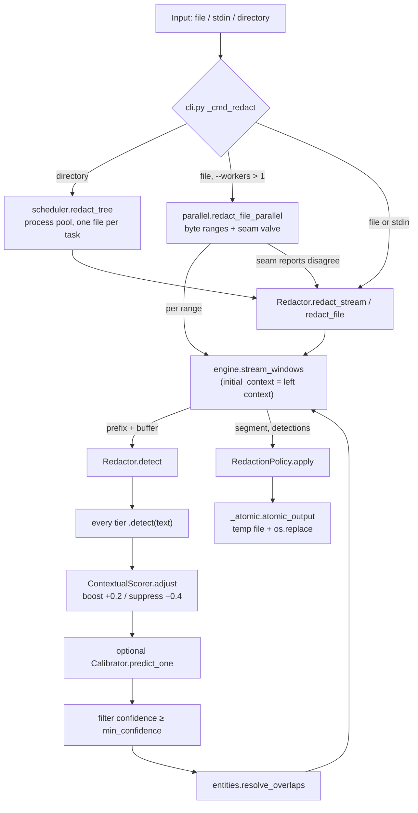

# SafeStream-Redactor: system architecture and codebase reference

A file-by-file technical reference for SafeStream-Redactor 0.4.0 (Python package
`safestream-redactor`, optional Rust extension `safestream-redactor-native`). It
covers what each module does, how data moves between them, the arithmetic that keeps
streaming output equal to a whole-document pass, the security boundaries and their
gaps, and measured performance.

References are `path:line` against this branch. Line numbers point at the
definition named; they move as the code changes. Where this document and the code
disagree, the code is right.

**Corrections to common assumptions.** Each one is explained in the section noted.

| Assumption | What the code does |
| --- | --- |
| Overlap resolution lives in the engine | `resolve_overlaps` is in `entities.py:81`; `Redactor.detect` calls it (§2.2) |
| Atomic writes are durable (`fsync`) | `_atomic.py` gives atomic *replacement* (`os.replace`) but never calls `fsync`; after a power loss the file can be empty or old (§4.6) |
| Network isolation uses a local proxy | No proxy exists. There is an in-process socket monkeypatch (`netguard.py`) and an opt-in kernel mode (`netguard_hard.py`) (§4.2) |
| `--offline-hard` fails closed | It warns and continues with the in-process guard when the kernel refuses (`cli.py:932`) (§4.3) |
| The seccomp filter is airtight | It is 9 BPF instructions with known bypasses: a foreign `AUDIT_ARCH` (i386 compat syscalls) is allowed, and so is the x32 ABI (§4.3) |
| The REST API and MCP server stream | Both call `Redactor.detect` on the whole request string. Bodies are capped (8 MiB / 4 MiB) instead (§2.10) |
| Exit code 1 means "error" | Exit 1 means an I/O or validation error **or** `detect --fail-on-detect` found something. Exit 3 is resource exhaustion, and `fanotify` uses exit 2 (§2.9) |
| Zero false negatives / false positives | Not achieved by any configuration; measured recall on real documents is 0.41–0.54 by character (§5.3) |

---

## Contents

1. [System overview](#1-system-overview)
2. [Core engine and file map](#2-core-engine-and-file-map)
3. [Streaming and window-boundary mathematics](#3-streaming-and-window-boundary-mathematics)
4. [Security, sandbox and threat model](#4-security-sandbox-and-threat-model)
5. [Performance, benchmarks and trade-offs](#5-performance-benchmarks-and-trade-offs)
6. [Appendix: repository map](#6-appendix-repository-map)

---

## 1. System overview

SafeStream-Redactor finds personal data and credentials in text and replaces them. It
runs in five ways that share one detection pipeline:

| Surface | Entry point | Input model |
| --- | --- | --- |
| CLI `redact` / `detect` | `cli.py:989` `main` | Streamed: files, directories, stdin |
| Library | `redactor.py:51` `Redactor` | Strings, chunk iterators, files |
| REST API (`serve`) | `api.py:189` `serve` | Whole JSON body, capped at 8 MiB |
| MCP stdio server (`mcp-serve`) | `mcp_server.py:304` `serve_stdio` | Whole tool argument, capped at 4 MiB |
| DLP daemon (`fanotify`) | `watch.py:330` `DlpWatcher` | Files in watched trees, streamed from a file descriptor |

### 1.1 Layered architecture

```
┌──────────────────────────────────────────────────────────────────────────────┐
│ Surfaces   cli.py · api.py · mcp_server.py · watch.py · ui/                  │
├──────────────────────────────────────────────────────────────────────────────┤
│ Hardening  netguard.py · netguard_hard.py · memory_budget.py · _atomic.py    │
├──────────────────────────────────────────────────────────────────────────────┤
│ Execution  scheduler.py (many files) · parallel.py (one file, many cores)    │
├──────────────────────────────────────────────────────────────────────────────┤
│ Streaming  engine.py  stream_windows / stream_transform / read_chunks        │
├──────────────────────────────────────────────────────────────────────────────┤
│ Pipeline   redactor.py  Redactor.detect → policy.py  RedactionPolicy.apply   │
│            entities.py  Detection, resolve_overlaps                          │
├──────────────────────────────────────────────────────────────────────────────┤
│ Tiers      detectors/: deterministic · labeled_id · entropy (+compound)      │
│            contextual · custom · ner · onnx_ner · gazetteer · ensemble       │
├──────────────────────────────────────────────────────────────────────────────┤
│ Native     native/ (Rust, PyO3): patterns · digits · labeled · secrets ·     │
│            context · unicode · offsets — optional, byte-identical            │
└──────────────────────────────────────────────────────────────────────────────┘
```

### 1.2 Data flow of one `redact` run



### 1.3 Detection tiers in run order

The order is fixed by `Redactor.__init__` (`redactor.py:105`). All tiers run on the
same window and produce candidate `Detection`s. Arbitration happens afterwards, so
order affects only tie-breaking in `resolve_overlaps`, which is order-independent
(it sorts first).

| # | Tier (`name`) | Module | On by default | Emits | `required_overlap` |
| --- | --- | --- | --- | --- | --- |
| 1 | `deterministic` | `detectors/deterministic.py:737` | yes | 23 regex+validator patterns (email, private keys, JWT, cloud and SaaS tokens, URL credentials, SSN, IPv4/6, card, phone) | 8192 |
| 2 | `labeled_identifier` | `detectors/labeled_id.py` | yes, when SSN/PHONE/CARD/DOB/ID types are in scope | values named by a cue word (`Student ID: …`) | max(64+8, 96) = 96 |
| 3 | `custom` | `detectors/custom.py` | when words/regexes are given | literal words, user regexes | 8192 |
| 4 | `ner` | `detectors/ner.py` | `--ner` | PERSON/ORG/LOC (spaCy) | max(256+256, 256) = 512 |
| 5 | `gazetteer_ner` | `detectors/gazetteer_ner.py` | library flag | names/orgs from honorifics and lists | max(64+8, 64) = 72 |
| 6 | `semantic_ensemble` | `detectors/semantic_ensemble.py` | library flag | calibrated name/org evidence | max(128+32, 40+2048+128) = 2216 |
| 7 | `onnx_ner` | `detectors/onnx_ner.py` | `--onnx` | PERSON/ORG/LOC (local ONNX) | 512 |
| 8 | `entropy` | `detectors/entropy.py:52` | yes, when SECRET is in scope | high-entropy base64/hex runs | 8192 |
| 9 | `compound_secret` | `detectors/entropy.py:162` | same as `entropy` | symbol-bearing password-like runs | 8192 |
| 10 | plugins | `detectors/registry.py` | `--enable-plugins` | anything | declared, else 8192 |
| 11 | `contextual` | `detectors/contextual.py:54` | yes, when SSN is in scope | bare 9-digit SSNs after an SSN cue | max(9, 48) = 48 |

`required_overlap` comes from `StreamingRequirements.required_overlap`
(`detectors/base.py`): `max(max_span + right_context, left_context)`. The engine's
safe minimum is the maximum over active tiers. With the defaults that is **8192**
(deterministic, entropy and compound all declare `max_span = 8192`).

---

## 2. Core engine and file map

### 2.1 `engine.py`: the streaming kernel (219 lines)

| Line | Symbol | Role |
| --- | --- | --- |
| 32 | `DEFAULT_CHUNK_SIZE = 64 * 1024` | characters per `read()` in `read_chunks` |
| 40 | `DEFAULT_OVERLAP = 8 * 1024` | characters of carried context; equals every built-in `max_span` |
| 46 | `required_overlap(detectors)` | max of the tiers' `required_overlap`, default 8192 |
| 59 | `read_chunks(path, chunk_size, encoding)` | `open(..., errors="replace", newline="")`; yields `f.read(chunk_size)`. `newline=""` keeps `\r\n` and lone `\r` byte-for-byte |
| 74 | `stream_windows(chunks, detect, overlap, *, initial_context, min_emit)` | the windowing algorithm (§3) |
| 159 | `_retreat_boundary(detections, emit_upto)` | moves the emit point left out of any straddling detection, to a fixpoint |
| 182 | `_warn_if_overlong(...)` | logs once per stream when a span is longer than `overlap` (assumption A1 broken) |
| 209 | `stream_transform(...)` | `stream_windows` + `apply` per segment |

`stream_windows` keeps two strings:

- `prefix`: the last `overlap` characters already **emitted**. It is read-only
  context: detectors see it, but any detection that starts inside it is discarded
  (`window_detect`, inner function at line 103).
- `buffer`: text not yet emitted, accumulated from `pieces`.

A pass runs once `buffered ≥ need`, where `min_emit = max(overlap, min_emit, 1)` and
`need = overlap + min_emit`. `Redactor` passes `min_emit = chunk_size`, so the
defaults give `need = 8192 + 65536 = 73728`. Coalescing small chunks up to `need`
keeps the rescan cost per emitted character constant, whatever the caller's chunk
size (a line iterator used to trigger a full rescan per line, ~100x slower).

### 2.2 `entities.py` and `redactor.py`: the detection pipeline

`Detection` (`entities.py:61`) is a mutable dataclass: `start`, `end`, `text`,
`entity_type`, `confidence`, `source`, `meta: dict[str, str]`. It is mutable because
the engine rebases offsets in place and the contextual scorer adjusts confidence in
place.

`Redactor.detect` (`redactor.py:276`) is the complete pipeline:

```python
raw = []
for detector in self._detectors:          # every tier, same text
    raw.extend(detector.detect(text))
self._scorer.adjust(text, raw)            # contextual boost / suppress, in place
if self.calibrator is not None:           # optional learned probabilities
    for det in raw:
        det.confidence = self.calibrator.predict_one(det)
confident = [d for d in raw if d.confidence >= self.min_confidence]   # default 0.5
return resolve_overlaps(confident)
```

`resolve_overlaps` (`entities.py:81`) keeps at most one detection per character:

1. Sort by `(-confidence, start - end, start)`: highest confidence first, then
   longest, then leftmost. A Luhn-valid card (0.9) beats the phone (0.6) inside it.
2. Keep a sorted list `spans` of accepted `(start, end)` pairs. Accepted spans never
   overlap, so their ends are sorted too, and the only accepted span that can
   overlap a candidate `[s, e)` is the last one starting before `e`:
   `i = bisect_left(spans, (e,)); reject if i and spans[i-1][1] > s`.
3. `insort` the accepted span. Each candidate costs one bisection plus one list
   insert, so this is O(n log n) comparisons; the list insert is a memmove, O(n) in
   the worst case but small in practice. The old linear scan was O(n²).
4. Return the kept detections sorted by `start`. `RedactionPolicy.apply` requires
   that order.

Construction (`redactor.py:105`) validates `chunk_size`, `overlap` and
`min_confidence` (`_validate_streaming_args`, line 29), builds the tier list (§1.3)
and calls `enforce_overlap_safety` (line 216). That method **raises `ValueError`**
when `overlap < min_safe_overlap`, unless `allow_unsafe_overlap=True`, which turns it
into a warning.

`redact_file` (line 331) refuses `input == output` (`os.path.samefile`), then streams
`read_chunks → redact_stream → atomic_output`. With `workers > 1` it delegates to
`parallel.redact_file_parallel`.

### 2.3 `policy.py`: rendering replacements

`RedactionPolicy.render` (`policy.py:63`), in priority order:

1. `replacements[entity_type]`: a fixed per-type string, if one is set.
2. `MASK`: `keep = min(max(0, mask_keep_last), n // 2)`; output
   `mask_char * (n - keep) + text[n-keep:]`. Never more than half is shown, so a
   4-character PIN with `keep_last=4` shows 2.
3. `PSEUDONYMIZE`: `HMAC-SHA256(key, text)`, hex, truncated to `pseudonym_length`
   (default 16, allowed 8–64) and rendered `<TYPE_hex>`. Deterministic by design, so
   it reveals equality and can be brute-forced over small domains (all SSNs) by
   anyone holding the key.
4. `REPLACE`: `replacement` (default `[REDACTED]`).

`apply` (line 83) concatenates the gaps and renders in one pass, O(len(text)).

### 2.4 `parallel.py`: one file across many cores

| Line | Symbol | Role |
| --- | --- | --- |
| 63 | `MIN_RANGE_BYTES = 8 MiB` | smallest range worth a worker |
| 74 | `splittable_encoding` | UTF-8 and single-byte codecs only; other encodings run sequentially |
| 84 | `SeamReport(rel_start, rel_end, entity_type)` | one worker's view of one seam |
| 106 | `_align_utf8` | move forward past continuation bytes (`0x80–0xBF`) |
| 120 | `_align` | UTF-8 alignment, and never between `\r` and `\n` |
| 137 | `_split_points` | `size * i // n` per seam, aligned, deduplicated |
| 147 | `_decode_bytes` | incremental decoder, `errors="replace"`, same as the sequential reader |
| 174 / 187 | `_read_chars_before` / `_read_chars_after` | read `n` characters around a byte offset (at most 4 bytes per character) |
| 242 | `_find_straddler` | the detection with `start < seam < end`, if any |
| 251 | `_redact_range` | the worker |
| 381 | `plan_ranges` | `n = min(workers, size // 8 MiB)`; coarsen until every range is ≥ `4 * overlap` |
| 400 | `redact_file_parallel` | orchestrator, seam valve, assembly |

The worker (`_redact_range`) for range `[byte_start, byte_end)`:

```
      context-only     scanned pad    the range itself                 scanned pad
   ┌──────────────┬──────────────┬──────────────────────────────────┬──────────────┐
   │  ov chars    │  ov chars    │  bytes [byte_start, byte_end)     │  ov chars    │
   └──────────────┴──────────────┴──────────────────────────────────┴──────────────┘
    initial_context  left_pad      seam_start ............ seam_end    right_pad
    (never emitted)  (scanned; cut   (local char positions)            (not for the
                      at start_cut)                                     last range)
```

1. The first range has no pads. Every other range reads `2·ov` characters before
   `byte_start`: the older `ov` becomes `initial_context` (prefix-only context) and
   the newer `ov` becomes `left_pad` (scanned).
2. `feed()` yields `left_pad`, the decoded range, then `right_pad` (`ov` characters
   after `byte_end`).
3. It runs `stream_windows(feed(), redactor.detect, ov, initial_context=context)`.
4. **Start cut:** once `cursor ≥ seam_start + 2·ov`, every detection that crosses
   `seam_start` has been seen. `start_cut` is the straddler's end, or `seam_start`
   when there is none. The left worker owns that straddler.
5. **Flush:** segments ending at or before `cursor − 2·ov` cannot be affected by the
   (still unknown) end seam. They are cut to `[max(seg_start, start_cut), …)`,
   redacted and written to a part file. `all_dets` is pruned to the same horizon, so
   memory stays at the engine buffer plus `2·ov`.
6. **End cut:** at end of stream, `end_cut` is the straddler's end at `seam_end`, or
   `seam_end`. The left worker emits the whole straddler.
7. It returns `_RangeResult(start_seam=…, end_seam=…)`.

The orchestrator then runs the **seam valve** (line 475): for each adjacent pair it
requires `left.end_seam == right.start_seam`, comparing relative start, relative end
and type. On any mismatch it discards all parts and calls the sequential path
(`ParallelOutcome.fell_back=True, fallback_reason="seam"`). Otherwise the parts are
concatenated into `atomic_output_bytes(out_path)` in 1 MiB copies.

Workers start through `_init_worker` (line 220). It installs `netguard` when
`offline_guard` is set and applies a per-worker `RLIMIT_AS` when
`worker_address_space_limit` is set. Detectors cross the process boundary by pickle.
`NativeBacked` (`detectors/deterministic.py:711`) pickles the backend name and
re-imports the extension on unpickle; `NERDetector` pickles its model name and
reloads spaCy.

### 2.5 `scheduler.py`: many files

- `_PER_WORKER_BASE = 96 MiB` (line 24).
- `ram_aware_workers` (line 53): an explicit request wins (floored at 1). Otherwise
  `min(cpu_count, MemAvailable // (96 MiB + chunk_size + overlap))`, with
  `MemAvailable` read from `/proc/meminfo` (line 41).
- `redact_tree` (line 102):
  - `rglob("*")` keeps regular files and **skips symlinks**, so a link cannot pull an
    out-of-tree file in.
  - Output paths mirror the input tree.
  - With more than one worker it uses a `ProcessPoolExecutor` and `as_completed`
    (for progress), and returns results in input order.
  - With one worker it runs in-process inside `netguard.enforced()`, so the guard
    does not outlive the call in a library user's process.

### 2.6 `_atomic.py`: output replacement (79 lines)

`_replace_on_success` (line 40):

```python
fd, tmp = tempfile.mkstemp(dir=dirname(path) or ".", prefix=basename(path) + ".", suffix=".tmp")
try:
    yield fd
    _match_destination_mode(tmp, path)   # existing mode, or 0o666 & ~umask
    os.replace(tmp, path)                # atomic rename on the same filesystem
except BaseException:                    # includes KeyboardInterrupt
    os.unlink(tmp)                       # (errors suppressed)
    raise
```

`atomic_output` (line 62, text, `newline=""`) and `atomic_output_bytes` (line 76)
wrap it. They are used by `redact_file`, stdin-to-file runs (`cli.py:567`), the
parallel assembler, JSON reports and the DLP daemon's in-place redaction. Nothing
calls `os.fsync` on the file or the directory (§4.6).

### 2.7 Detection tiers in detail

#### `detectors/deterministic.py`: tier 1

- `Pattern` (line 350) holds `regex`, `confidence`, an optional `validator`, a
  capture `group`, and prefilter hints: `anchors` (case-sensitive literals),
  `anchors_lower`, `needs_digit`, and an optional linear `scanner`.
- `_detect_python` (line 825) skips a pattern when the window has no digit
  (`needs_digit`) or none of its anchors. This is a C-level substring test, much
  cheaper than the regex it avoids. A differential test pins output with
  `prefilter=False`.
- `_PATTERNS` (line 413) has 23 entries with these confidences: email 0.95,
  private_key 0.99, JWT 0.95, AWS key 0.98, GitHub 0.98, Slack token 0.98, Slack
  webhook 0.98, Stripe 0.97, Google API 0.95, SendGrid 0.98, Twilio 0.9, npm 0.98,
  Anthropic 0.98, OpenAI 0.95, URL credentials 0.97, AWS secret 0.9, generic
  `api_key` 0.75 (group 1, anchors `key/secret/token/pass/pwd`), credit card 0.9,
  SSN 0.85, IPv4 0.9, IPv6 0.9, structured phone 0.6, bare phone 0.45.
- The bare phone pattern scores below the 0.5 threshold. It survives only when the
  contextual tier boosts it (+0.2 from `phone/tel/mobile/cell/fax/call`).

Validators, all pure and allocation-light:

| Line | Function | Rule |
| --- | --- | --- |
| 34 | `luhn_ok` | 13–19 digits, Luhn mod 10 |
| 49 | `ssn_ok` | area ∉ {000, 666, 9xx}, group ≠ 00, serial ≠ 0000 |
| 68 | `E164_COUNTRY_CODES` | 215 assigned codes (libphonenumber metadata); a prefix code |
| 289 | `e164_country_code_ok` | after `+`: a 1–3 digit group must be a code exactly; a longer run must start with one; a leading 0 is rejected (`int("020") == 20` was a bug) |
| 311 | `phone_ok` | not ISO-date shaped, not SSN shaped, 7–15 digits, valid E.164 when it starts with `+` |
| 323 | `ipv4_ok` | each octet `0` or no leading zero and ≤ 255 |
| 336 | `ipv6_ok` | `ipaddress.IPv6Address` after stripping a `%zone` |

`_email_scan` (line 377) replaces `finditer` for email. `finditer` is O(n²) on a
long `a.a.a…` run (32K characters took ~1.3 s). The scanner visits only `@`
positions, walks the local part back to the previous match end, and makes one
`regex.match` from the first word boundary. It yields the same `re.Match` objects.

Native wiring:

- `_load_native` (line 621) imports `safestream_native`.
- `_native_matches_spec` (line 662) checks the extension against the Python pattern
  sources.
- `_NATIVE_API` (line 699) lists the functions a compatible build must export.
- Version skew or an absent extension falls back to Python; `"native"` warns,
  `"auto"` is silent.
- `_detect_hybrid` (line 791) calls `scan_text`. On `None` (ambiguous Unicode, §2.8)
  the whole window goes to Python; otherwise it keeps native results for covered
  types and runs Python only for uncovered ones.

#### `detectors/labeled_id.py`: label-anchored identifiers

- `_MAX_VALUE = 64` (line 40) and `_CUE_WINDOW = 96` (line 41).
- `_SEP` (line 53) allows `: = # - .`, whitespace and short connectives
  (`number|num|no|id|code|is|of`). The trailing punctuation owns its whitespace, so
  the regex stays linear; the earlier form took ~19 s on a cue followed by 32K
  spaces.
- `_RULES` (line 61) has six rules, compiled `\b(?:cue)\b{_SEP}(value)` with
  `re.IGNORECASE`:

| Cue | Value | Type | Conf. |
| --- | --- | --- | --- |
| `ssn`, `social security`, `sin`, `national id` | `\d{3}[-\s]?\d{2}[-\s]?\d{4}` or `\d{9}` | ID_NUMBER | 0.8 |
| `dob`, `date of birth`, `born` | `\d{1,4}[-/.]\d{1,2}[-/.]\d{1,4}` | DOB | 0.8 |
| `phone`, `tel`, `mobile`, `cell`, `fax` | `\+?\d[\d\s().-]{6,61}\d` | PHONE | 0.8 |
| `card`, `credit card`, `pan` | `(?:\d[ -]?){12,18}\d` | CREDIT_CARD | 0.85 |
| `account`, `iban`, `swift`, `routing`, … | IBAN shape or `\d[\d\s-]{4,62}\d` | ID_NUMBER | 0.8 |
| `employee`, `patient`, `passport`, `mrn`, `npi`, … | `[A-Za-z]{0,6}[-/]?\d[A-Za-z0-9-]{2,56}` | ID_NUMBER | 0.75 |

Only the value span is emitted. A match whose value starts more than 96 characters
after the cue is dropped (`_detection`).

#### `detectors/entropy.py`: statistical secrets

- `MAX_SPAN = 8192` (line 29); `_CANDIDATE = [A-Za-z0-9+/=_-]{20,8192}` (line 38).
- Runs longer than 8192 become consecutive capped pieces.
- `shannon_entropy` (line 43): `−Σ (c/n)·log2(c/n)`.
- `EntropyDetector` (line 52), defaults `min_length=24`, `base64_entropy=4.0`,
  `hex_entropy=3.0`, confidence 0.6. It rejects all-letter tokens. Hex tokens need
  length ≥ 32 and H ≥ 3.0; others need H ≥ 4.0.
- `CompoundSecretDetector` (line 162), defaults `min_length=20`,
  `entropy_floor=3.5`, `distinct_ratio=0.45`. The candidate alphabet adds
  `!#$%^&*~`. All four gates must hold:
  1. a special character sits between two alphanumerics;
  2. at least two of lower/upper/digit;
  3. distinct characters / length ≥ 0.45;
  4. H ≥ 3.5.

#### `detectors/contextual.py`: tier 3

- `_BOOST_TRIGGERS` (line 17), per type. Examples: SSN → `ssn`, `social security`;
  PHONE → `phone`, `tel`, `mobile`, `cell`, `fax`, `call`; API_KEY → `key`,
  `secret`, `token`, `password`, `credential`, `auth`.
- `_SUPPRESS_TRIGGERS` (line 28): `example`, `sample`, `dummy`, `test`, `fake`,
  `placeholder`, `lorem`, `xxx-xx`.
- `BOOST = 0.2`, `SUPPRESS = 0.4` (lines 43–44).

`adjust` (line 101) checks each detection:

- **boost** if a type trigger occurs in `text[start-48:start].lower()`;
- **suppress** if a suppress trigger occurs in `text[start-16:start].lower()` or in
  the detection text itself.

The confidence arithmetic always runs in Python. `detect` emits a bare 9-digit
number (`(?<![\d-])\d{9}(?![\d-])`) as SSN 0.8 when an SSN trigger is within 48
characters before it.

Suppression is a precision tool that an attacker can also use (§4.7). `api_key`
(0.75), phone (0.6) and entropy secrets (0.6) fall below 0.5 when `test` or `example`
appears up to 16 characters before them.

#### Other tiers

- `custom.py`: escaped literal words and user regexes; declares `max_span = 8192`.
- `ner.py`: spaCy `en_core_web_sm` by default, confidence 0.7, PERSON/ORG/LOC (and
  `_LABEL_MAP` types). On this branch it passes the whole window to `nlp(text)`.
  Streaming windows stay under ~148K characters (§3.4), but the whole-string
  API/MCP paths can exceed spaCy's 1,000,000-character `max_length` with `--ner`,
  which raises. The fix is on `feat/spacy-ner-default`.
- `onnx_ner.py`: a local `onnxruntime` token classifier (BIO/IOB2).
- `gazetteer_ner.py` and `semantic_ensemble.py`: model-free name/org evidence
  scoring. The ensemble derives `left_context` from its propagation window, and
  `tests/test_streaming_contract.py` checks declared ≥ actual context.
- `registry.py`: entry-point plugins, off by default. Plugin code runs with full
  process privileges.
- `_lookaround_free.py` (`LF_PATTERNS`, line 126): proven lookaround-free rewrites
  of tier-1 patterns, the basis for the DFA patterns in the native crate.

### 2.8 The native crate (`native/`)

A Rust library (`regex 1`, `regex-syntax 0.8`) with an optional `python` feature
(`pyo3 0.22`, `abi3-py310`). `cargo build --no-default-features` gives a plain Rust
library with no PyO3. All offsets inside Rust are **bytes**; the bindings convert to
**characters**.

`src/lib.rs` contains:

```rust
#![cfg_attr(not(test), deny(clippy::unwrap_used, clippy::expect_used, clippy::panic))]

pub struct RawMatch { pub start: usize, pub end: usize, pub pattern: u16 }
pub enum Scan { Exact, NeedsPython }

pub fn scan(text: &str, out: &mut Vec<RawMatch>) -> Result<Scan, Error> {
    out.clear();
    if unicode::needs_python(text) { return Ok(Scan::NeedsPython); }
    patterns::scan_regex(text, out)?;            // 20 regex patterns
    digits::scan_digits(text, SLOTS, out)?;      // card + 2 phone scanners
    Ok(Scan::Exact)
}
```

`SLOTS` is computed by a `const fn` at compile time, so a missing pattern is a build
error. The other entry points are `scan_labeled`, `scan_entropy`, `scan_compound`,
`scan_bare_ssn`, `adjust` and `warm_up`. `bench_hooks` is a hidden module for
Criterion.

| File | Contents |
| --- | --- |
| `patterns.rs` | `PATTERNS` (line 45): the 23 specs with name, confidence, source and `Kind` (`Simple`, `Ssn`, `Ipv4`, `Ipv6`, `Captured`, `AwsSecret`, `CreditCard`, `PhoneStructured`, `PhoneBare`). `rust_source` (line 200) rewrites `\s` to `[\s\x1C-\x1F]` (CPython's `\s` includes the four ASCII separators). `compile` (line 204) sets `SIZE_LIMIT = 16 MiB` and `DFA_SIZE_LIMIT = 4 MiB`. Lookaround is replaced by code checks: `ssn_boundary_ok` (249), `ipv4_boundary_ok` (268), `ipv6_boundary_ok` (302), `aws_after_ok` (311, which also rejects `ſ` U+017F and the Kelvin sign U+212A because they case-fold to ASCII letters in CPython's `(?i)`). `scan_regex` (323) runs `find_iter` per pattern; a single `RegexSet` measured ~6 MB/s and was rejected. |
| `digits.rs` | Linear transcriptions of the card and two phone regexes (§2.8.1). |
| `labeled.rs` | `SEP` (line 17) and `RULES` (line 20): the six labeled rules, compiled `(?i)`, returning `(match_start, value_start, value_end, rule)`. |
| `secrets.rs` | Entropy and compound scanners with a float uncertainty band (§2.8.2). |
| `context.rs` | `BOOST_TRIGGERS` (19), `SUPPRESS_TRIGGERS` (37), `lower_byte` (60), `scan_bare_ssn` (98), `adjust` (147), which returns `BOOSTED=1` / `SUPPRESSED=2` bits per span. |
| `unicode.rs` | `digit_value` (31) over 76 Nd blocks (Unicode 16.0); `is_digit` (48); `is_word` (59, `regex_syntax::is_word_character`); `ambiguity` (84); `needs_python` (115); `has_ambiguous_digit` (141). |
| `unicode_tables.rs` | Generated by `tools/gen_unicode_tables.py`: `WORD_AMBIGUOUS` (13,454 code points where `\w` differs across supported CPythons or from `regex`), `DIGIT_AMBIGUOUS` (110), `SPACE_AMBIGUOUS` (0), `FOLD_AMBIGUOUS` (U+0130–U+0131). |
| `offsets.rs` | `OffsetMap` (14) converts byte to char offsets. It sorts only the match offsets and counts non-continuation bytes between them (`(b as i8) >= -0x40`, vectorised), and is the identity for ASCII text. `ByteMap` (79) converts char to byte offsets for `adjust`. |
| `error.rs` | `Error::{Pattern, OutOfMemory}`; `try_push` (35) uses `try_reserve`, so a failed allocation becomes `MemoryError` in Python (exit 3) instead of an abort. |
| `python.rs` | `#[pyfunction]`s `scan_text` (61), `scan_labeled_text` (90), `scan_entropy_text` (143), `scan_compound_text` (166), `scan_bare_ssn_text` (190), `adjust_text` (219), `context_triggers`, `e164_country_codes`, `patterns`, `labeled_rules`, `digit_value_of`, `classify`, `needs_python`. The six scanning functions release the GIL (`py.allow_threads`) and uses a thread-local `Scratch` of reusable `Vec`s, so a scan allocates nothing once the buffers have grown (the result list for Python is the exception). |
| `corpus.rs` | Deterministic synthetic log corpus for benchmarks. |
| `benches/throughput.rs` | Criterion benches on a 4 MiB corpus at 0/1/10/50 % PII: `scan/whole`, `scan/windows` (64 KiB + 8 KiB overlap), `labeled`, `entropy`, `compound`, `regex_only`, `digits_only`, `floor_count_lines`. |
| `tests/properties.rs` | proptest: no panic on arbitrary Unicode or digit soup; cutting text into chunks with overlap preserves every match; a token split at every offset is found exactly once. |
| `examples/` | `dump_classes`, `profile_digits`, `per_pattern`. |

**Why `NeedsPython` exists.** Rust `regex` and CPython `re` disagree on some
characters: which ones are `\w` (the `\b` word boundaries depend on this), Unicode
digits, case folding (`İ`, `ı`). Rather than risk a different match, `needs_python`
returns true when an ambiguous code point appears:

- any `DIGIT`, `SPACE` or `FOLD` ambiguous character returns true;
- a `WORD`-ambiguous character returns true only when it sits next to a boundary
  anchor.

The Python tier then scans the **whole window**. Output stays identical; the cost is
speed on text with such characters.

#### 2.8.1 `digits.rs`: linear card and phone scanners

The card and phone regexes are greedy, variable-length, and guarded by negative
lookahead. CPython backtracks to a shorter match when the lookahead fails, which a
DFA plus post-filter cannot reproduce. `fancy-regex` was built and rejected: it
truncated under its backtrack limit (a missed detection) and gave no speedup. The
crate instead transcribes each regex and explores alternatives in CPython's priority
order:

- A `Window` (line ~43) holds up to `WIN = 48` characters from a candidate start,
  with `u8` byte offsets (48 × 4 = 192 bytes fits). Filling stops one character
  after the first non-consumable character. A match is bounded (card ≤ 37
  characters, phone ≤ 36), so each start position does constant work.
- `match_card` (line 140) handles `(?<![\d-])(?:\d[ -]?){12,18}\d(?![\d-])`. It
  builds the digit chain (each digit followed by an optional single `[ -]` then a
  digit) and tries `j = 18` down to `12`. The first end not followed by `-` or a
  digit is CPython's match. `luhn_ok` (line 165) uses `digit_value`, so Unicode
  digits count as in Python's `int()`.
- `match_phone_structured` (261) and `match_phone_bare` (306) do a depth-first
  search with greedy `{2,4}`/`{1,4}` repetitions, memoised in `Memo([u8; WIN*5])`:
  0 = unknown, 1 = fail, `end+2` = match.
- `e164_ok` (355) checks `E164_SET: [u64; 16]` (line 336), a 1000-bit set built at
  compile time, so a lookup is one shift and mask.
- `skip_to_candidate` (440) is SWAR. It loads 8 bytes as a `u64` and
  `word_may_start` (433) tests, branch-free:
  - any high bit (non-ASCII);
  - any byte in `0x30–0x39` (digit) via `has_between` (424, Hacker's Delight);
  - any byte in `0x28–0x2B` (a superset of `(` and `+`).
  When none match, it skips 8 bytes at once.
- `scan_digits` (456) keeps per-pattern resume points (`card_from`, `sphone_from`,
  `bphone_from`), because `finditer` never starts inside its own previous match. It
  evaluates the three lookbehinds against `prev`.

#### 2.8.2 `secrets.rs`: entropy with an uncertainty band

Python's `sum()` changed algorithm in 3.12 (Neumaier compensation), and `log2` is
not correctly rounded everywhere. So Rust cannot promise bit-identical entropy.
Instead:

- `entropy` (line 75) uses a stack histogram `[u32; 128]`, with no allocation.
- `certain(h, t)` (line 91) requires `|h − t| > BAND = 1e-9`. All faithful
  implementations agree to within ~1e-13 for tokens of ≤ 66 distinct ASCII
  characters and ≤ 8192 length.
- `format_safe(h)` (line 97) requires `h·100` to be more than 1e-6 from a `.5`
  rounding point, so `f"{h:.2f}"` in `meta["entropy"]` matches.
- Otherwise the token is `Verdict::Undecided` and Python classifies it. This is rare;
  an exact 4.0, for example, is 16 distinct characters used equally.
- `runs` (line 105) reproduces `re.finditer([class]{20,8192})` exactly: maximal runs,
  split into 8192-byte pieces, pieces shorter than 20 dropped.

### 2.9 `cli.py`: commands, flags, exit codes

Commands: `redact`, `detect`, `init-config`, `serve`, `mcp-serve`, `fanotify`, `ui`.
`main` (line 989):

1. Parse arguments. `_surface_library_warnings` attaches `_StderrWarnings`, so
   library warnings (unsafe overlap, overlong span, skipped plugins) reach stderr.
2. `init-config`, `serve`, `mcp-serve`, `fanotify` and `ui` return directly.
   `mcp-serve` and `fanotify` install `netguard` themselves. `serve` and `ui` bind
   sockets and do not install it.
3. `redact`/`detect`: install `netguard` unless `--allow-network`, then
   `_apply_offline_hard(--offline-hard)`.
4. Run the command, mapping exceptions to exit codes:

| Exit | Meaning |
| --- | --- |
| 0 | success (and `detect` without `--fail-on-detect`, or with it and no hits) |
| 1 | `OSError`/`ValueError` (bad path, bad config, unsafe overlap) **or** `detect --fail-on-detect` found something |
| 2 | `fanotify`: bad mode/directory, or enforcement unavailable (block mode without `CAP_SYS_ADMIN`); argparse usage errors also exit 2 |
| 3 | `ResourceExhaustionError` (budget admission refused) or `MemoryError` (the `RLIMIT_AS` cap refused an allocation) |

Key functions:

- `_build_redactor` (line 394) merges a TOML `--config` with CLI flags into one
  constructor call, so every validation runs on the final configuration. Scalars
  override the config, lists append, and `--ner`/`--onnx` only turn tiers on.
- `_plan_budget` (line 495) implements `--memory-limit` (§4.5).
- `_cmd_redact` (line 644) dispatches:
  - a directory goes to `redact_tree`;
  - `-o -` goes to stdout;
  - stdin goes through an atomic file stream;
  - `--workers > 1` goes to `redact_file_parallel` with a per-worker `RLIMIT_AS`;
  - anything else goes to `redact_file`.
- `_input_chunks` (line 591) decodes stdin bytes with the same incremental decoder
  and `errors="replace"` as files. `--chunk-size` is applied to `read()`, which
  counts **characters** for files and **bytes** for stdin.
- `_finish_run` (line 614) always warns when undecodable bytes were replaced with
  U+FFFD, because those bytes were never scanned.
- `_expand_inputs` (line 735, `detect`) skips symlinks, `.git`/`.hg`/`.svn` and
  binary files (a NUL byte in the first 8 KiB).
- `_cmd_detect` (line 758) streams, converts offsets to line and column with
  `LineTracker`, and prints text, JSON lines or SARIF. Matched text is hidden unless
  `--show-text`.
- `_cmd_serve` (line 847) warns when binding a non-loopback host.

### 2.10 `api.py` and `mcp_server.py`: service surfaces

**REST** (`api.py`):

- `ThreadingHTTPServer`, default `127.0.0.1:8000`.
- `dispatch` (line 50) is a pure function, so it can be tested without a server.
  Routes:
  - `GET /health`, `GET /version`;
  - `GET /detectors` (tier names and entity types);
  - `POST /redact` returns `{redacted, total_detections, detections_by_type}`;
  - `POST /scan` returns offsets, types, confidences and sources, never text.
- Handler hardening (`make_handler`, line 116):
  - `Transfer-Encoding` returns 411;
  - a non-numeric or negative `Content-Length` returns 400;
  - a body over `max_body_bytes` (8 MiB) returns 413 before the body is read;
  - every rejection sets `close_connection`, so an unread body cannot be parsed as
    the next request;
  - socket timeout 30 s (slow-loris);
  - `log_message` is a no-op.
- There is **no authentication**. Anyone who can reach the port can submit text and
  read `/redact` output.

**MCP** (`mcp_server.py`):

- Newline-delimited JSON-RPC 2.0 on stdio, protocol `2024-11-05`.
- Tools: `scan`, `redact`, `explain_detection`, `detectors`, `health`.
- `_require_text` (line 204) rejects over `MAX_TEXT_BYTES = 4 MiB`.
- `scan`/`explain_detection` return types, offsets, confidence, severity and the
  `meta` notes, never matched text. Note that `meta["cue"]` from the semantic tiers
  holds up to 32 characters of label text, not the value.
- Errors map to −32700 parse, −32600 invalid request, −32601 method not found,
  −32602 invalid params, −32603 internal.

### 2.11 Reporting

- `report.py`: `RedactionStats` (per-type counts, characters in/out, decode
  replacements) and `build_report` (JSON; counts and sizes only).
- `sarif.py`: SARIF 2.1.0. `_region` (line 51) emits only line and column numbers
  and offsets, never a `snippet`. Severity levels come from `severity.py`.
- `locate.py`: `LineTracker` turns streamed absolute offsets into 1-based
  line/column positions, carrying the line count across segments.
- `calibration.py`: a logistic `Calibrator` over per-detection features (base
  confidence, one-hot source tier, boosted/suppressed context flags, structured
  type). It depends only on local features,
  so the streaming and parallel guarantees hold.

### 2.12 `watch.py`: the `fanotify` DLP daemon

| Line | Symbol | Role |
| --- | --- | --- |
| 59 | `MODES = ("audit", "redact", "block")` | |
| 62–76 | fanotify constants | `FAN_ACCESS_PERM 0x20000`, `FAN_CLOSE_WRITE 0x8`, `FAN_EVENT_ON_CHILD 0x08000000`; metadata struct `=IBBHQii` |
| 88 | `DEFAULT_MAX_SCAN_BYTES = 64 MiB` | |
| 113 | `scan_fd` | `pread` from offset 0 through `detect_stream`; `stop_at_first` for verdicts; `None` if larger than the limit |
| 135 | `redact_in_place` | `read_chunks → redact_stream → atomic_output(path)` |
| 150 | `_VerdictCache` | LRU of 4096 entries keyed by `(st_dev, st_ino)`, valid while `(size, mtime_ns, ctime_ns)` is unchanged. Users cannot set ctime, so restoring mtime does not hide a rewrite |
| 221 | `_FanotifySource` | `fanotify_init(FAN_CLASS_CONTENT` for block, else `FAN_CLASS_NOTIF)`; inode marks with `FAN_CLOSE_WRITE \| FAN_EVENT_ON_CHILD [\| FAN_ACCESS_PERM]` on every directory under the roots |
| 274 | `_InotifySource` | unprivileged fallback: `IN_CLOSE_WRITE \| IN_MOVED_TO \| IN_CREATE` |
| 330 | `DlpWatcher` | the daemon |
| 395 | `_verdict` | permission decision |
| 421 | `_on_written` | close-after-write handling |
| 453 | `run` | `poll` loop (200 ms) with a rescan every 2 s for new directories |

Block-mode decision for each `read()` of a watched file:

1. `fstat(event.fd)` and look up the cache. On a miss, scan with
   `stop_at_first=True`.
2. A scan error, or a file over `max_scan_bytes`, is **denied** unless
   `--fail-open`.
3. Any detection means deny (`EPERM` for the reader). A `blocked` record is logged
   once per `(dev, ino, mtime_ns, pid)`, with at most 4096 remembered.
4. Reads by the daemon's own pid are always allowed.

Close-after-write:

- The daemon scans the file. In block mode it fills the cache, so the first read
  costs no scan.
- In `redact` mode it rewrites the file atomically and remembers
  `(st_ino, st_mtime_ns)`, so its own rename does not trigger a second pass.

Behaviour without fanotify:

- Without `CAP_SYS_ADMIN`, `audit`/`redact` fall back to inotify and log a
  `fallback` record.
- `block` raises `WatchUnavailable` (exit 2) rather than run unenforced.

Limits are in §4.4.

---

## 3. Streaming and window-boundary mathematics

### 3.1 Definitions

- `T`: the full input text, `|T| = N` characters.
- `Π(T)`: the reference output, `Redactor.detect(T)` on the whole text, then `apply`.
- `w = overlap` (default 8192) and `m = min_emit` (default `chunk_size` = 65536).
- `L_max`: the longest span any active tier emits (8192 by default).
- `C_left` / `C_right`: the most context a tier reads left or right of a span
  (96 / 8 by default, from the labeled tier).
- **A1**: every span in `Π(T)` has length ≤ `L_max`. **A2**: every verdict depends
  only on `[start − C_left, end + C_right)`.
- **Theorem 1** (`docs/FORMAL_MODEL.md`): under A1 and A2, if
  `w ≥ max(L_max, C_left, C_right)`, then the streaming output `S_w(T) = Π(T)`.

Chunk boundaries from `read()` do not matter. `stream_windows` concatenates pieces
(`buffer = "".join(pieces)`) before detecting, so a token split across two 64 KiB
reads is whole in the buffer. The only boundary a token can straddle is the **emit
boundary** `emit_upto`.

### 3.2 One pass, step by step

State before a pass: `prefix` (≤ w chars, already emitted) and `buffer` (≥ w + m
chars, not emitted).

```
     already emitted            not yet emitted
 ┌───────────────────┬──────────────────────────────────────────────────────┐
 │   prefix (≤ w)    │                     buffer                           │
 └───────────────────┴──────────────────────────────────────────────────────┘
                     0                              emit_upto      len(buffer)
                                                        │◄──── w ────►│
 detect(prefix + buffer), then shift every detection by −len(prefix):
   start < 0              → drop (it was decided by an earlier pass)
   start < emit_upto < end → retreat: emit_upto := start (repeat to a fixpoint)
   end ≤ emit_upto         → "ready": emitted now
   start ≥ emit_upto       → deferred: re-detected next pass (that text stays in buffer)
```

1. `emit_upto = len(buffer) − w`.
2. `detections = detect(prefix + buffer)`, rebased, keeping only `start ≥ 0`.
3. `emit_upto = _retreat_boundary(detections, emit_upto)`. Detections from
   `Redactor.detect` never overlap, so at most one straddler exists and one step
   suffices. The fixpoint loop protects callers that pass overlapping detections.
   `emit_upto` strictly decreases and is bounded by 0, so the loop terminates.
4. If `emit_upto ≤ 0`, a detection pins the whole buffer. Keep it and wait until
   `buffered + m` (`need = buffered + min_emit`), not on every small chunk. Under A1
   with `m ≥ w ≥ L_max` this cannot happen: it needs a span longer than
   `len(buffer) − w ≥ m`.
5. Yield `(buffer[:emit_upto], [d for d in detections if d.end ≤ emit_upto])`.
6. `prefix = (prefix + buffer[:emit_upto])[-w:]` and `buffer = buffer[emit_upto:]`.
7. At end of input, the remainder is detected and yielded in full.

### 3.3 Why there are no duplicates and no omissions

**No duplicates.** A detection is emitted only when `end ≤ emit_upto` of its pass, so
it lies entirely in emitted text. In every later pass it starts inside `prefix`
(start < 0 after rebasing) and is dropped. Each character is emitted exactly once
(step 6 moves exactly `emit_upto` characters from buffer to prefix), so segments
concatenate to `T`.

**No omissions** (under A1/A2 with `w ≥ max(L_max + C_right, C_left)`, which is what
`required_overlap` enforces). Take a span `s = [i, j)` of `Π(T)`. Consider the first
pass whose window reaches `j + C_right`.

- If `i ≥ emit_upto` of a pass, `s` stays in `buffer` and is considered again.
- If `i < emit_upto < j`, the retreat moves the boundary to `i`, so `s` is deferred
  whole.
- If `j ≤ emit_upto`, then `j + C_right ≤ emit_upto + w = len(buffer)`. The right
  context is in the window. The left context `[i − C_left, i)` is in the window too:
  either it is in `buffer`, or it lies in the last `w ≥ C_left` emitted characters,
  which is `prefix`.

By A2 the window decides `s` exactly as `Π(T)` does, so `s` is emitted with the same
type and confidence.

`resolve_overlaps` is a deterministic function of the candidates. Under A1/A2 every
candidate that can overlap `s` lies within `L_max` of it and is decided identically,
so arbitration picks the same winner.

### 3.4 Worked example (defaults: w = 8192, m = 65536)

Input: a 300,000-character log file read in 65,536-character chunks. Then
`need = w + m = 73,728`.

| Step | Event | Buffer before | `emit_upto` | Emitted | Buffer after |
| --- | --- | --- | --- | --- | --- |
| read 1 | 65,536 < 73,728 | — | — | — | 65,536 |
| read 2 | 131,072 ≥ 73,728: **pass 1** | `T[0:131072]` | 131,072 − 8,192 = **122,880** | see below | |

Suppose a card number occupies `T[65530:65549]`. It crosses the boundary between
read 1 and read 2, but pass 1 sees one concatenated buffer, so it is detected whole.
It ends at 65,549 ≤ 122,880, so it is emitted in segment 1.

Now suppose a second card occupies `T[122875:122894]`, straddling 122,880:

- `_retreat_boundary` sets `emit_upto = 122,875`.
- Segment 1 = `T[0:122875]` with the first card. The second card is not emitted.
- `prefix = T[114683:122875]` (last 8,192 emitted characters);
  `buffer = T[122875:131072]` (8,197 characters).

| Step | Event | Buffer | `emit_upto` | Result |
| --- | --- | --- | --- | --- |
| read 3 | 8,197 + 65,536 = 73,733 ≥ 73,728: **pass 2** | `T[122875:196608]` | 73,733 − 8,192 = 65,541 | the card is at buffer offset 0 (`start = 0 ≥ 0`, kept), so it is emitted whole in segment 2 = `T[122875:188416]` |
| read 4 | 8,192 + 65,536 ≥ 73,728: **pass 3** | `T[188416:262144]` | 65,536 | segment 3 |
| read 5 | 8,192 + 37,856 = 46,048 < 73,728 | — | — | end of input |
| final | remainder | `T[253952:300000]` | — | segment 4, detected in full with the 8,192-character prefix |

In pass 2 the window is `prefix + buffer`. The prefix holds the 8,192 characters
before the card, so the contextual scorer sees any `card:` cue up to 48 characters
back. That is the same left context as the whole-text pass.

Costs at steady state:

- **Rescan factor.** Each pass detects over `w + (w + m) = 81,920` characters to
  emit `m = 65,536`: a 1.25x rescan factor. Smaller `m` (`min_emit = overlap`, the
  parallel worker's default) gives `(2w + w)/w = 3x` per pass when input arrives in
  small pieces. 64 KiB file reads keep it near 1.25x.
- **Largest `detect` input.** A pass runs when `buffered ≥ 73,728`, and the last
  chunk adds at most 65,536, so `len(buffer) < 73,728 + 65,536 = 139,264`. With the
  8,192-character prefix the largest input to `detect` is under 147,456 characters,
  whatever the file size.

### 3.5 Memory bound

Live characters at the worst instant: prefix `w` + `pieces` (< `w + 2m`) + the
joined `buffer` copy (< `w + 2m`) + `prefix + buffer` for `detect` + detector
temporaries. That is about `3m + 4w` characters. `memory_budget.STREAM_CHAR_FACTOR = 4`
(`memory_budget.py:74`) bounds it as `4·(m + w)` characters. With the defaults:
`4 × 73,728 = 294,912` characters, about 288 KiB at 1 byte per character, about
1.1 MiB at 4. Measured RSS stays flat over 200 MB inputs (§5.2).

### 3.6 Parallel seams

For a seam at character position `s` between workers L and R:

- L scans through `s + w` (its right pad); R scans from `s − w` (its left pad) with
  another `w` of context before that.
- A straddler has span ≤ `L_max ≤ w` and right context ≤ `C_right`, so it lies in
  `[s − w, s + w)`, and both workers see it with full context. Under A1/A2 they
  compute the same detection.
- R decides `start_cut` only after scanning `2w` past `s`, once every straddler has
  ended. L assigns the straddler to itself (`end_cut = straddler.end`); R starts
  emitting at the same position.
- The valve compares the two `SeamReport`s. If an A1 violation (a span longer than
  `w` on the seam) makes them disagree, the whole file is redone sequentially. So
  parallel output equals sequential output byte for byte, or it is the sequential
  output (`docs/FORMAL_MODEL.md`, Theorem 2).

`plan_ranges` requires every range to be ≥ `4w` bytes: `2w` to settle the start
seam, plus `2w` of look-ahead for the end seam. Ranges are at least 8 MiB in
practice, so this binds only for an unusually large `overlap`.

### 3.7 Where the guarantee stops

- **Spans longer than `overlap`** (custom regexes, user-raised `max_span`, base64
  runs over 8,192 characters). The engine warns once. Sequentially, such a span can
  be cut at a boundary. For entropy runs the 8,192-character piece boundaries depend
  on where the window starts, and a trailing piece under 20 characters is dropped,
  so a few characters at the end of a very long run can stay unredacted. In parallel,
  the valve falls back.
- **`allow_unsafe_overlap=True` with a small overlap.** The caller has explicitly
  accepted missed detections.
- **NER tiers.** Model output depends on the sentence, not on a fixed character
  window. The declared 256/256 context reduces boundary effects but does not make
  spaCy/ONNX output identical to a whole-document run.
- **Decoding.** Invalid bytes become U+FFFD and are not scanned as the original
  bytes. The CLI warns.
- **Non-splittable encodings** (UTF-16, Shift-JIS, …) always run sequentially.

---

## 4. Security, sandbox and threat model

### 4.1 Assets, adversaries, boundaries

| Asset | Threat | Control |
| --- | --- | --- |
| Input secrets/PII | Left in the output (missed detection) | Detection tiers; overlap safety (§3); conservative defaults. **Not guaranteed** (§5.3) |
| Input secrets/PII | Sent off the host by this process | `netguard` (default), `--offline-hard` (opt-in) |
| Input secrets/PII | Written to logs, reports, SARIF, MCP/REST metadata | Content-free reporting; `--show-text` is opt-in |
| Output integrity | A truncated file that looks complete | `_atomic` temp file + `os.replace` |
| Host | Memory exhaustion from large or hostile input | Streaming, `--memory-limit` admission and `RLIMIT_AS`, body caps |
| Host | ReDoS | Linear scanners (`_email_scan`, `_SEP` rewrite, Rust `regex` with no backtracking) |
| Watched tree | A secret file read out (`fanotify --mode block`) | `FAN_ACCESS_PERM` denial |

Out of scope: a malicious local user with the same uid (they can read the input
directly), malicious plugins (they run with full privileges, and loading them is
opt-in), and kernel compromise.

### 4.2 `netguard.py`: the in-process egress guard

`install` (line 61) replaces `socket.socket.connect`, `connect_ex`, `sendto` and
`sendmsg` (where the platform has it) with wrappers that call `_block(address)`.
`_is_local` (line 40) allows:

- non-tuple addresses (AF_UNIX paths);
- `localhost`, `127.0.0.1`, `0.0.0.0`, `::1`, `::`;
- `127.*` and `::ffff:127.*`.

Everything else raises `NetworkAccessError`.

What it does not cover, as its docstring states:

- `getaddrinfo`: DNS can leak a hostname before any socket call.
- C extensions making raw syscalls, `ctypes` calls into libc.
- Subprocesses (`curl`), other processes on the host.
- Disk-based exfiltration.

It is a guard against **accidents** by Python code, not a security boundary. It is
installed by the CLI for `redact`/`detect` (unless `--allow-network`), inside every
parallel and scheduler worker, and by `mcp-serve` and `fanotify`. `serve` and `ui`
do not install it, because they serve sockets themselves.

### 4.3 `netguard_hard.py`: kernel-enforced modes

`netns`, `enable_network_namespace` (line 124):

- Tries `unshare(CLONE_NEWNET)`, which needs `CAP_SYS_ADMIN`. On failure it tries
  `unshare(CLONE_NEWUSER | CLONE_NEWNET)` (unprivileged user namespaces).
- The new namespace has only a **down** loopback, so nothing can connect, including
  127.0.0.1. Children inherit it, native code included.
- It is irreversible for the process.

`seccomp`, `enable_seccomp_inet_block` (line 181), sets `PR_SET_NO_NEW_PRIVS`, then
installs this program with `seccomp(SECCOMP_SET_MODE_FILTER)`. The syscall is 317 on
x86_64 and 277 on aarch64; it falls back to `prctl(PR_SET_SECCOMP)`. The program is
built by `_build_inet_block_filter` (line 157):

| # | Instruction | Meaning |
| --- | --- | --- |
| 0 | `LD W ABS [4]` | A = `seccomp_data.arch` |
| 1 | `JEQ audit_arch, jt=0, jf=6` | arch matches → 2, else → 8 (**ALLOW**) |
| 2 | `LD W ABS [0]` | A = syscall nr |
| 3 | `JEQ socket_nr, jt=0, jf=4` | `socket` (x86_64: 41, aarch64: 198) → 4, else → 8 |
| 4 | `LD W ABS [16]` | A = low 32 bits of `args[0]` (domain) |
| 5 | `JEQ 2 (AF_INET), jt=1, jf=0` | → 7 |
| 6 | `JEQ 10 (AF_INET6), jt=0, jf=1` | → 7, else → 8 |
| 7 | `RET ERRNO\|EACCES` | `socket()` fails with `EACCES` |
| 8 | `RET ALLOW` | |

Gaps in this filter:

- **Foreign architecture.** A process on x86_64 can make i386 syscalls (`int 0x80`)
  with `AUDIT_ARCH_I386`. Instruction 1 **allows** any non-matching arch, and i386
  `socketcall(2)` is not filtered.
- **x32 ABI.** x32 syscalls carry `__X32_SYSCALL_BIT` (`0x40000000`), so the x32
  `socket` number is `41 | 0x40000000`. It does not equal 41, so it is allowed.
- **Existing sockets.** Sockets opened before the filter, or passed in over
  AF_UNIX, keep working.
- **Other families.** `AF_NETLINK`, `AF_PACKET` (needs `CAP_NET_RAW`) and
  `AF_UNIX` are allowed. `AF_UNIX` is allowed deliberately, because
  multiprocessing uses it.

A strict version would kill on arch mismatch, deny `nr ≥ 0x40000000`, and filter
`socketcall`.

`--offline-hard auto` tries `netns` first, then `seccomp`. `_apply_offline_hard`
(`cli.py:932`) **never fails the run**. When neither mode applies it prints a warning
and continues with `netguard` only. Use `--network none` or an equivalent container
policy when a hard guarantee is required.

### 4.4 `fanotify` DLP: what is enforced

Enforced, verified as root in `tests/test_watch.py` (CI runs it with `sudo`):

- `block` denies `read()` of any file under the roots that contains a detection.
  `cat`/`cp` get `EPERM`, and a cleaned file reads again.
- Unscannable files (too large, I/O error) are denied unless `--fail-open`.
- `redact` replaces a file with its redacted version right after the writer closes
  it.
- `audit` logs `{"event": "finding", "path", "types", "action"}`, never content.

Not enforced:

- **Writes.** fanotify does not expose a write's data, so a secret can always be
  *written*. `block` stops it from being read back out.
- **`mmap` reads** generate no `FAN_ACCESS_PERM`.
- **New directories** are marked by a rescan every 2 s. A file read in a new
  directory before the rescan is not checked.
- **`redact` window.** Between close and rewrite, another process can read the
  original.
- **Queue overflow.** Notification events with `FAN_NOFD` (overflow) are skipped, so
  audit/redact can miss files under heavy load. Permission events are not dropped;
  the reader waits.
- **Latency.** The daemon is single-threaded. A cache miss scans before answering,
  so a reader of a large file waits for the scan (up to 64 MiB of text).
- **Tamper resistance.** A root user can kill the daemon. When the fanotify fd
  closes, the kernel allows pending events. There is no service unit or capability
  bounding.

### 4.5 `memory_budget.py`: admission and kernel caps

`--memory-limit SIZE` (CLI `_plan_budget`, line 495):

1. Build `MemoryBudget(limit, model_budget=512 MB if --ner/--onnx else 0,
   per_worker_fixed=12 MiB + (32 MiB if a native tier is loaded))`.
2. Compute the per-worker estimate (`per_worker_estimate`, line 349):

   ```
   effective_chunk   = chunk_size if chunk_size ≥ overlap else chunk_size + overlap
   per_worker_bytes  = 4 · (effective_chunk + overlap) · bytes_per_char + per_worker_fixed
   allocatable_bytes = limit − model_bytes − 0.15 · limit
   ```

   Defaults with the native core:
   `4 · (65536 + 8192) · 1 + 12 MiB + 32 MiB = 288 KiB + 44 MiB ≈ 44.3 MiB` per worker.
3. Admit or refuse (`plan`, line 367):
   - If `model_bytes ≥ limit`, or `per_worker > allocatable`, raise
     `ResourceExhaustionError` (**exit 3**). The message suggests the largest
     `chunk_size` that fits (`_largest_fitting_chunk`, line 429:
     `(allocatable − fixed)/bytes_per_char/4 − overlap`).
   - Otherwise `workers = min(allocatable // per_worker, --workers, cpu_count)`.
4. Apply the kernel cap: `enforce_address_space_limit(limit)` (line 213) sets
   `RLIMIT_AS = current VSZ (/proc/self/statm field 0) + limit`. It only tightens an
   existing limit. Parallel workers get their own cap of VSZ + `per_worker_bytes`.
   An allocation past the cap raises `MemoryError` in Python (exit 3). The native
   core turns allocation failure into `Error::OutOfMemory`, which becomes
   `MemoryError`, through `try_reserve`/`try_push`.

Limits:

- `RLIMIT_AS` counts virtual address space, so the cap can refuse before RSS
  reaches the budget (glibc arenas, thread stacks). The direction is conservative.
- The budget bounds the streaming working set, not the interpreter: the CLI warns
  when baseline RSS already exceeds the limit.
- The `regex` crate's lazy DFA cache can still abort the process on allocation
  failure inside the crate, which is why `NATIVE_PER_WORKER` reserves 32 MiB.

### 4.6 Output integrity

Atomic replacement ensures a reader sees either the old file or the complete new one,
never a prefix, and a crash or `^C` leaves no partial output (the temp file is
unlinked). Without `fsync`:

- After an OS crash or power loss, the renamed file may contain zero bytes or stale
  blocks, depending on the filesystem (ext4 `auto_da_alloc` mitigates
  replace-via-rename, but this is not guaranteed).
- The directory entry may revert.

A durable variant would `fsync(fd)` before `os.replace` and `fsync` the directory
after.

### 4.7 Detection-evasion surface

Redaction coverage is only as good as the detectors. Known ways input can avoid
redaction:

| Technique | Effect | Mitigation |
| --- | --- | --- |
| A suppress word (`test`, `example`, `fake`, …) up to 16 characters before, or inside, a value | −0.4 confidence: `api_key` 0.75 → 0.35, phone 0.6 → 0.2 and entropy 0.6 → 0.2 are dropped. Named credentials (≥ 0.9) survive | Lower `min_confidence` or disable suppression for strict runs |
| Splitting a value (`4111 1111` / newline / `1111 1111`) | No pattern matches a split value | Out of scope for pattern engines |
| Encodings (base64 of a secret, URL encoding, homoglyphs) | Base64 of a high-entropy secret is usually caught by `entropy`; others are not | — |
| Names and free-text addresses without `--ner` | Not detected | `--ner` / `--onnx` at a precision cost (§5.3) |
| Non-UTF-8 input decoded as UTF-8 | Invalid bytes become U+FFFD, unscanned | `--encoding`; the CLI warns |
| A span longer than `overlap` | May be cut at a boundary | The engine warns; raise `overlap` |

### 4.8 Information hygiene

- `detect` hides matched text unless `--show-text`.
- `/scan`, MCP `scan`/`explain_detection`, SARIF, JSON reports and DLP logs carry
  offsets, types, counts and confidence only.
- The REST server's `log_message` is a no-op. Library logging never includes matched
  text (warnings name types and lengths).
- The exceptions: `/redact` and MCP `redact` return the redacted text (by design),
  and `--show-text` prints matches.

---

## 5. Performance, benchmarks and trade-offs

All numbers were measured on this branch: 4 vCPU x86_64 Linux, Python 3.11. Sources:
`docs/NATIVE_CORE.md`, `docs/AUDIT_0.5.md`, `benchmarks/PRESIDIO_COMPARISON.md`.

### 5.1 Native scanners (Criterion, 4 MiB, `cargo bench --no-default-features`)

| Benchmark | Throughput | Note |
| --- | --- | --- |
| `floor_count_lines` | ~2.1 GiB/s | a byte-count pass: the machine's memory-bandwidth ceiling |
| `scan/compound` | ~960 MiB/s (0 %) / ~870 MiB/s (50 %) | prefiltered on strong specials |
| `scan/entropy` | ~530 / ~400 MiB/s | stack histogram, no allocation |
| `scan/regex_only` | ~300 MiB/s | 20 DFA patterns, `find_iter` each |
| `scan/digits_only` | ~270 MiB/s | SWAR skip + linear card/phone |
| `scan/whole` | ~97–140 MiB/s | all 23 patterns |
| `scan/labeled` | ~130 MiB/s | 6 case-insensitive rules |
| `scan/windows` | ~90 MiB/s | 64 KiB chunks rescanned with 8 KiB overlap |

The equivalent Python tiers run at roughly 4–53 MB/s each.

### 5.2 End to end (`benchmarks/baseline.py`, real `redact_file`)

200 MB synthetic logs, with every tier, arbitration, policy and atomic write:

| Density | Workers | Python | Native | Speedup |
| --- | --- | --- | --- | --- |
| low (1 %) | 1 | 1.31 MB/s | 34.5 MB/s | 26x |
| low (1 %) | 4 | 5.17 MB/s | 120.7 MB/s | 23x |
| high (50 %) | 1 | 1.12 MB/s | 10.4 MB/s | 9.3x |
| high (50 %) | 4 | 2.14 MB/s | 36.5 MB/s | 17x |

Detection counts are identical between backends (18,579 at low density, 1,367,479
at high). RSS stays flat: 42.8 MB for the parent and 36–38 MB per native worker
(Python: 18–20 MB per worker).

Each pipeline stage at 4 MB in 64 KiB windows (native) runs at 44.2 MB/s (0 % PII),
28.2 MB/s (10 %) and 12.6 MB/s (50 %). Throughput falls with density because each
detection still costs Python work: building a `Detection`, `resolve_overlaps`, and
`RedactionPolicy.apply`. That gap between ~100+ MiB/s scanners and 10–35 MB/s per
core end to end is the main remaining throughput cost.

### 5.3 Accuracy and cost vs Microsoft Presidio

`benchmarks/presidio_compare.py` runs each tool in its own process and scores both
against the same gold spans. **Entity recall** counts a gold span only if every
character is redacted. **Character precision/recall** are computed over the union
of gold characters.

| Dataset | Tool | Entity recall | Char precision | Char recall | Throughput | Tool RSS |
| --- | --- | --- | --- | --- | --- | --- |
| logs | safestream-native | 1.000 | 0.999 | 1.000 | 8.89 MB/s | 29 MB |
| logs | safestream-native-ner | 0.997 | 0.923 | 0.998 | 0.03 MB/s | 598 MB |
| logs | presidio | 0.856 | 0.737 | 0.872 | 0.02 MB/s | 837 MB |
| redactionbench | safestream-native | 0.437 | 0.754 | 0.412 | 5.17 MB/s | 25 MB |
| redactionbench | safestream-native-ner | 0.520 | 0.547 | 0.540 | 0.04 MB/s | 642 MB |
| redactionbench | presidio | 0.640 | 0.403 | 0.366 | 0.02 MB/s | 837 MB |

How to read this:

- **Logs** is a self-generated corpus in formats SafeStream targets. It measures
  format coverage and false-positive resistance, not real-world recall.
- **RedactionBench** (200 real documents): SafeStream is more precise
  (0.75 vs 0.40) and covers more sensitive characters (0.41 vs 0.37). Presidio fully
  catches more entities (0.64 vs 0.44), mostly names. Neither is close to complete.
- With spaCy NER, SafeStream is about as slow and large as Presidio. The model sets
  the cost, not the engine.

### 5.4 Positioning vs gitleaks and other compiled scanners

gitleaks, trufflehog and ripgrep-based scanners are Go/Rust binaries that run
hundreds of MB/s to GB/s per core on secret patterns. SafeStream was not benchmarked
against them here; the comparison below is qualitative and based on design.

| Aspect | SafeStream-Redactor | gitleaks-class scanners |
| --- | --- | --- |
| Goal | **rewrite** text (redact, mask, pseudonymize) and detect | detect and report only |
| Scope | credentials **and** PII (SSN, card with Luhn, phone with E.164, IP, email, labeled IDs, optional NER) | credentials and secrets |
| Single-core speed | native scanners 100–960 MiB/s; end to end 10–35 MB/s (Python orchestration) | typically faster end to end |
| Streaming equivalence | proven window arithmetic (§3), byte-identical parallel mode | per-file or per-line scanning |
| Validation | Luhn, SSN ranges, octets, E.164, entropy band | rule regexes, entropy, optional live verification (trufflehog) |
| Output safety | atomic replace, content-free reports | reports contain matches unless redacted |

### 5.5 Design trade-offs

| Decision | Benefit | Cost |
| --- | --- | --- |
| Python reference + optional Rust core, byte-identical | one source of truth, differential tests, works without a compiler | per-detection Python overhead caps end-to-end speed |
| `NeedsPython` fallback on ambiguous Unicode | output never depends on the backend | one ambiguous character sends the whole ~147K window to Python |
| Per-pattern `find_iter` instead of `RegexSet` | 400–1200 MB/s per pattern vs ~6 MB/s for the set | 20 passes over each window |
| Hand-written card/phone scanners | linear time, exact CPython semantics | more code to maintain; checked by proptest and differential fuzzing |
| `overlap = 8192` (= `L_max`) | private keys and long tokens are seen whole | ~25 % extra scanning per pass at the default chunk size (81,920 characters detected per 65,536 emitted) |
| Fail-closed overlap check | a misconfiguration cannot silently leak | `--allow-unsafe-overlap` needed for experiments |
| Seam valve with sequential fallback | parallel never changes output | a disagreement costs a full sequential rerun |
| Suppress triggers | fewer false positives on test fixtures | an evasion vector (§4.7) |
| Atomic rename without `fsync` | fast; never a visible partial file | not durable across power loss |
| `--offline-hard` warns instead of failing | runs on every platform | a hard guarantee needs an external sandbox |

---

## 6. Appendix: repository map

```
src/safestream_redactor/
  __init__.py          public API: Redactor, RedactionPolicy, EntityType, …
  __main__.py          python -m safestream_redactor → cli.main
  cli.py               commands, flag merging, exit codes, offline/budget setup
  redactor.py          Redactor: tier assembly, detect pipeline, streams, files
  engine.py            stream_windows, read_chunks, boundary retreat
  entities.py          EntityType, Detection, resolve_overlaps
  policy.py            replace / mask / pseudonymize rendering
  parallel.py          intra-file parallelism, seam valve
  scheduler.py         directory trees across processes
  _atomic.py           temp file + os.replace writers
  memory_budget.py     admission control, RLIMIT_AS
  netguard.py          socket monkeypatch guard
  netguard_hard.py     netns / seccomp-bpf
  watch.py             fanotify / inotify DLP daemon
  api.py               REST server
  mcp_server.py        MCP stdio server
  report.py sarif.py severity.py locate.py   reporting
  calibration.py       logistic confidence calibration
  config.py            TOML schema validation and mapping
  detectors/           tiers (see §1.3) + base.py protocol + registry.py plugins
  ui/                  local playground (loopback by default)
  memstream/           unfinished event-log prototype; excluded from the wheel, unused
native/
  src/                 lib, patterns, digits, labeled, secrets, context, unicode,
                       unicode_tables (generated), offsets, error, python, corpus
  benches/throughput.rs   Criterion
  tests/properties.rs     proptest
  tools/gen_unicode_tables.py
benchmarks/            baseline.py, native_backend.py, presidio_compare.py,
                       generate_hard_dataset.py, redactionbench/ loader
tests/                 47 test modules: streaming contract, boundary adversarial,
                       parallel, native differential, kernel hardening, watch, …
docs/                  FORMAL_MODEL, NATIVE_CORE, FANOTIFY, MEMORY_ARCHITECTURE,
                       AUDIT_0.5, adr/, …
```

Related documents:

- `docs/FORMAL_MODEL.md`: the proofs behind §3.
- `docs/NATIVE_CORE.md`: the native port's history, rejected designs and benchmarks.
- `docs/FANOTIFY.md`: daemon operation.
- `docs/MEMORY_ARCHITECTURE.md`: the derivation of the budget model.
- `docs/AUDIT_0.5.md`: scored assessment and remaining gaps.
- `SECURITY.md`: the reporting policy and threat model.
