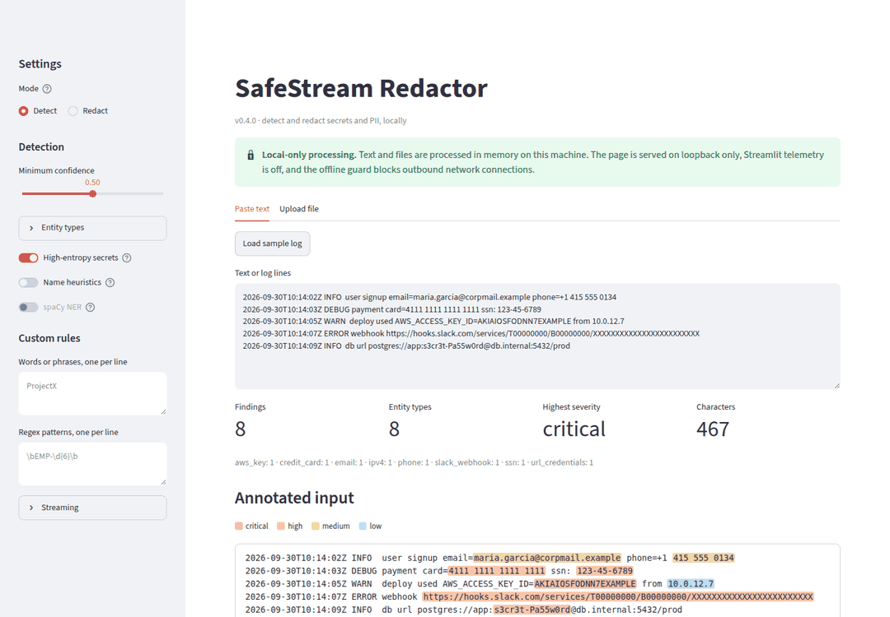
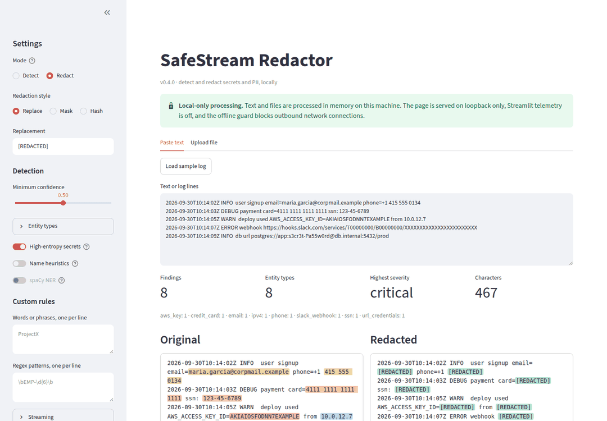

# Web playground (`safestream ui`)

A local playground for trying the engine without writing code: paste text or upload a
file, then tune detection in the sidebar and watch the results update.

```bash
pip install 'safestream-redactor[ui]'      # or, from a clone: pip install -e '.[ui]'
safestream ui                               # opens http://127.0.0.1:8501
safestream ui --port 9000 --headless        # another port, no browser tab
safestream ui --max-upload-mb 4096          # accept uploads up to 4 GB (default 2 GB)
python -m safestream_redactor.ui            # same as `safestream ui`
```



- **Detect mode** highlights each finding, coloured by severity (hover for type,
  confidence, and `line:col`). A findings table lists type, severity, confidence,
  `line:col`, character span, and detector. Matched values stay hidden unless you
  toggle *Reveal matched values*, the same default as `safestream detect`.
- **Redact mode** shows the original and the sanitized text side by side. It supports
  **Replace** (`[REDACTED]` or your own token), **Mask** (never more than half a value
  visible), and **Hash** (keyed HMAC pseudonyms, stable for equal values). You can copy
  the output from its code block or download it as `<name>.redacted.<ext>`.
- **Inspect mode** replays the streaming engine one detection pass at a time, so you
  can watch how a file is processed in constant memory:
  - **Left pane:** the window the pass scanned, in three bands: dim read-only context
    (8,192 chars), the emitted segment, and the dotted tail carried to the next pass.
  - **Right pane:** what that pass writes to the output.
  - **Boundaries:** when an entity would be cut by a boundary, a red dashed line marks
    the planned cut and a green line the actual one, and the next pass reports the
    entity it emitted whole.
  - **Controls:** Play/Pause, Step, Step back, a seek bar, and a delay slider
    (50–2,000 ms, default 500).
  - **History:** the last 5 segments stay in full text, and every pass is listed in a
    table when paused.
  - **Chunk size:** 1× or 2× the overlap. The engine never emits less than the overlap
    per pass, so smaller chunks change nothing.

  For large uploads, Inspect covers the first 200,000 characters.
- **The sidebar** sets the minimum confidence, which entity types run, high-entropy
  secret detection, the dependency-free name heuristics, spaCy NER (when the `[ner]`
  extra is installed), custom words and regexes (one per line), and the streaming chunk
  size and overlap.
- **Inputs:** a paste box (with a sample log) and uploads of `.txt`, `.log`, `.json`,
  and `.csv`, up to 2 GB by default (`--max-upload-mb`). Binary files are refused, and
  bytes that are not valid UTF-8 are reported rather than silently skipped.
- **Large files:** pasted text and uploads up to 5 MiB are analysed entirely in the
  page. A bigger upload goes to a large-file path, which starts only when you click
  *Process*:
  - the file is copied to a private temporary folder and redacted by the same parallel
    streaming engine as the CLI, on every core, with output byte-identical to it;
  - the counts cover the whole file, and highlights cover its first 200,000 characters;
  - Redact mode saves the redacted file to a folder you choose (by default, where you
    ran `safestream ui`), and offers a browser download for outputs up to 200 MiB.

  Measured on a 1 GB log with 4 cores: about 4 minutes, and each redaction worker uses
  22 MiB of private memory. Streamlit itself keeps an upload in memory while it is
  selected, about twice the file size (≈2 GB of RAM for a 1 GB upload). For files near
  your free RAM, use the CLI, which never holds the file in memory:
  `safestream redact big.log -o clean.log --workers 4`.
- **Errors:** invalid settings, such as a malformed regex or an overlap below the safe
  minimum, appear as alerts that quote the engine's own validation message, never as a
  traceback.



**Local-only by construction.** Streamlit's own defaults would listen on every network
interface, collect usage statistics from your browser, and show a button that publishes
the app to Streamlit Community Cloud. `safestream ui` turns all three off, caps uploads
at the server, and installs the offline network guard in the page's process. The page
then checks its running configuration. It shows the green *Local-only processing*
banner only if every guarantee holds, and otherwise lists what is missing (for example,
after a plain `streamlit run`). The UI adds no detection logic of its own: findings come
from the same streaming engine the CLI uses, so results match `safestream detect` and
`safestream redact`.
