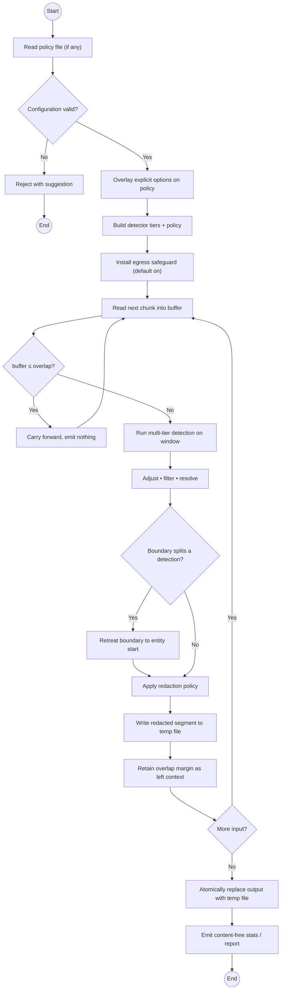

# Redaction Activity / Workflow

End-to-end control flow of a run: validate configuration, build tiers, install
the egress safeguard, then loop chunk-by-chunk (retreating the boundary when it
would split a detection) until the input is exhausted, commit atomically, and
emit a content-free report.

> Validated against `cli.py` (config validation, egress guard install),
> `engine.py` (window loop, overlap carry-forward, boundary retreat),
> `redactor.py:redact_file` (temp write + atomic commit), and `report.py`.

