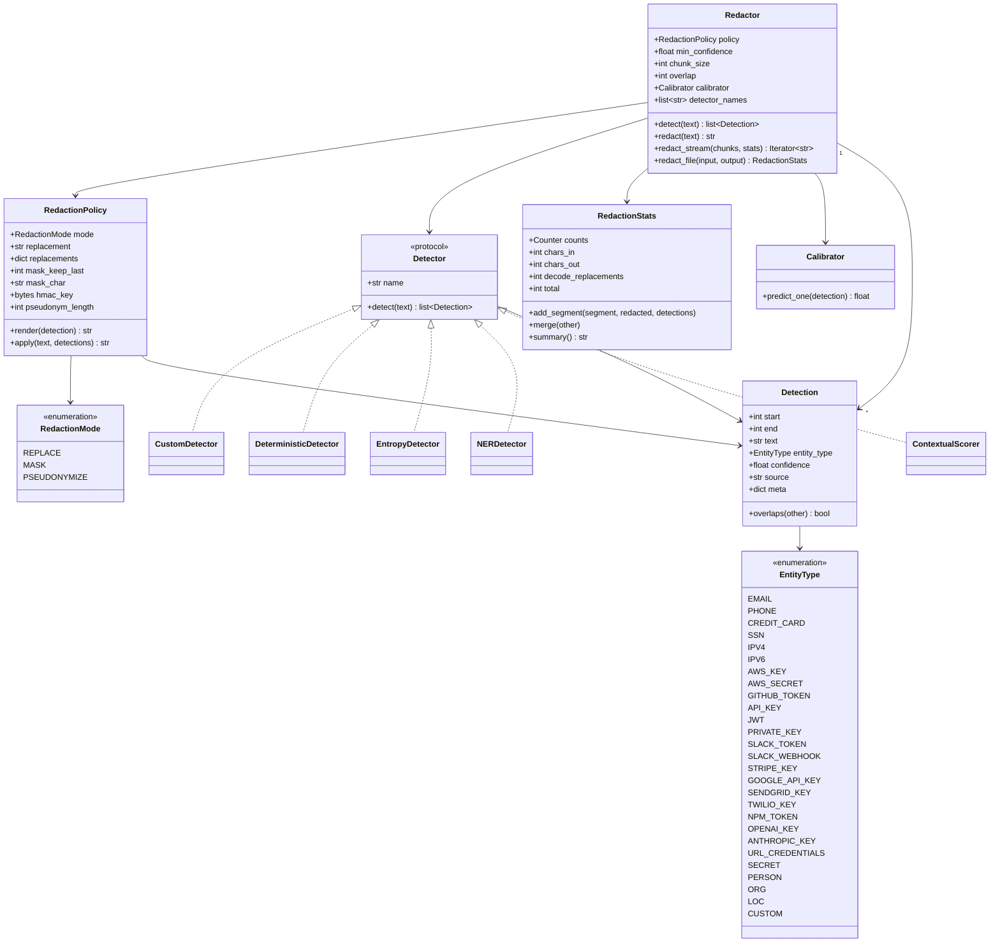

# Structural / Class Model

Core types and their relationships. **Corrected against the implementation**
(`entities.py`, `policy.py`, `report.py`, `redactor.py`): the `EntityType`
enum, the `Detection` fields (`text`, `meta`), and `RedactionStats` now match
the code exactly.

