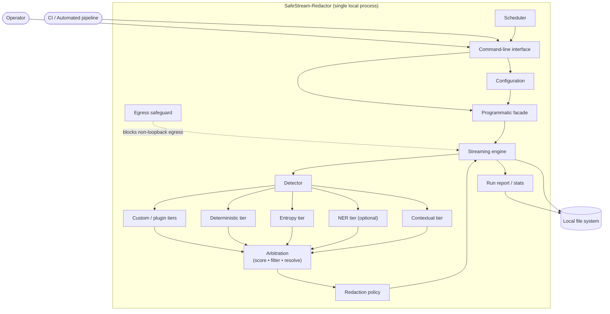

# Component Model

Runtime components inside the single local process, and the two external actors
(a human operator and an automated CI pipeline) that invoke it.

> Validated against `cli.py`, `redactor.py` (facade), `config.py`,
> `netguard.py` (egress safeguard), `engine.py` (streaming), `detectors/`
> (tiers + plugins via `detectors/registry.py`), `entities.py:resolve_overlaps`
> (arbitration), `policy.py`, `report.py` (run report / stats),
> `scheduler.py` / `parallel.py` (scheduler).

