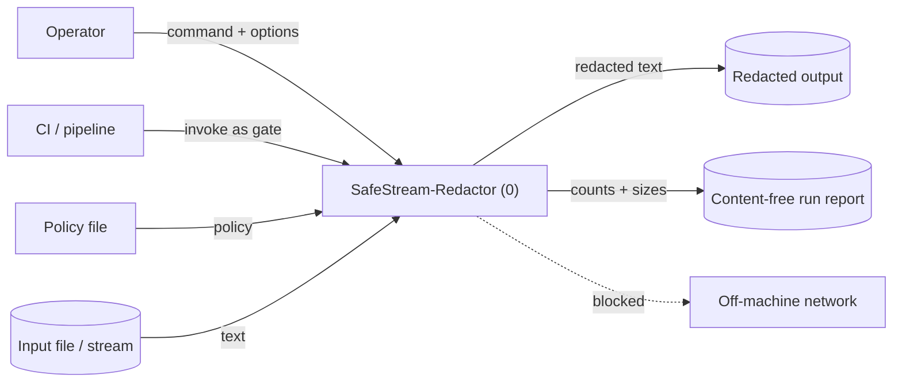

# Context-Level Data Flow Diagram

The system as a single process (0) and the external entities it exchanges data
with. Off-machine network access is blocked by the egress safeguard.

> Validated against `cli.py` (command/options, policy file, input),
> `report.py` (content-free run report), `netguard.py` (blocked egress).

