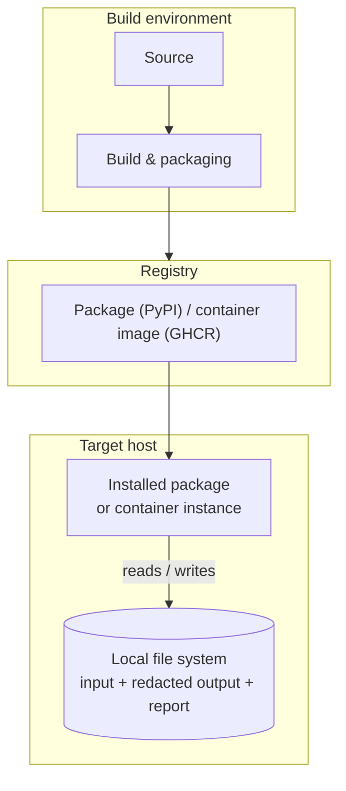

# Deployment Model

The system is packaged once and installed as either a PyPI package or a
container image on a local-first, self-contained target host that reads input
and writes redacted output plus a report to the local file system.

> Validated against `pyproject.toml` (wheel/sdist + `safestream` entry point),
> `Dockerfile`, and `.github/workflows/` (`ci.yml`, `docker.yml`,
> `publish.yml`).

