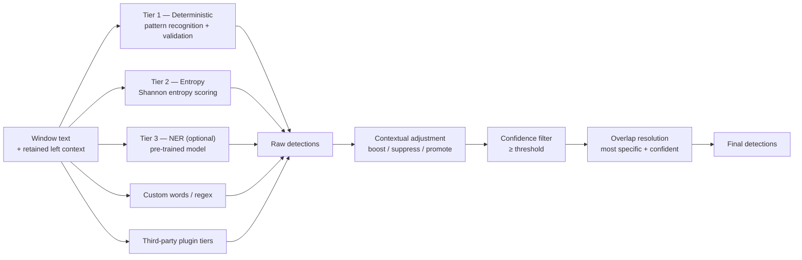

# Multi-Tier Detection Cascade

Each window of text is scanned by every enabled tier in parallel; the raw
detections are pooled, contextually adjusted, filtered by confidence threshold,
and reduced to a non-overlapping set by overlap resolution.

> Validated against `redactor.py:detect` (pool → `ContextualScorer.adjust` →
> optional `Calibrator` → `min_confidence` filter → `resolve_overlaps`),
> `detectors/deterministic.py`, `detectors/entropy.py`, `detectors/ner.py`,
> `detectors/custom.py`, `detectors/registry.py` (plugins), and
> `entities.py:resolve_overlaps` (most-specific + most-confident wins).

