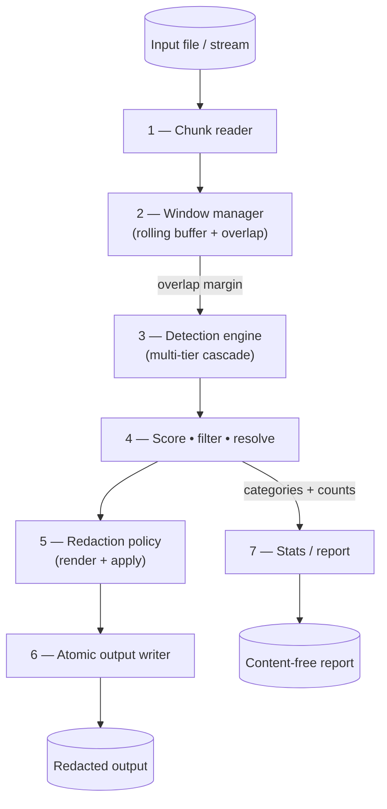

# Level-1 Data Flow Diagram

Decomposition of process (0) into its seven internal processes: chunk reader,
window manager, detection engine, score/filter/resolve, redaction policy,
atomic output writer, and stats/report.

> Validated against `engine.py` (1–2, 6), `redactor.py:detect` +
> `detectors/` (3), `entities.py:resolve_overlaps` + contextual/calibration (4),
> `policy.py` (5), `report.py` (7).

