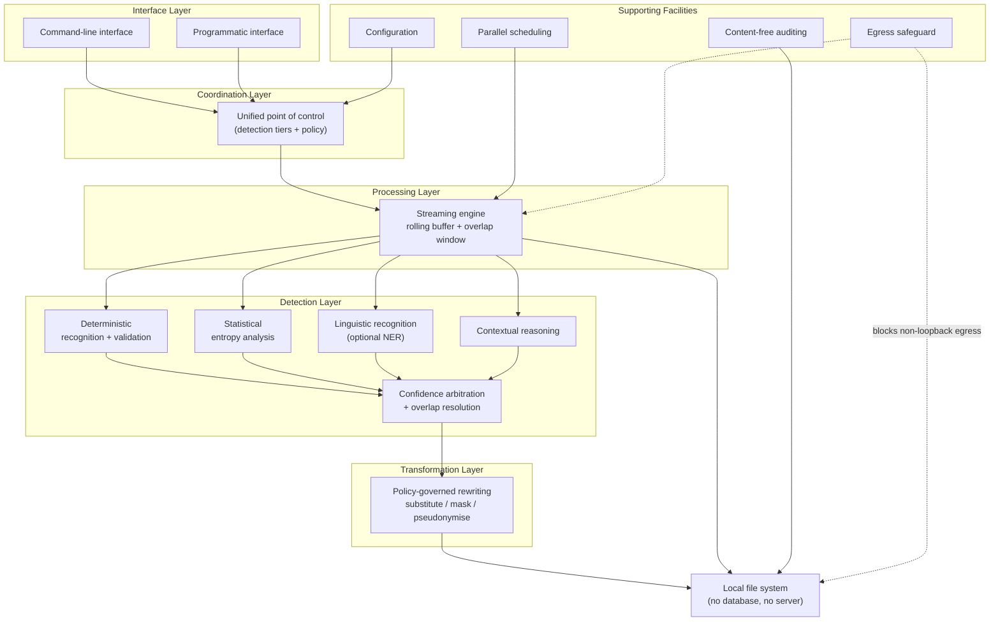

# Overall System Architecture

Layered view of the whole system. Interfaces and supporting facilities feed a
single coordination point, which drives the streaming engine; the engine fans
window text out to the detection tiers, whose arbitrated results are rewritten
by the transformation layer and written to the local file system.

> Validated against `cli.py` / `redactor.py` (interfaces + coordination),
> `engine.py` (streaming), `detectors/` (detection tiers), `policy.py`
> (transformation), `netguard.py` (egress safeguard), `report.py`
> (content-free auditing). The stray "Context-free auditing" node from the
> original figure was dropped — it corresponds to no component.

