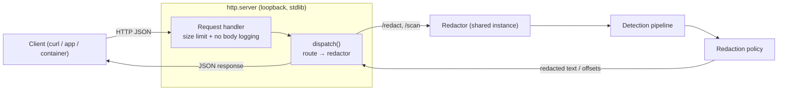

# REST API Architecture

The optional REST layer is a thin transport adapter (`api.py`, standard-library
`http.server` only). It holds one configured `Redactor` and forwards every
request to it — the HTTP path and the CLI/library path share a single
implementation, so results are identical. The server binds to loopback by
default and never logs request bodies.

> Validated against `api.py` (`dispatch`, `make_handler`, `serve`) and
> `redactor.py` (`detect`, `policy.apply`, `detector_names`). Routes:
> `GET /health`, `GET /version`, `GET /detectors`, `POST /redact`, `POST /scan`.

## Endpoints

| Method | Path | Body | Response |
|---|---|---|---|
| GET | `/health` | — | `{"status": "ok"}` |
| GET | `/version` | — | `{"tool", "version"}` |
| GET | `/detectors` | — | active tier names + all entity types |
| POST | `/redact` | `{"text": "..."}` | `{"redacted", "total_detections", "detections_by_type"}` |
| POST | `/scan` | `{"text": "..."}` | offsets + types + confidence (never the matched substring) |

Errors: `400` invalid/missing JSON `text`, `413` body over the size limit,
`404` unknown route.
