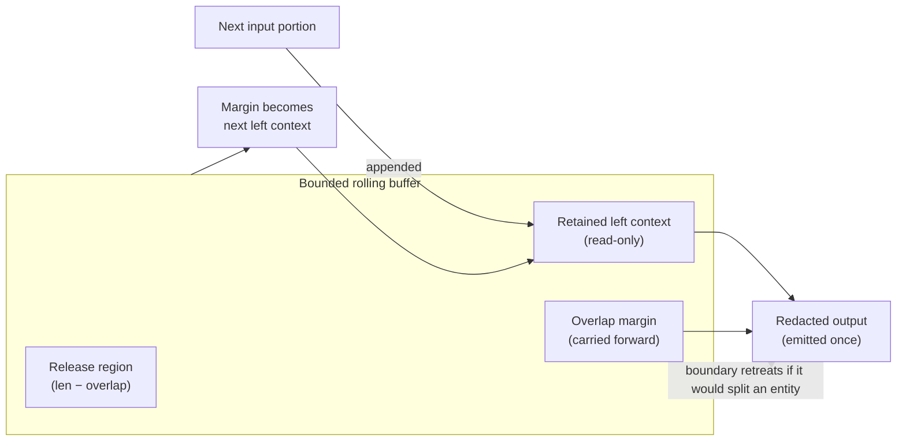

# Rolling Buffer / Overlap Window

How constant-memory streaming avoids splitting an entity across a chunk
boundary. A bounded buffer holds the release region plus a retained left
context and an overlap margin; the boundary retreats rather than cut an entity,
and each character is emitted exactly once. The margin becomes the next window's
left context.

> Validated against `engine.py` (`stream_windows`, `stream_transform`,
> `read_chunks`) and the `DEFAULT_OVERLAP` guarantee that entities up to
> `overlap` characters long are caught across boundaries.

