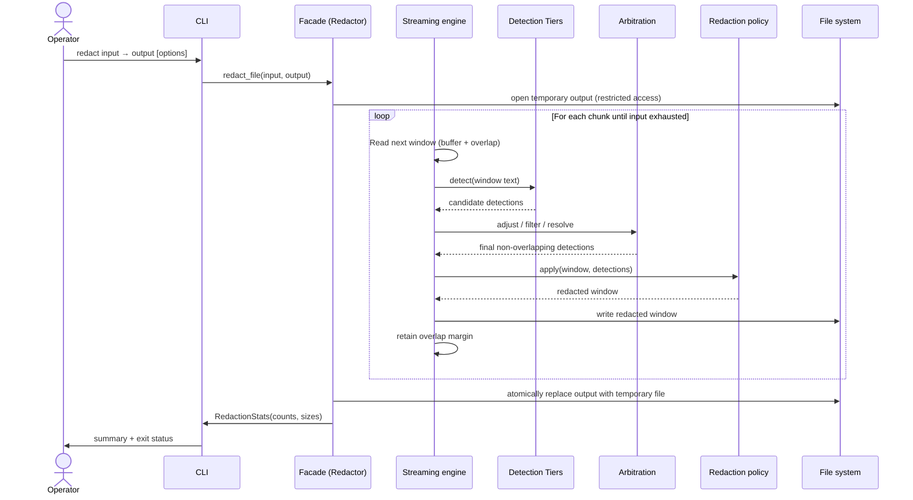

# File-Redaction Sequence

The canonical sequence for redacting a file: the facade opens a restricted-access
temporary output, streams window-by-window through detection → arbitration →
policy, writes each redacted window, and finally replaces the output atomically.

> Validated against `redactor.py:redact_file` (temp file via `mkstemp`,
> streaming loop, `os.replace` atomic commit) and `cli.py`.

