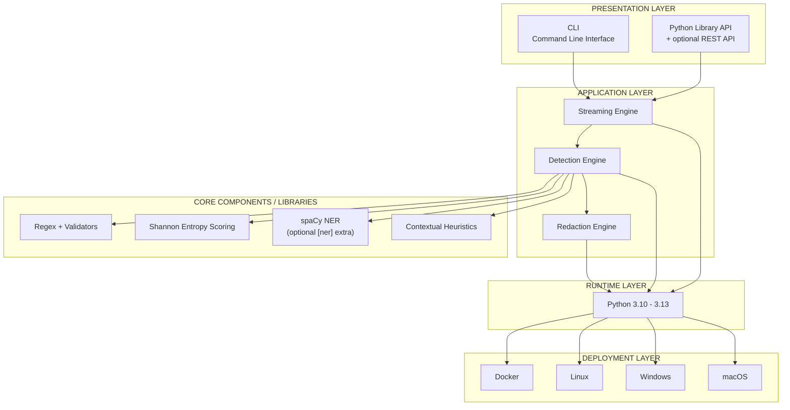

# Technology Stack

Layered technology view: interfaces, application engines, the concrete
detection techniques, the runtime, and supported deployment targets.

> Validated against `pyproject.toml` (Python 3.10–3.13, zero third-party
> runtime deps in the core; spaCy is the optional `[ner]` extra) and
> `detectors/` (regex + validators, Shannon entropy, contextual heuristics).

